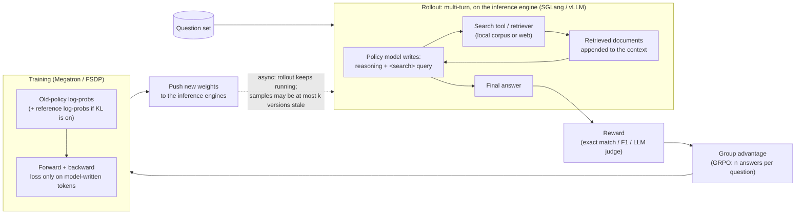

# AI-Search-Plugin

English | [中文](README.zh-CN.md)

Drop-in components that speed up and stabilize **RL post-training of search agents** (AI search / deep-research models) on existing RL frameworks such as slime and verl.

> Status: early release for review.
> - The speed-ups below are final for the setups listed. They were measured with the original implementation this package was ported from, health-checked on both sides and independently reviewed, unless marked otherwise.
> - Several components are still stubs (not ported).
> - This repository's own tests are CPU-only; see [Install](#install).
> - Per-run details: [EXPERIMENTS.md](EXPERIMENTS.md).

---

## Results at a glance

**speed-up = baseline s/Mtok ÷ ours s/Mtok**

where s/Mtok = (sum of step wall-clock times in the measurement window) ÷ (millions of tokens actually trained in that window).

How these were measured:
- Both arms ran on the same node, in both orders (A→B and B→A).
- Pairs are combined by geometric mean. The 95% CI is a bootstrap over steps within each pair.
- Health checks were run on both sides: entropy, train–inference log-prob gap, starting reward, tokens trained, staleness ≤ 2.
- Every row was independently reviewed. Health-check failures and open questions are listed in the Notes column.
- The baseline is the fastest configuration of that framework we could find that stays within staleness 2.

| Workload (model, hardware) | Baseline | Pairs | Speed-up [95% CI] | Notes |
|---|---|---|---|---|
| Search-R1 (Qwen2.5-7B, 1× B300 node) | slime, 5 training + 3 rollout GPUs, selective recompute (same in both arms) | 2 | **1.170×** [1.164, 1.177] | All health checks pass. The largest single components are response logits (×1.116) and prefetch (×1.033), together ×1.152. The remaining ~1.5% is not explained by any single component (not investigated). |
| Search-R1 (Qwen2.5-7B, 1× B300 node) | verl, colocated async, off-policy limit 3 | 8 | **1.002×** [0.984, 1.021], **tie** | Per step we are 4.6% slower (0.956×); we also train more loss tokens per step (+6.8%). Two health checks failed: that token count, and reward over the first 3 steps (at the threshold). Circumstantial evidence suggests the baseline drops over-age samples; not proven. Some of our components did not activate here (e.g. `toolcache`, see section 4). |
| ASearcher (Qwen2.5-7B, 1× B300 node) | verl, best config (colocated async, off-policy limit 3) | 4 | **1.167×** [1.131, 1.208] | Staleness compliance of verl is unproven: an upper-bound estimate gives worst staleness 3 on 0.002–0.16% of trajectories (verl's own label says 2). If verl did exceed it, that made verl faster, so the ratio is conservative for us. Against slime with `--use-distributed-post` the result is 1.299× [1.235, 1.355] (reference only). |
| Libra (Qwen3-14B, 1× B200 node) | slime best config **plus our ticket admission** (without it, slime must drop to concurrency 8 to stay within staleness 2) | 6 | **1.219×** [1.133, 1.310] | The effect of ticket admission is excluded from this ratio. Single components are mostly within noise; the gain comes from the combination. |
| Qwen3-Next 80B-A3B (4× B300 nodes) | verl, best config found (separate async, off-policy limit 3, partial rollout, routing replay) | 4 | **1.560×** [1.389, 1.719] | See notes below. |

**Required notes for the Qwen3-Next row**
1. **One scenario, synthetic tool.** The search tool is synthetic (scenario *g1*: tool latency jitter, timeouts and errors; see section 5), not a real retrieval corpus, so rewards are only a trend. The layout is a scaled-down 1:1 split (2 training + 2 rollout nodes, 64 prompts × 8 answers).
2. **`ws direct` was on during the measurement.** It was later turned off in the default config because it caused hangs (ours 1 in 60 syncs; verl hung 1 in 63 for its own, unconfirmed reason). It was not re-measured; the whole weight-sync group is worth about 1% (one order only, not significant).
3. **The result is conservative on ticket admission.** Ticket admission can be turned off in this scenario, which is then ~2.3% faster and still within staleness 2. The 1.560× was measured with it on.
4. **Staleness use differs.** Our samples were almost all at staleness 2; verl's were ~99.6% at staleness 1, both within the bound. Part of the speed-up may come from using S = 2 fully; that part was not measured separately.
5. **The 1.56× cannot yet be attributed to components.** Only prefetch (+13.5%) and expert placement (+2.7%) are significant in the ablations. The per-stage difference against verl (section 3) is a different measurement: **do not add it to, or subtract it from, the component ablations.**
6. **verl needed local fixes.** To reach a normal train–inference log-prob gap (0.210 → 0.016–0.021), verl needed three local fixes, not upstream: a newer SGLang Python package, an adapter shim for it, and the original GDN output-norm weights. Both arms used the same SGLang.

---

## 1. What is AI-search post-training?

A search agent answers a question by reasoning, issuing search queries, reading the returned documents, and repeating until it can answer. RL post-training teaches the model *when* and *what* to search and how to use what comes back. The only training signal is whether the final answer is right.



What a training sample looks like:

```text
[ system prompt + question ][ thought + query ][ retrieved docs ][ thought + query ][ retrieved docs ] ... [ answer ]
  not in loss                  in loss            not in loss        in loss           not in loss          in loss
```

Only the tokens the model wrote count in the loss, but every token still goes through every layer, because later tokens attend to the retrieved documents.

---

## 2. How it differs from other RL post-training

Single-turn math/code RL is the usual reference. Most of the differences below also exist in other multi-turn, tool-using agent RL (coding agents, games). AI search is an extreme case of them rather than a different kind of problem.

| | Single-turn math / code RL | AI-search RL | What it changes for the system |
|---|---|---|---|
| **Who wrote the tokens** | Mostly the model | Mostly the search tool: long retrieved documents, the model writes a small part | Inference time goes to prefill (reading documents in), not decode; training spends most compute on tokens that are not in the loss |
| **Shared context in a group** | Short shared prompt | Long system prompt + question shared by all n answers of a group | Computing the shared prefix once (prefix sharing) pays off much more |
| **What makes a batch slow** | Long generations | Slow or repeated tool calls; a few questions take many rounds | A synchronous batch waits for its slowest question → asynchronous rollout with a staleness bound is required |
| **Where the bottleneck sits** | GPU compute | Often CPU and scheduling: many short, bursty requests and tool round-trips | Control plane (request dispatch, tool client) becomes the limit before the GPU does |
| **Lifetime of one sample** | One generation, one policy version | Many rounds; weights can change in the middle of a trajectory | Cached prefixes go stale across weight updates; routing (MoE) and sparse-attention selections can differ between inference and training |

Not specific to search but easy to get wrong in multi-turn RL: keep passing **token IDs** between turns (decode → re-tokenize breaks training), and mask retrieved tokens out of the loss.

---

## 3. Performance bottlenecks: small dense vs. large sparse models

Where step time goes, taken only from measured per-stage splits. Each row describes one workload in one setup. It is not a general rule: the same component helped a lot on one workload and did nothing on another (see section 4).

Stage names: **waiting for data** is the time the trainer waits for a full batch of rollouts (it includes tool calls). **Training** is forward + backward + optimizer. **Weight sync** pushes the new weights to the inference engines.

| | Small dense models (Qwen2.5-7B, Qwen3-14B; one node) | Large MoE model (Qwen3-Next 80B-A3B: MoE + GDN linear attention; 4 nodes) |
|---|---|---|
| **Where time goes (measured)** | It depends on the workload. **ASearcher**, slime baseline, before slime's own `--use-distributed-post` was turned on: 25.57 s/Mtok = training 14.64 + waiting 10.94. Ours: 15.86 = 13.60 + 2.26. Waiting accounts for 89% of the gap. Independently reviewed, one order only. **Libra**, an earlier baseline config (slime + our ticket admission): 30.4 s/step = training 23.6 + waiting 6.8 + sync 0.8 (not independently reviewed). | Training is the largest stage on both sides. Mean seconds per step, ours / verl: waiting for data (verl: generation) 58.75 / 102.63; training 168.70 / 211.33; weight sync 6.85 / 37.53; preprocess 7.6–9.1 / 1.25. Step time: 227.85 / 352.96. On our side, sync and preprocess overlap with waiting and are not on the step path. On verl they are serial. *Per-stage split not independently reviewed; the overall ratio is.* |
| **What made the baseline slow (measured)** | **The rollout client's CPU, not the GPU or the tool server** (ASearcher). Calls measured on the client took p50 1.005 s, while the retrieval server answered at p50 0.036 s and was far from saturated (39 queries/s). The rollout manager runs one asyncio event loop that sends both LLM requests and tool calls. That thread used ~81% CPU and held the GIL 62% of wall time; other threads held it ~0%. So the cause is one saturated event loop, not GIL contention. *Profiled, not independently reviewed.* With the client sharded over 8 processes (`rshard`), per-call time on the client fell from 2.52 s to 0.82 s and generation time per trajectory from 19.5 s to 9.6 s (our arm with vs. without `rshard`; independently reviewed; comparison across runs). | verl's generation phase is irregular: 0–13 s on short steps, 194–236 s on long ones. Its weight sync (~37 s) and training also sit on the step path. *Not independently reviewed.* |
| **What helped (measured, independently reviewed)** | Search-R1 on slime: computing logits only on response tokens ×1.116 and prefetching rollout data ×1.033. ASearcher: deferring slow groups (DEFER) ×1.333, engine hooks ×1.116, response logits ×1.090. Libra: engine hooks ×1.151. Weight-sync changes did not register on small models (×1.002, ×0.999). | Prefetch +13.51%: without it, waiting grows by ~30 s/step. Expert placement +2.70%: without it, training grows by ~4 s/step. |
| **Can the baseline get it by config?** | Partly. slime's own `--use-distributed-post` (HTTP poster actors for LLM requests; tool calls stay on the main loop) roughly halved the baseline's waiting (10.47 / 9.41 → 5.11 / 5.28 s/Mtok in the two orders, training unchanged; *not independently reviewed*). The final ASearcher arms have it on. With it on in both arms, `rshard` added ×1.051 [0.995, 1.112], which is not significant. | No for prefetch and expert placement. verl's Megatron path has no expert load balancing (reviewer spot-checked). |
| **Not measured** | Prefill vs. decode split. Effects at multi-node scale. | Prefill vs. decode split. Where exactly prefetch's ~30 s/step comes from. Sparse-attention (DSA) models. Real (non-synthetic) retrieval. |

Two measured observations that do not generalize on their own:
- **Staleness admission matters only where a plain concurrency cap breaks the staleness bound.** On Libra, slime had to drop to concurrency 8 to keep staleness ≤ 2 without ticket admission. On ASearcher, no concurrency without it (256 down to 64) stayed ≤ 2. On Search-R1·slime, both arms were compliant at the same concurrency and ticket admission changed nothing (×0.996). On Qwen3-Next it cost 2.32% (see section 4).
- **Weight sync can be fast and still not matter.** On Qwen3-Next, turning off our engine-side hooks doubled sync time (7.0–7.3 → 14.0–15.0 s/step), but step time did not change, because sync overlaps with waiting for data (*not independently reviewed*).

Per-run numbers: [EXPERIMENTS.md](EXPERIMENTS.md).

---

## 4. What the plugin contains

Every component is opt-in. Switches, defaults and status for each one are in [docs/COMPONENTS.md](docs/COMPONENTS.md); `ai-search-plugin list` prints the same table. *Stub* means the component has a registry entry but its code is not ported into this package yet ([docs/PORTING.md](docs/PORTING.md)).

**How to read "measured effect".**
- Small models: ratio = (s/Mtok with the component removed) ÷ (s/Mtok with the full set). Above 1 means the component helps.
- Qwen3-Next: gain = that ratio − 1.
- Every number is leave-one-out from our full set, on the same node, in both orders. ✓ = 95% CI excludes no-effect; n.s. = not significant.
- Short names: SR1 = Search-R1, ASR = ASearcher, Q3N = Qwen3-Next 80B.
- "Did not activate" means the component never actually ran in that setup. A "no gain" there says nothing about the component itself.

The measurements used the original implementation that this package was ported from, with each workload's own settings. The plugin's default set is close to those settings but not identical: for example, `ws direct` is now off.

### Model-agnostic

| Component | Problem it solves | Measured effect | Can the baseline get it by its own config? |
|---|---|---|---|
| `ticket_admission` (slime) | Bounds staleness at S without throttling concurrency. A group gets a "ticket" for the batch it will train in. DEFER moves slow groups to a later batch, and a budgeted cut drops stragglers. | **DEFER**: ASR ×1.333 [1.252, 1.412] ✓; Q3N +0.38% n.s. **Ticket itself**: SR1·slime ×0.996 n.s. (both arms compliant at concurrency 854); Q3N **−2.32%** [−3.92%, −0.60%] ✓ (turning it off was faster and still compliant). ASR: no compliant run without it to compare. Libra: the baseline already uses it. | No. verl's off-policy limit drops stale samples; it does not admit by staleness. |
| `verl_ceiling` (verl) | The same hard staleness ceiling, expressed in verl's own unit | SR1·verl ×1.000 n.s. The ceiling never triggered, so this mostly measured off-policy limit 4 vs 3. | Yes (verl's off-policy limit). |
| `pool_fill` (slime) | Keeps every engine full within the staleness ceiling. The in-flight pool is sized from batch and engine count, not from group size. | Not ablated separately. | No. |
| `rshard` (slime) | One rollout event loop saturates its CPU. This shards the rollout client over processes. | ASR ×1.051 [0.995, 1.112] n.s. (slime's `--use-distributed-post` on in both arms); Libra n.s. | Partly: `--use-distributed-post` covers LLM requests but not tool calls. |
| `toolcache` (+ `tool_hedge`) | Identical concurrent read-only tool calls share one call (TTL cache, single-flight). A duplicate request goes out when a call falls into the slow tail. | ASR ×1.079 [0.974, 1.180] n.s.; Libra n.s.; SR1·verl ×1.011 n.s., **did not activate** (the tool was called with a positional argument, so the cache was bypassed). | No. |
| `sampler_nosync` + engine-side `fastload` | Removes SGLang's per-step GPU→CPU sync when log-probs are returned. Loads weights in the engine by record/replay. Measured together as "engine hooks". | ASR ×1.116 [1.027, 1.196] ✓; Libra ×1.151 [1.045, 1.267] ✓ (each alone n.s.); SR1·slime ×1.002 n.s.; SR1·verl (fastload only) ×0.986 n.s.; Q3N −0.29% n.s. | No. |
| `weight_sync` (+ `verl_inplace`) | Faster trainer → engine weight push: flattened buckets, pipelined send, parallel PP stages; in-flight requests are kept. | SR1·slime ×1.002 n.s.; ASR ×0.999 n.s.; Libra n.s.; Q3N +1.2% (one order only, n.s.; sync 6.4 vs 14.9 s/step). `verl_inplace` was not ablated separately. | Partly. The 2 GB buffer was given to the slime baselines. verl already buckets and uses multiple senders. |
| `prefetch` (slime) | Overlaps the trainer's rollout-data fetch with the weight sync and prebuilds the next batch | SR1·slime ×1.033 [1.027, 1.038] ✓; ASR ×1.066 [1.012, 1.130] (2 pairs, weakly ✓); Libra n.s.; Q3N **+13.51%** [+11.56%, +15.59%] ✓ (together with `r3_transfer`). | No. |
| `response_logits` | Computes the LM head, log-prob and entropy only on response rows, chunked. Most tokens in a search trajectory are prompt or retrieved text. | SR1·slime ×1.116 [1.109, 1.122] ✓; ASR ×1.090 [1.043, 1.135] ✓; Libra ×1.053 [0.980, 1.127] n.s.; Q3N +1.01% [−0.82%, +2.99%] n.s. Not used in the SR1·verl (FSDP) runs. | No. verl's fused kernel saves memory but does not skip non-response rows. |
| `kvepoch` / `kvfresh` / `verl_kvfresh` | Correctness: after a weight sync, no request reuses prefix KV computed with the old weights. These keep the train–inference log-prob gap from growing. | Cost: SR1·verl ×0.993 [0.968, 1.016] n.s. Libra, compared against prefix cache off: ×1.065 [0.967, 1.171] n.s. | Partly: flush or disable the prefix cache at every sync. |
| `jitcache` | Keeps compiled Triton kernels and autotune results across runs (saves step-0 compile time) | Not ablated (baselines had a persistent compile cache too). | Mostly. |
| `prefix_tree` | Trains a GRPO group's shared prompt once | Stub; not in the measured configs. | — |

### Model-family

| Component | Family | Problem it solves | Measured effect | Baseline by config? |
|---|---|---|---|---|
| `expert_placement` (**stub**) | MoE | Moves experts across EP ranks from routing counts when load is uneven | Q3N **+2.70%** [+1.21%, +4.38%] ✓ (the saving is in training). The code is not in this package yet. | No (verl's Megatron path). |
| `r3_transfer` | MoE + routing replay (R3) | Routed-expert ids sent as int16/uint8, copy-free validation | Measured only inside Q3N's prefetch result above. | No. |
| `r3pack` | MoE + R3 | Balances per-micro-step expert load when packing micro-batches | **Did not activate** on Q3N: it turned itself off (gain below its threshold), so we have no evidence either way. | No. |
| `jitfix` | MoE / GDN | Stops torch.compile recompile storms under dynamic token counts | Not ablated; turns itself off on dense models. | No. |
| `mtp_draft_loader` (stub) | MTP head | MTP speculative decoding in rollout | Q3N: MTP on was slower in both tries (3.4% slower in a screening run; −1.6% [−3.8%, +0.7%] in a second, single-order run). Not judged; off in the measured config. verl could not run it (out of memory after the first sync). | — |
| `dsa_replay`, `r3_ep_plan`, `hybridep_overlap`, `gdn_cudnn`, `fla_nb_bucket`, `gdn_convfuse_ep` (stubs) | DSA / MoE / GDN | See COMPONENTS.md | Not in the measured configs. `gdn_cudnn` was slower than FLA in an earlier verl test and is not used. | — |

`ws direct` is the direct-HTTP path of `weight_sync`. It is **off by default**: it caused rare hangs on the 80B model (1 in 60 syncs in the timed runs). The root cause is not confirmed.

---

## 5. Hard scenarios this targets

These are industrial situations we built synthetic versions of, to check where the components should matter. This README has no numbers for them: only the Qwen3-Next result above (scenario *g1*, public model) is reported.

| | Situation | Why it hurts | Components that address it |
|---|---|---|---|
| a | Single-turn, very long prompt | Almost all tokens are outside the loss, yet all go through every layer | `response_logits`, `prefix_tree` (stub) |
| b | Multi-turn retrieval | Many short, bursty LLM and tool requests; prefix KV goes stale across weight syncs | `rshard`, `toolcache`, `prefetch`, `kvepoch` / `kvfresh` |
| c | Long-tail imbalance across questions | A few long trajectories hold up the batch | `ticket_admission` (DEFER, straggler cut), `pool_fill`, `verl_ceiling` |
| d | Very long trajectories (100k+ tokens) | Memory spikes from full-vocabulary logits; long prefill | `response_logits` |
| e | Mix of easy and hard questions whose ratio drifts during training (curriculum) | A fixed in-flight amount is wrong half the time: data starves when tasks get harder, and training becomes the bottleneck when they get easier | `ticket_admission`, `pool_fill`, `prefetch` |
| f | A few extremely slow trajectories, long in tokens or in tool time | The step waits for the last trajectory. Frameworks that cap staleness by dropping samples lose the slow ones | `ticket_admission` (DEFER, budgeted cut), `verl_ceiling` |
| g | Tool service jitter, timeouts, occasional failures | The tool tail sets the trajectory tail; retries pile up on the client | `toolcache`, `tool_hedge`, `rshard`, async admission |
| h | Several tools mixed: search, page fetch with long returns, slow code execution with a sandbox concurrency limit | Long returns add prefill; a slow sandbox queues requests; caching does not help unique code calls | `toolcache` (search/fetch only), `rshard`, `kvepoch` / `kvfresh` |
| i | Bimodal answer lengths (many short, a few very long) | Decode batches shrink to a few sequences at the tail, so GPUs idle | `ticket_admission` (DEFER), `pool_fill` |
| j | Large batch / very high concurrency (thousands of in-flight trajectories) | The control plane (one Python process, routing, tool QPS) saturates before the GPU does | `rshard`, `pool_fill`, `toolcache` |
| k | An inference engine or training node dies mid-run (preemption) | Lost in-flight work, slow restart (compile warm-up) | `jitcache` (warm restart) only; no engine health-check or re-routing component yet |
| l | MoE expert load skew (hot experts) | The busiest EP rank sets the training speed | `expert_placement` (stub), `r3pack` |
| m | Different training : rollout GPU ratios | The optimum moves with the workload; more engines make each sync more expensive | `weight_sync` (parallel stages), `prefetch`, async admission |
| n | Larger GRPO groups (e.g. n = 16, fewer prompts) | A group waits for its slowest member; the shared prefix is repeated n times | `prefix_tree` (stub), `toolcache` (same query within a group), `kvepoch` |
| o | Multi-task batches (long single-turn mixed with multi-turn) | Unbalanced micro-batches; prefill and decode interfere | none specific (relies on the framework's dynamic batching) |
| p | Slow reward / LLM-as-judge (seconds per sample) | Reward time adds to the step unless it overlaps with training | none yet (design only) |

---

## Install

```bash
# from this directory (package name: ai-search-plugin; no hard runtime dependencies)
pip install .                 # or: pip install -e ".[test]"
ai-search-plugin list         # components, defaults, status  (same as: python -m ai_search_plugin list)
ai-search-plugin plan verl default max_staleness=2   # print the env / arguments it would set
```

Install it into the same environment as the framework, and make sure every Ray worker can import it. torch, slime, verl, SGLang and Megatron are imported lazily, inside the processes that already have them. From Python:

```python
import ai_search_plugin as asp
plan = asp.install(framework="slime", components="default", options={"max_staleness": 2})
print(plan.shell())   # env + framework arguments
```

Launch examples, both illustrative and not run in this repository's tests:
- [examples/slime/](examples/slime/): `launch_slime.sh`, `runtime_env.py`, `in_process.py`. slime must be in fully-async rollout mode. The trainer runs through `python -m ai_search_plugin.adapters.slime_train` so that `prefetch` can work.
- [examples/verl/](examples/verl/): `launch_verl.sh`, `in_process.py`. Uses `VERL_USE_EXTERNAL_MODULES`. `response_logits` needs the Megatron engine.

**What is tested here.** `pytest tests/` runs on a CPU-only machine with no framework installed. It covers the registry, install/CLI, hooks and the CPU-testable logic of each ported component: currently 80 passed and 2 skipped (the skipped ones need a slime checkout via `SLIME_SRC`).

**What is not tested here.**
- Real slime or verl launches.
- The SGLang engine patches.
- NCCL weight transfer.
- `rshard` (its Ray integration test was not run).
- The `response_logits` op and adapters: GPU tests exist in `tests/gpu/` but were not run.

Details are in [docs/COMPONENTS.md](docs/COMPONENTS.md#what-is-tested-here-cpu-only-no-gpu-no-framework-installed).
