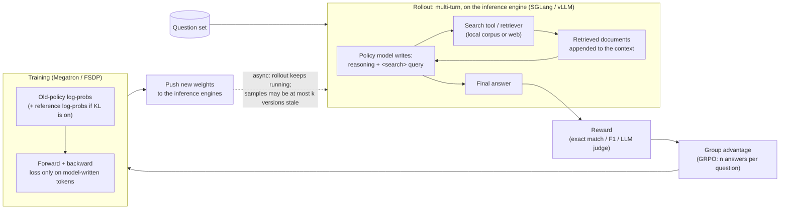

# AI-Search-Plugin

English | [中文](README.zh-CN.md)

Drop-in components that make **RL post-training of search agents** (AI search / deep research) faster and more stable on slime and verl.

> Early release for review. The speed-ups below were measured with the original implementation this package was ported from. Some components are still stubs, and the tests here are CPU-only. Per-run details: [EXPERIMENTS.md](EXPERIMENTS.md).

On five workloads against each framework's fastest config: 1.17–1.56× faster on four, a tie on one. See [section 4](#4-performance-speed-ups-and-where-time-goes).

---

## 1. What is AI-search post-training?

The model reasons, searches, reads the results and repeats until it can answer. RL teaches it when and what to search. The only reward is whether the final answer is right.



A training sample:

```text
[ system prompt + question ][ thought + query ][ retrieved docs ][ thought + query ][ retrieved docs ] ... [ answer ]
  not in loss                  in loss            not in loss        in loss           not in loss          in loss
```

Only model-written tokens are in the loss, but every token still goes through every layer.

---

## 2. What kind of training it is, and the hard scenarios

AI-search RL is multi-turn, tool-using RL, the same family as coding agents and multi-turn games: the model writes, calls a tool, the result is appended to the context, and it writes again until it answers. The hard parts are broadly shared across this family; how much each one matters depends on the task.

Below are hard scenarios that can show up in industry. We built a synthetic version of each to see where each component should matter; only *f1* (the Qwen3-Next run) has reported numbers (see section 4).

| | Scenario | Why it hurts |
|---|---|---|
| a | One turn, but a very long question | Almost nothing is in the loss, yet every layer computes it all |
| b | Multi-turn search, many rounds | Many small requests; caches go stale after each weight update |
| c | A few very slow trajectories hold up the batch (uneven questions, extreme outliers, very short vs. very long answers) | Every step waits for the last one while other GPUs idle; frameworks that control staleness by dropping samples lose the slow ones |
| d | Very long trajectories (100k+ tokens) | Memory blows up; reading the input is slow |
| e | Easy and hard questions mixed, and the mix keeps changing | When questions get harder, data runs short; when easier, training can't keep up |
| f | Unstable search service: slow at times, timeouts, errors | One slow search slows the whole trajectory; retries pile up |
| g | Several tools mixed: search, opening web pages, running code | Web pages are long; code runs queue up; code results can't be reused |
| h | Very high concurrency (thousands at once) | The request-sending side saturates first while GPUs idle |
| i | A machine dies mid-training | Half-done work is lost and restart is slow |
| j | A few MoE experts are much busier than the rest | The busiest GPU sets the pace |
| k | Different training-to-rollout GPU ratios | The best ratio shifts; more rollout GPUs make weight sync costlier |
| l | More answers per question (e.g. 16) | A group waits for its slowest answer; the same prompt is recomputed |
| m | Long single-turn and multi-turn questions mixed | Uneven batch sizes; reading and generating interfere |
| n | Slow scoring, e.g. another LLM as judge | Scoring time adds straight to every step |

Two easy mistakes in any multi-turn tool-using RL: pass **token IDs** between turns (re-tokenizing breaks training), and mask tool output out of the loss.

---

## 3. Components

All components are opt-in. Switches and defaults: [docs/COMPONENTS.md](docs/COMPONENTS.md), or `ai-search-plugin list`. *Stub* = registered but not ported yet ([docs/PORTING.md](docs/PORTING.md)).

**Reading the effect column.** Leave-one-out from our full set, same node, both orders. Small models: ratio (above 1 = helps). Qwen3-Next: % gain. ✓ = significant at 95%; n.s. = not significant; *not active* = the component never ran there, so no conclusion. SR1 = Search-R1, ASR = ASearcher, Q3N = Qwen3-Next. Measured with the original implementation; current defaults differ slightly (e.g. `ws direct` is off).

### Model-agnostic

| Component | What it does | Measured effect | Baseline can get it by config? |
|---|---|---|---|
| `ticket_admission` (slime) | Bounds staleness without capping concurrency. DEFER moves slow groups to a later batch; a budgeted cut drops stragglers. | DEFER: ASR ×1.333 ✓; Q3N +0.38% n.s. Ticket itself: SR1·slime ×0.996 n.s.; Q3N −2.32% ✓ (off is faster and still compliant); ASR has no compliant run without it. | No. verl drops stale samples instead. |
| `verl_ceiling` (verl) | The same staleness ceiling, in verl's units | SR1·verl ×1.000 n.s. (never triggered) | Yes |
| `pool_fill` (slime) | Keeps every engine full within the ceiling | Not ablated | No |
| `rshard` (slime) | Shards the rollout client over processes | ASR ×1.051 n.s. (`--use-distributed-post` on in both arms); Libra n.s. | Partly: `--use-distributed-post` covers LLM requests, not tool calls |
| `toolcache` + `tool_hedge` | Merges identical concurrent tool calls; sends a backup request for slow ones | ASR ×1.079 n.s.; Libra n.s.; SR1·verl not active (a positional-argument call bypassed the cache) | No |
| `sampler_nosync` + `fastload` ("engine hooks") | Removes SGLang's per-step GPU→CPU sync; faster weight loading in the engine | ASR ×1.116 ✓; Libra ×1.151 ✓; SR1 n.s.; Q3N n.s. | No |
| `weight_sync` (+ `verl_inplace`) | Faster weight push: buckets, pipelined send, parallel PP stages | n.s. everywhere (Q3N +1.2%, one order only) | Partly: slime baselines got the same 2 GB buffer; verl already buckets |
| `prefetch` (slime) | Overlaps rollout-data fetch with weight sync; prebuilds the next batch | SR1·slime ×1.033 ✓; ASR ×1.066 (weak ✓); Libra n.s.; Q3N +13.51% ✓ (with `r3_transfer`) | No |
| `response_logits` | LM head, log-prob and entropy only on response tokens, chunked | SR1·slime ×1.116 ✓; ASR ×1.090 ✓; Libra n.s.; Q3N n.s. | No. verl's fused kernel saves memory but still computes every row |
| `kvepoch` / `kvfresh` / `verl_kvfresh` | Correctness: after a sync, no request reuses prefix KV from old weights | Cost n.s. (SR1·verl ×0.993; Libra vs. prefix cache off ×1.065) | Partly: flush or disable the prefix cache |
| `jitcache` | Keeps Triton compile and autotune results across runs | Not ablated | Mostly |
| `prefix_tree` (stub) | Trains a group's shared prompt once | Not measured | — |

### Model-family

| Component | Family | What it does | Measured effect | Baseline by config? |
|---|---|---|---|---|
| `expert_placement` (stub) | MoE | Moves experts across EP ranks to even out load | Q3N +2.70% ✓ (code not in this package yet) | No |
| `r3_transfer` | MoE + routing replay | Sends routed-expert ids in compact form | Only measured as part of prefetch | No |
| `r3pack` | MoE + routing replay | Balances expert load when packing micro-batches | Not active on Q3N (turned itself off) | No |
| `jitfix` | MoE / GDN | Prevents torch.compile recompile storms | Not ablated | No |
| `mtp_draft_loader` (stub) | MTP | MTP speculative decoding in rollout | Q3N: slower in both tries (−3.4%; −1.6% n.s.); kept off | — |
| `dsa_replay`, `r3_ep_plan`, `hybridep_overlap`, `gdn_cudnn`, `fla_nb_bucket`, `gdn_convfuse_ep` (stubs) | DSA / MoE / GDN | See COMPONENTS.md | Not measured (`gdn_cudnn` was slower than FLA in an earlier test) | — |

`ws direct` (the direct-HTTP path of `weight_sync`) is **off by default**: it caused rare hangs on the 80B model (1 in 60 syncs); root cause not confirmed.

---

## 4. Performance: speed-ups and where time goes

Three open-source small models (Search-R1, ASearcher, Libra) and one large model (Qwen3-Next 80B).

### 4.1 Speed-ups

**Speed-up = baseline ÷ ours**, in seconds per million trained tokens (s/Mtok).

- Both arms run on the same node, in both orders. 95% CI by bootstrap.
- Health checks on both sides: entropy, train–inference log-prob gap, starting reward, tokens trained, staleness ≤ 2.
- Every row was independently reviewed.
- Baseline = the fastest config of that framework we found that stays within staleness 2.

| Workload | Baseline | Pairs | Speed-up [95% CI] | Notes |
|---|---|---|---|---|
| Search-R1 · Qwen2.5-7B · 1× B300 | slime (5 training + 3 rollout GPUs) | 2 | **1.170×** [1.164, 1.177] | All checks pass. Mostly response logits (×1.116) and prefetch (×1.033); ~1.5% unattributed. |
| Search-R1 · Qwen2.5-7B · 1× B300 | verl, colocated async, off-policy limit 3 | 8 | **1.002×** [0.984, 1.021], tie | 4.6% slower per step, but trains 6.8% more loss tokens per step. Two checks failed: that token count, and first-3-step reward (at threshold). The baseline may drop over-age samples (not proven). `toolcache` did not activate. |
| ASearcher · Qwen2.5-7B · 1× B300 | verl best config (colocated async, off-policy limit 3) | 4 | **1.167×** [1.131, 1.208] | verl may slightly exceed staleness 2 (upper bound: 0.002–0.16% of trajectories at 3); that would favor verl. Against slime with `--use-distributed-post`: 1.299× (reference only). |
| Libra · Qwen3-14B · 1× B200 | slime best config + our ticket admission (without it, slime needs concurrency 8 to stay within staleness 2) | 6 | **1.219×** [1.133, 1.310] | Excludes ticket admission's gain. The gain comes from the combination; single components are mostly within noise. |
| Qwen3-Next 80B-A3B · 4× B300 | verl best config (separate async, off-policy limit 3, partial rollout, routing replay) | 4 | **1.560×** [1.389, 1.719] | See below. |

**Qwen3-Next caveats**
1. One scenario, synthetic search tool (*f1*: latency jitter, timeouts, errors), so rewards show a trend only. Scaled-down layout: 2 training + 2 rollout nodes, 64 prompts × 8 answers.
2. Measured with `ws direct` on. It is now off by default because it caused rare hangs (1 in 60 syncs; verl also hung 1 in 63, cause unknown). Not re-measured; the whole weight-sync group is worth ~1% (not significant).
3. Measured with ticket admission on. Turning it off here is ~2.3% faster, so 1.560× is conservative.
4. Our samples were nearly all at staleness 2, verl's ~99.6% at staleness 1 (both within the bound). Part of the gain may come from this; not measured separately.
5. In the ablations only prefetch (+13.5%) and expert placement (+2.7%) are significant; the rest is not attributed. Do not add or subtract the per-stage numbers in 4.2–4.3 to/from the ablations.
6. verl needed three local fixes (not upstreamed) to bring its log-prob gap from 0.210 to 0.016–0.021: a newer SGLang, an adapter shim for it, and the original GDN output-norm weights. Both arms used the same SGLang.

### 4.2 Where time goes

Share of each step per stage. "Step total" units: s/Mtok for small models (reviewed), s/step for Qwen3-Next (not reviewed); waiting excludes sync everywhere:

| Comparison | Arm | Training | Waiting | Sync | Other | Step total |
|---|---|---|---|---|---|---|
| Search-R1 vs. slime | Baseline | 86% | 14% | 0% | 0% | 18.31 |
| | Ours | 89% | 10% | 1% | 0% | 15.64 |
| Search-R1 vs. verl (PPO, training includes the critic) | Baseline | 66% | 17% | 14% | 3% | 47.96 |
| | Ours | 64% | 19% | 14% | 3% | 47.87 |
| ASearcher vs. verl | Baseline | 73% | 22% | 4% | 1% | 16.52 |
| | Ours | 88% | 12% | 1% | 0% | 14.36 |
| ASearcher vs. slime (reference) | Baseline | 71% | 29% | 0% | 0% | 18.97 |
| | Ours | 86% | 13% | 0% | 0% | 14.70 |
| Libra vs. slime | Baseline | 66% | 33% | 2% | 0% | 45.81 |
| | Ours | 76% | 21% | 3% | 0% | 37.50 |
| Qwen3-Next vs. verl | Baseline | 60% | 29% | 11% | 0% | 352.96 |
| | Ours | 74% | 23% | 3% | 0% | 227.85 |

### 4.3 Where small and large models get stuck

| | Small dense models (Search-R1, ASearcher: Qwen2.5-7B; Libra: Qwen3-14B; one node) | Large MoE model (Qwen3-Next 80B-A3B; 4 nodes) |
|---|---|---|
| **Where most time goes** | **Training**: 66–86% of each step for baselines, 64–89% for ours. Waiting is about 10–33% | **Training**: 74% for ours (168.70 / 227.85 s/step), 60% for verl (211.33 / 352.96) |
| **Where we gain** | **Mostly in waiting**: 81% of the gap on ASearcher (vs. slime) and 83% on Libra. Exception: Search-R1·slime, where baseline waiting is already small and 65% of the gain is in training (logits on response tokens only). Against verl: on ASearcher we gain in generation and sync, while our training is slightly slower; on Search-R1 the training gain is cancelled by more generation time, hence the tie | **Both**: training 43 s/step shorter, waiting 44 s/step shorter (our waiting includes 6.9 s of sync; ~51 s shorter without it); verl's 37.5 s sync is added to the step, ours is inside the waiting time and not added on top |
| **Why waiting is slow** | slime sends all requests from one process and its CPU can't keep up: client-side p50 1.005 s vs. 0.036 s at the retriever (ASearcher, not reviewed). Retrieved text is ~52% (Search-R1) to 70–83% (ASearcher) of all tokens | verl's generation varies widely: 0–13 s on short steps, 194–236 s on long ones; sync and training run serially (not reviewed) |
| **What helped (reviewed)** | Waiting: DEFER ×1.333 (ASearcher), engine hooks ×1.12–1.15 (ASearcher, Libra), prefetch ×1.033 (Search-R1). Training: response logits ×1.09–1.12 (Search-R1, ASearcher). Weight-sync changes: no effect | prefetch +13.51% (without it, ~30 s/step more waiting); expert placement +2.70% (~4 s/step less training) |
| **Can the baseline get it by config?** | Partly: slime's own `--use-distributed-post` roughly halves waiting (not reviewed); with it on in both arms, our `rshard` adds only ×1.051 (not significant) | No: verl's Megatron path has no expert load balancing |
| **Not measured** | Prefill vs. decode split; multi-node scale | Prefill vs. decode split; where prefetch's ~30 s comes from; sparse-attention (DSA) models; real retrieval |

### 4.4 Two more observations

Valid only for these workloads:
- **Staleness admission helps only where a plain concurrency cap breaks the bound**: needed on Libra and ASearcher; no effect on Search-R1 (×0.996); 2.32% slower on Qwen3-Next.
- **Faster sync doesn't always matter**: on Qwen3-Next, disabling engine hooks doubled sync time but step time did not change, because sync overlaps with waiting (not reviewed).

---

## Install

```bash
pip install .                 # or: pip install -e ".[test]"   (no hard runtime dependencies)
ai-search-plugin list         # components, defaults, status
ai-search-plugin plan verl default max_staleness=2   # print the env / arguments it would set
```

Install into the framework's environment so every Ray worker can import it. torch, slime, verl, SGLang and Megatron are imported lazily.

```python
import ai_search_plugin as asp
plan = asp.install(framework="slime", components="default", options={"max_staleness": 2})
print(plan.shell())   # env + framework arguments
```

Launch examples (illustrative, not run in tests):
- [examples/slime/](examples/slime/): needs slime's fully-async rollout mode; start the trainer with `python -m ai_search_plugin.adapters.slime_train` so `prefetch` works.
- [examples/verl/](examples/verl/): uses `VERL_USE_EXTERNAL_MODULES`; `response_logits` needs the Megatron engine.

**Tested:** `pytest tests/` on a CPU-only machine without any framework: registry, CLI, hooks and the CPU logic of each ported component. 80 passed, 2 skipped (need a slime checkout via `SLIME_SRC`).

**Not tested:** real slime/verl runs, SGLang engine patches, NCCL weight transfer, `rshard`'s Ray integration, and the `response_logits` GPU tests in `tests/gpu/`. See [docs/COMPONENTS.md](docs/COMPONENTS.md#what-is-tested-here-cpu-only-no-gpu-no-framework-installed).
