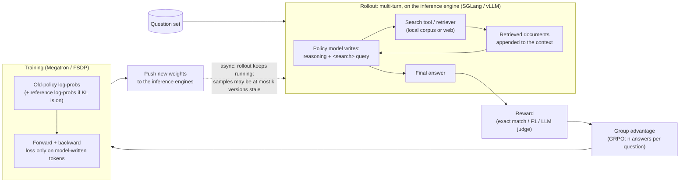

# AI-Search-Plugin

English | [中文](README.zh-CN.md)

Drop-in components that make **RL post-training of search agents** (AI search / deep research) faster and more stable on slime and verl.

> Early release for review. The speed-ups below were measured with the original implementation this package was ported from. Some components are still stubs, and the tests here are CPU-only. Per-run details: [EXPERIMENTS.md](EXPERIMENTS.md).

On five workloads against each framework's fastest config: 1.17–1.56× faster on four, a tie on one. See [section 5](#5-results).

---

## 1. What is AI-search post-training?

The model reasons, searches, reads the results and repeats until it can answer. RL teaches it when and what to search. The only reward is whether the final answer is right.



A training sample:

```text
[ system prompt + question ][ thought + query ][ retrieved docs ][ thought + query ][ retrieved docs ] ... [ answer ]
  not in loss                  in loss            not in loss        in loss           not in loss          in loss
```

Only model-written tokens are in the loss, but every token still goes through every layer.

---

## 2. How it differs from single-turn RL

Most of these also apply to other multi-turn agent RL; AI search is the extreme case.

| | Single-turn math / code | AI search | Impact on the system |
|---|---|---|---|
| **Who writes the tokens** | The model | Mostly the search tool (long documents) | Inference is prefill-heavy; most training compute goes to tokens outside the loss |
| **Shared context** | Short prompt | Long prompt shared by all n answers of a group | Prefix sharing pays off much more |
| **What slows a batch** | Long generations | Slow tools; questions that need many rounds | Needs async rollout with a staleness bound |
| **Bottleneck** | GPU | Often CPU and scheduling: many small, bursty requests | The control plane saturates before the GPU |
| **Sample lifetime** | One policy version | Weights can change mid-trajectory | Cached prefixes go stale; MoE routing and sparse-attention choices can differ between inference and training |

Two easy mistakes in any multi-turn RL: pass **token IDs** between turns (re-tokenizing breaks training), and mask retrieved tokens out of the loss.

---

## 3. Bottlenecks: small dense vs. large MoE

Measured per-stage splits for specific workloads, not general rules. Stages: **waiting** for data (includes tool calls), **training** (forward + backward + optimizer), weight **sync**.

### Small dense models (Qwen2.5-7B, Qwen3-14B; one node)

- **Where time goes** depends on the workload.
  - ASearcher, slime baseline (before `--use-distributed-post`): 25.57 s/Mtok = training 14.64 + waiting 10.94. Ours: 15.86 = 13.60 + 2.26. Waiting is 89% of the gap (reviewed, one order).
  - Libra, earlier baseline: 30.4 s/step = training 23.6 + waiting 6.8 + sync 0.8 (not reviewed).
- **Why the baseline waits (ASearcher): the rollout client's CPU**, not the GPU or the retriever. Calls took p50 1.005 s on the client, while the retriever answered in 0.036 s at only 39 QPS. One asyncio loop sends both LLM and tool requests; that thread ran at ~81% CPU and held the GIL 62% of the time (profiled, not reviewed). Sharding the client over 8 processes (`rshard`) cut per-call time 2.52 → 0.82 s and generation per trajectory 19.5 → 9.6 s (reviewed; across runs).
- **What helped** (reviewed): Search-R1·slime: response logits ×1.116, prefetch ×1.033. ASearcher: DEFER ×1.333, engine hooks ×1.116, response logits ×1.090. Libra: engine hooks ×1.151. Weight-sync changes: no effect (×1.002, ×0.999).
- **What the baseline gets by config**: slime's `--use-distributed-post` roughly halves its waiting (10.47 / 9.41 → 5.11 / 5.28 s/Mtok; not reviewed). With it on in both arms, `rshard` adds only ×1.051 (not significant).

### Large MoE model (Qwen3-Next 80B-A3B: MoE + GDN linear attention; 4 nodes)

- **Where time goes**, s/step, ours / verl: waiting 58.75 / 102.63, training 168.70 / 211.33, sync 6.85 / 37.53, preprocess 7.6–9.1 / 1.25; step 227.85 / 352.96. Our sync and preprocess overlap with waiting; verl's run serially. verl's generation varies widely: 0–13 s on short steps, 194–236 s on long ones. (Per-stage split not reviewed; the overall ratio is.)
- **What helped** (reviewed): prefetch +13.51% (without it, waiting grows ~30 s/step); expert placement +2.70% (training ~4 s/step shorter). verl cannot get either by config: its Megatron path has no expert load balancing.

### Two observations that do not generalize

- **Staleness admission helps only where a plain concurrency cap breaks the bound.** Needed on Libra (otherwise concurrency 8) and ASearcher (no concurrency from 256 down to 64 stayed ≤ 2). No effect on Search-R1·slime (×0.996). Cost 2.32% on Qwen3-Next.
- **Faster sync does not always matter.** On Qwen3-Next, disabling engine hooks doubled sync time (7.0–7.3 → 14.0–15.0 s/step) but step time did not change, because sync overlaps with waiting (not reviewed).

**Not measured:** prefill vs. decode split; multi-node scale for small models; where prefetch's ~30 s/step comes from; sparse-attention (DSA) models; real retrieval.

---

## 4. Components

All components are opt-in. Switches and defaults: [docs/COMPONENTS.md](docs/COMPONENTS.md), or `ai-search-plugin list`. *Stub* = registered but not ported yet ([docs/PORTING.md](docs/PORTING.md)).

**Reading the effect column.** Leave-one-out from our full set, same node, both orders. Small models: ratio (above 1 = helps). Qwen3-Next: % gain. ✓ = significant at 95%; n.s. = not significant; *not active* = the component never ran there, so no conclusion. SR1 = Search-R1, ASR = ASearcher, Q3N = Qwen3-Next. Measured with the original implementation; current defaults differ slightly (e.g. `ws direct` is off).

### Model-agnostic

| Component | What it does | Measured effect | Baseline can get it by config? |
|---|---|---|---|
| `ticket_admission` (slime) | Bounds staleness without capping concurrency. DEFER moves slow groups to a later batch; a budgeted cut drops stragglers. | DEFER: ASR ×1.333 ✓; Q3N +0.38% n.s. Ticket itself: SR1·slime ×0.996 n.s.; Q3N −2.32% ✓ (off is faster and still compliant); ASR has no compliant run without it. | No. verl drops stale samples instead. |
| `verl_ceiling` (verl) | The same staleness ceiling, in verl's units | SR1·verl ×1.000 n.s. (never triggered) | Yes |
| `pool_fill` (slime) | Keeps every engine full within the ceiling | Not ablated | No |
| `rshard` (slime) | Shards the rollout client over processes | ASR ×1.051 n.s. (`--use-distributed-post` on in both arms); Libra n.s. | Partly: `--use-distributed-post` covers LLM requests, not tool calls |
| `toolcache` + `tool_hedge` | Merges identical concurrent tool calls; sends a backup request for slow ones | ASR ×1.079 n.s.; Libra n.s.; SR1·verl not active (a positional-argument call bypassed the cache) | No |
| `sampler_nosync` + `fastload` ("engine hooks") | Removes SGLang's per-step GPU→CPU sync; faster weight loading in the engine | ASR ×1.116 ✓; Libra ×1.151 ✓; SR1 n.s.; Q3N n.s. | No |
| `weight_sync` (+ `verl_inplace`) | Faster weight push: buckets, pipelined send, parallel PP stages | n.s. everywhere (Q3N +1.2%, one order only) | Partly: slime baselines got the same 2 GB buffer; verl already buckets |
| `prefetch` (slime) | Overlaps rollout-data fetch with weight sync; prebuilds the next batch | SR1·slime ×1.033 ✓; ASR ×1.066 (weak ✓); Libra n.s.; Q3N +13.51% ✓ (with `r3_transfer`) | No |
| `response_logits` | LM head, log-prob and entropy only on response tokens, chunked | SR1·slime ×1.116 ✓; ASR ×1.090 ✓; Libra n.s.; Q3N n.s. | No. verl's fused kernel saves memory but still computes every row |
| `kvepoch` / `kvfresh` / `verl_kvfresh` | Correctness: after a sync, no request reuses prefix KV from old weights | Cost n.s. (SR1·verl ×0.993; Libra vs. prefix cache off ×1.065) | Partly: flush or disable the prefix cache |
| `jitcache` | Keeps Triton compile and autotune results across runs | Not ablated | Mostly |
| `prefix_tree` (stub) | Trains a group's shared prompt once | Not measured | — |

### Model-family

| Component | Family | What it does | Measured effect | Baseline by config? |
|---|---|---|---|---|
| `expert_placement` (stub) | MoE | Moves experts across EP ranks to even out load | Q3N +2.70% ✓ (code not in this package yet) | No |
| `r3_transfer` | MoE + routing replay | Sends routed-expert ids in compact form | Only measured as part of prefetch | No |
| `r3pack` | MoE + routing replay | Balances expert load when packing micro-batches | Not active on Q3N (turned itself off) | No |
| `jitfix` | MoE / GDN | Prevents torch.compile recompile storms | Not ablated | No |
| `mtp_draft_loader` (stub) | MTP | MTP speculative decoding in rollout | Q3N: slower in both tries (−3.4%; −1.6% n.s.); kept off | — |
| `dsa_replay`, `r3_ep_plan`, `hybridep_overlap`, `gdn_cudnn`, `fla_nb_bucket`, `gdn_convfuse_ep` (stubs) | DSA / MoE / GDN | See COMPONENTS.md | Not measured (`gdn_cudnn` was slower than FLA in an earlier test) | — |

`ws direct` (the direct-HTTP path of `weight_sync`) is **off by default**: it caused rare hangs on the 80B model (1 in 60 syncs); root cause not confirmed.

---

## 5. Results

**Speed-up = baseline ÷ ours**, in seconds per million trained tokens (s/Mtok).

- Both arms run on the same node, in both orders. 95% CI by bootstrap.
- Health checks on both sides: entropy, train–inference log-prob gap, starting reward, tokens trained, staleness ≤ 2.
- Every row was independently reviewed.
- Baseline = the fastest config of that framework we found that stays within staleness 2.

| Workload | Baseline | Pairs | Speed-up [95% CI] | Notes |
|---|---|---|---|---|
| Search-R1 · Qwen2.5-7B · 1× B300 | slime (5 training + 3 rollout GPUs) | 2 | **1.170×** [1.164, 1.177] | All checks pass. Mostly response logits (×1.116) and prefetch (×1.033); ~1.5% unattributed. |
| Search-R1 · Qwen2.5-7B · 1× B300 | verl, colocated async, off-policy limit 3 | 8 | **1.002×** [0.984, 1.021], tie | 4.6% slower per step, but trains 6.8% more loss tokens per step. Two checks failed: that token count, and first-3-step reward (at threshold). The baseline may drop over-age samples (not proven). `toolcache` did not activate. |
| ASearcher · Qwen2.5-7B · 1× B300 | verl best config (colocated async, off-policy limit 3) | 4 | **1.167×** [1.131, 1.208] | verl may slightly exceed staleness 2 (upper bound: 0.002–0.16% of trajectories at 3); that would favor verl. Against slime with `--use-distributed-post`: 1.299× (reference only). |
| Libra · Qwen3-14B · 1× B200 | slime best config + our ticket admission (without it, slime needs concurrency 8 to stay within staleness 2) | 6 | **1.219×** [1.133, 1.310] | Excludes ticket admission's gain. The gain comes from the combination; single components are mostly within noise. |
| Qwen3-Next 80B-A3B · 4× B300 | verl best config (separate async, off-policy limit 3, partial rollout, routing replay) | 4 | **1.560×** [1.389, 1.719] | See below. |

**Qwen3-Next caveats**
1. One scenario, synthetic search tool (*g1*: latency jitter, timeouts, errors), so rewards show a trend only. Scaled-down layout: 2 training + 2 rollout nodes, 64 prompts × 8 answers.
2. Measured with `ws direct` on. It is now off by default because it caused rare hangs (1 in 60 syncs; verl also hung 1 in 63, cause unknown). Not re-measured; the whole weight-sync group is worth ~1% (not significant).
3. Measured with ticket admission on. Turning it off here is ~2.3% faster, so 1.560× is conservative.
4. Our samples were nearly all at staleness 2, verl's ~99.6% at staleness 1 (both within the bound). Part of the gain may come from this; not measured separately.
5. In the ablations only prefetch (+13.5%) and expert placement (+2.7%) are significant; the rest is not attributed. Do not add or subtract section 3's per-stage numbers to/from the ablations.
6. verl needed three local fixes (not upstreamed) to bring its log-prob gap from 0.210 to 0.016–0.021: a newer SGLang, an adapter shim for it, and the original GDN output-norm weights. Both arms used the same SGLang.

---

## 6. Hard scenarios

Synthetic versions of industrial cases, used to see where each component should matter. Only *g1* (the Qwen3-Next run) has reported numbers.

| | Scenario | Why it hurts | Components |
|---|---|---|---|
| a | Single turn, very long prompt | Almost no token is in the loss, yet all go through every layer | `response_logits`, `prefix_tree` (stub) |
| b | Multi-turn retrieval | Many small, bursty requests; prefix KV goes stale after syncs | `rshard`, `toolcache`, `prefetch`, `kvepoch` / `kvfresh` |
| c | Long tail across questions | A few long trajectories hold up the batch | `ticket_admission`, `pool_fill`, `verl_ceiling` |
| d | 100k+ token trajectories | Full-vocabulary logits spike memory; long prefill | `response_logits` |
| e | Easy/hard mix that drifts during training | A fixed in-flight amount is wrong half the time | `ticket_admission`, `pool_fill`, `prefetch` |
| f | A few extremely slow trajectories | The step waits for the last one; drop-based staleness control loses them | `ticket_admission`, `verl_ceiling` |
| g | Tool jitter, timeouts, failures | The tool tail becomes the trajectory tail | `toolcache`, `tool_hedge`, `rshard` |
| h | Mixed tools (search, long page fetch, slow sandboxed code) | Long returns add prefill; the sandbox queues; caching cannot help unique code calls | `toolcache` (search/fetch), `rshard`, `kvepoch` / `kvfresh` |
| i | Bimodal answer lengths | Decode batches shrink to a few sequences at the tail | `ticket_admission`, `pool_fill` |
| j | Thousands of in-flight trajectories | The control plane saturates before the GPU | `rshard`, `pool_fill`, `toolcache` |
| k | An engine or node dies mid-run | Lost work, slow restart | `jitcache` only (no failover yet) |
| l | Hot MoE experts | The busiest EP rank sets the pace | `expert_placement` (stub), `r3pack` |
| m | Different training : rollout GPU ratios | The optimum moves; more engines make sync costlier | `weight_sync`, `prefetch` |
| n | Larger GRPO groups (e.g. n = 16) | A group waits for its slowest member; the shared prefix repeats n times | `prefix_tree` (stub), `toolcache`, `kvepoch` |
| o | Long single-turn mixed with multi-turn | Unbalanced micro-batches; prefill and decode interfere | None (relies on the framework's dynamic batching) |
| p | Slow reward / LLM judge | Reward time adds to the step | None yet |

---

## Install

```bash
pip install .                 # or: pip install -e ".[test]"   (no hard runtime dependencies)
ai-search-plugin list         # components, defaults, status
ai-search-plugin plan verl default max_staleness=2   # print the env / arguments it would set
```

Install into the framework's environment so every Ray worker can import it. torch, slime, verl, SGLang and Megatron are imported lazily.

```python
import ai_search_plugin as asp
plan = asp.install(framework="slime", components="default", options={"max_staleness": 2})
print(plan.shell())   # env + framework arguments
```

Launch examples (illustrative, not run in tests):
- [examples/slime/](examples/slime/): needs slime's fully-async rollout mode; start the trainer with `python -m ai_search_plugin.adapters.slime_train` so `prefetch` works.
- [examples/verl/](examples/verl/): uses `VERL_USE_EXTERNAL_MODULES`; `response_logits` needs the Megatron engine.

**Tested:** `pytest tests/` on a CPU-only machine without any framework: registry, CLI, hooks and the CPU logic of each ported component. 80 passed, 2 skipped (need a slime checkout via `SLIME_SRC`).

**Not tested:** real slime/verl runs, SGLang engine patches, NCCL weight transfer, `rshard`'s Ray integration, and the `response_logits` GPU tests in `tests/gpu/`. See [docs/COMPONENTS.md](docs/COMPONENTS.md#what-is-tested-here-cpu-only-no-gpu-no-framework-installed).
