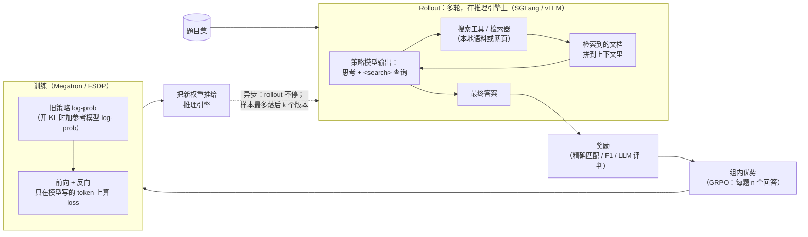

# AI-Search-Plugin

[English](README.md) | 中文

一组即插即用的组件，用来给 **搜索智能体的 RL 后训练**（AI 搜索 / 深度研究类模型）提速、提稳，可接到 slime、verl 等现有 RL 框架上。

> 状态：早期版本，供审阅。
> - 下面的提速数字，对所列配置是最终结论。除非另有标注，这些数字都是用本包移植前的原始实现测的，两边都做了健康检查，并经过独立复核。
> - 有几个组件还是空壳（stub，尚未移植）。
> - 本仓库自带的测试只在 CPU 上跑，见[安装](#安装)。
> - 每次实验的细节：[EXPERIMENTS.md](EXPERIMENTS.md)。

---

## 结果一览

**提速比 = 基线 s/Mtok ÷ 我们的 s/Mtok**

其中 s/Mtok =（测量窗口内各步墙钟时间之和）÷（该窗口内实际训练的 token 数，单位百万）。

测量方法：
- 两边在同一节点上跑，正反两种顺序都跑（A→B 和 B→A）。
- 各对结果按几何平均合并。95% 置信区间是在每对内部按步做 bootstrap 得到的。
- 两边都做了健康检查：熵、训推 log-prob 差、起始奖励、实际训练的 token 数、陈旧度（staleness）≤ 2。
- 每一行都经过独立复核。没过的健康检查项和没搞清的问题都写在"说明"列。
- 基线 = 该框架在陈旧度 ≤ 2 的前提下，我们能找到的最快配置。

| 任务（模型，硬件） | 基线 | 对数 | 提速比 [95% CI] | 说明 |
|---|---|---|---|---|
| Search-R1（Qwen2.5-7B，1 台 B300） | slime，5 张训练卡 + 3 张推理卡，选择性重算（两边相同） | 2 | **1.170×** [1.164, 1.177] | 健康检查全过。单个组件里贡献最大的是 response logits（×1.116）和 prefetch（×1.033），两者合计 ×1.152。剩下约 1.5% 不能归到任何单个组件上（未深查）。 |
| Search-R1（Qwen2.5-7B，1 台 B300） | verl，同卡异步，off-policy 上限 3 | 8 | **1.002×** [0.984, 1.021]，**打平** | 按每步算我们慢 4.6%（0.956×），但我们每步训练的 loss token 多 6.8%。有两项健康检查没过：一是这个 token 数，二是前 3 步的奖励（卡在阈值上）。有旁证显示基线丢掉了超龄样本，但没证实。我们有些组件在这里没生效（如 `toolcache`，见第 4 节）。 |
| ASearcher（Qwen2.5-7B，1 台 B300） | verl 最优配置（同卡异步，off-policy 上限 3） | 4 | **1.167×** [1.131, 1.208] | verl 是否守住陈旧度没有证实：按上界估算，有 0.002–0.16% 的轨迹最坏陈旧度为 3（verl 自己的标记是 2）。如果 verl 真的超了，那是让 verl 变快，所以这个比值对我们是偏保守的。对比开了 `--use-distributed-post` 的 slime，结果是 1.299× [1.235, 1.355]（仅供参考）。 |
| Libra（Qwen3-14B，1 台 B200） | slime 最优配置 **加上我们的 ticket 准入**（不加的话，slime 必须把并发降到 8 才能守住陈旧度 2） | 6 | **1.219×** [1.133, 1.310] | 这个比值里不含 ticket 准入的收益。单个组件大多在噪声范围内，收益来自组合。 |
| Qwen3-Next 80B-A3B（4 台 B300） | verl 能找到的最优配置（分离式异步，off-policy 上限 3，partial rollout，路由回放） | 4 | **1.560×** [1.389, 1.719] | 见下方说明。 |

**Qwen3-Next 这一行必须附带的说明**
1. **只测了一个场景，工具是模拟的。** 搜索工具是合成的（场景 *g1*：工具延迟抖动、超时和报错，见第 5 节），不是真实检索库，所以奖励只看趋势。布局是缩小版 1:1（2 台训练 + 2 台推理，64 道题 × 每题 8 个回答）。
2. **测速时 `ws direct` 是开着的。** 后来因为它会导致卡死，在默认配置里关掉了（我们每 60 次同步卡 1 次；verl 每 63 次卡 1 次，原因在它自己那边，未确认）。关掉后没有重测；整个权重同步组件组的收益大约 1%（只测了单序，不显著）。
3. **在 ticket 准入上，这个结果偏保守。** 这个场景下 ticket 准入可以关掉，关掉后快约 2.3%，陈旧度仍 ≤ 2。1.560× 是开着它测的。
4. **两边用陈旧度的方式不同。** 我们的样本几乎全是陈旧度 2；verl 约 99.6% 是陈旧度 1，都在上限内。部分提速可能来自我们把 S = 2 用满了，这部分没有单独测。
5. **1.56× 目前还不能拆到各组件上。** 消融里只有 prefetch（+13.5%）和专家重排（+2.7%）是显著的。第 3 节里和 verl 的分阶段对比是另一种测量：**不要把它和组件消融相加或相减。**
6. **verl 需要本地修补。** 为了让训推 log-prob 差回到正常水平（0.210 → 0.016–0.021），verl 做了三处本地修补，没有推上游：换新版 SGLang Python 包、为它加一层适配、恢复 GDN output-norm 的原始权重。两边用的是同一个 SGLang。

---

## 1. 什么是 AI 搜索后训练？

搜索智能体回答问题的方式是：先思考，发出搜索查询，读返回的文档，如此反复，直到能给出答案。RL 后训练教模型*什么时候*搜、*搜什么*，以及怎么用搜回来的东西。唯一的训练信号是最终答案对不对。



一条训练样本长这样：

```text
[ 系统提示 + 题目 ][ 思考 + 查询 ][ 检索文档 ][ 思考 + 查询 ][ 检索文档 ] ... [ 答案 ]
  不进 loss          进 loss        不进 loss     进 loss        不进 loss         进 loss
```

只有模型自己写的 token 计入 loss，但所有 token 仍要过每一层，因为后面的 token 要 attend 到检索文档。

---

## 2. 和其他 RL 后训练有什么不同

通常拿单轮数学/代码 RL 作对照。下面大部分差异在其他多轮、用工具的智能体 RL（代码智能体、游戏）里也存在。AI 搜索是这些问题的极端情况，而不是另一类问题。

| | 单轮数学 / 代码 RL | AI 搜索 RL | 对系统的影响 |
|---|---|---|---|
| **token 是谁写的** | 大多是模型 | 大多是搜索工具：检索文档很长，模型只写一小部分 | 推理时间花在 prefill（读文档）而不是 decode；训练大部分算力花在不进 loss 的 token 上 |
| **组内共享上下文** | 共享的提示很短 | 很长的系统提示 + 题目，被一组 n 个回答共享 | 共享前缀只算一次（前缀共享）收益大得多 |
| **什么让一个 batch 变慢** | 生成很长 | 工具调用慢或重复；少数题要很多轮 | 同步 batch 要等最慢的那道题 → 必须用带陈旧度上限的异步 rollout |
| **瓶颈在哪** | GPU 算力 | 常常在 CPU 和调度：大量短小、突发的请求和工具往返 | 控制面（请求分发、工具客户端）先于 GPU 成为瓶颈 |
| **一条样本的生命周期** | 一次生成，一个策略版本 | 很多轮；轨迹进行到一半权重就可能变了 | 缓存的前缀在权重更新后过期；MoE 路由和稀疏注意力的选择在推理和训练间可能不一致 |

不是搜索特有、但多轮 RL 里容易做错的两点：轮与轮之间要一直传 **token ID**（先 decode 再重新分词会把训练搞坏）；检索回来的 token 要从 loss 里 mask 掉。

---

## 3. 性能瓶颈：小 dense 模型 vs. 大稀疏模型

步时间花在哪，只取实测的分阶段数据。每一行描述的是某个任务在某个配置下的情况，不是普遍规律：同一个组件在一个任务上帮助很大，在另一个任务上可能毫无作用（见第 4 节）。

阶段说明：**等数据** = 训练端等凑满一批 rollout 的时间（含工具调用）。**训练** = 前向 + 反向 + 优化器。**权重同步** = 把新权重推给推理引擎。

| | 小 dense 模型（Qwen2.5-7B、Qwen3-14B；单节点） | 大 MoE 模型（Qwen3-Next 80B-A3B：MoE + GDN 线性注意力；4 节点） |
|---|---|---|
| **时间花在哪（实测）** | 看任务。**ASearcher**，slime 基线，在打开 slime 自带的 `--use-distributed-post` 之前：25.57 s/Mtok = 训练 14.64 + 等数据 10.94。我们：15.86 = 13.60 + 2.26。差距的 89% 来自等数据。经独立复核，只测了单序。**Libra**，较早的基线配置（slime + 我们的 ticket 准入）：30.4 s/步 = 训练 23.6 + 等数据 6.8 + 同步 0.8（未独立复核）。 | 两边最大的阶段都是训练。每步平均秒数，我们 / verl：等数据（verl 为生成）58.75 / 102.63；训练 168.70 / 211.33；权重同步 6.85 / 37.53；预处理 7.6–9.1 / 1.25。步时间：227.85 / 352.96。我们这边同步和预处理与等数据重叠，不在步的关键路径上；verl 是串行的。*分阶段数据未独立复核；总比值经过复核。* |
| **基线慢在哪（实测）** | **慢在 rollout 客户端的 CPU，不是 GPU，也不是工具服务**（ASearcher）。客户端测到的调用耗时 p50 为 1.005 s，而检索服务端 p50 只要 0.036 s，远没打满（39 次查询/秒）。rollout 管理器只有一个 asyncio 事件循环，LLM 请求和工具调用都由它发。这个线程 CPU 约 81%，62% 的墙钟时间持有 GIL；其他线程几乎不持有 GIL。所以原因是一个事件循环被打满，不是 GIL 争抢。*做过 profile，未独立复核。* 把客户端拆到 8 个进程（`rshard`）后，客户端单次调用耗时从 2.52 s 降到 0.82 s，每条轨迹的生成时间从 19.5 s 降到 9.6 s（我们这边开/关 `rshard` 对比；经独立复核；跨 run 比较）。 | verl 的生成阶段很不均匀：短步 0–13 s，长步 194–236 s。它的权重同步（约 37 s）和训练也都在步的关键路径上。*未独立复核。* |
| **什么有用（实测，经独立复核）** | slime 上的 Search-R1：只在回答 token 上算 logits ×1.116，预取 rollout 数据 ×1.033。ASearcher：慢组延后（DEFER）×1.333，引擎钩子 ×1.116，response logits ×1.090。Libra：引擎钩子 ×1.151。权重同步的改动在小模型上看不出效果（×1.002、×0.999）。 | prefetch +13.51%：去掉后等数据每步多约 30 s。专家重排 +2.70%：去掉后训练每步多约 4 s。 |
| **基线改配置能不能拿到？** | 部分能。slime 自带的 `--use-distributed-post`（用 HTTP poster actor 发 LLM 请求；工具调用仍在主循环里）把基线的等数据时间大约砍半（两种顺序下 10.47 / 9.41 → 5.11 / 5.28 s/Mtok，训练不变；*未独立复核*）。ASearcher 最终两边都开了它。两边都开时，`rshard` 带来 ×1.051 [0.995, 1.112]，不显著。 | prefetch 和专家重排拿不到。verl 的 Megatron 路径没有专家负载均衡（复核人抽查过）。 |
| **没测的** | prefill 与 decode 的拆分。多节点规模下的效果。 | prefill 与 decode 的拆分。prefetch 省下的每步约 30 s 具体在哪一环。稀疏注意力（DSA）模型。真实（非合成）检索。 |

两条实测观察，单独看不能推广：
- **陈旧度准入只在"单纯限并发会突破陈旧度上限"时才有用。** Libra 上，不用 ticket 准入的话，slime 要把并发降到 8 才能保住陈旧度 ≤ 2。ASearcher 上，不用它时并发从 256 降到 64 都守不住 ≤ 2。Search-R1·slime 上，两边在相同并发下都合规，ticket 准入没有影响（×0.996）。Qwen3-Next 上它反而亏 2.32%（见第 4 节）。
- **权重同步快了也可能没用。** Qwen3-Next 上，关掉我们的引擎侧钩子后同步时间翻倍（7.0–7.3 → 14.0–15.0 s/步），但步时间不变，因为同步和等数据是重叠的（*未独立复核*）。

每次实验的数字：[EXPERIMENTS.md](EXPERIMENTS.md)。

---

## 4. 插件里有什么

每个组件都要手动开启。各组件的开关、默认值和状态见 [docs/COMPONENTS.md](docs/COMPONENTS.md)；`ai-search-plugin list` 会打印同一张表。*Stub（空壳）* 表示组件已在注册表里登记，但代码还没移植进本包（[docs/PORTING.md](docs/PORTING.md)）。

**"实测效果"怎么看**
- 小模型：比值 =（去掉该组件后的 s/Mtok）÷（全开时的 s/Mtok）。大于 1 表示该组件有用。
- Qwen3-Next：收益 = 该比值 − 1。
- 所有数字都是从我们的全套里去掉一个（leave-one-out），同节点、正反两序。✓ = 95% CI 不含"无效果"；n.s. = 不显著。
- 简称：SR1 = Search-R1，ASR = ASearcher，Q3N = Qwen3-Next 80B。
- "没生效"指该组件在那个配置里根本没真正运行过。此时的"没收益"不说明组件本身好坏。

这些测量用的是本包移植前的原始实现，以及各任务自己的设置。插件的默认组合接近这些设置，但不完全相同：例如 `ws direct` 现在是关的。

### 与模型无关的组件

| 组件 | 解决什么问题 | 实测效果 | 基线改自己的配置能拿到吗？ |
|---|---|---|---|
| `ticket_admission`（slime） | 在不压并发的前提下把陈旧度限制在 S 以内。每组拿一张"票"，对应它将参与训练的那一批。DEFER 把慢组挪到后面的批次，按预算截断掉队的样本。 | **DEFER**：ASR ×1.333 [1.252, 1.412] ✓；Q3N +0.38% n.s.。**ticket 本身**：SR1·slime ×0.996 n.s.（并发 854 时两边都合规）；Q3N **−2.32%** [−3.92%, −0.60%] ✓（关掉更快且仍合规）。ASR：没有它就没有合规的 run 可比。Libra：基线已经用了它。 | 不能。verl 的 off-policy 上限是丢掉陈旧样本，不是按陈旧度准入。 |
| `verl_ceiling`（verl） | 同样的陈旧度硬上限，用 verl 自己的单位表示 | SR1·verl ×1.000 n.s.。上限从没触发，所以测到的主要是 off-policy 上限 4 对 3 的差别。 | 能（verl 的 off-policy 上限）。 |
| `pool_fill`（slime） | 在陈旧度上限内让每个引擎都满载。在途池大小按 batch 和引擎数定，而不是按组大小定。 | 没有单独消融。 | 不能。 |
| `rshard`（slime） | rollout 只有一个事件循环，CPU 被打满。把 rollout 客户端拆到多个进程。 | ASR ×1.051 [0.995, 1.112] n.s.（两边都开了 slime 的 `--use-distributed-post`）；Libra n.s.。 | 部分能：`--use-distributed-post` 管 LLM 请求，不管工具调用。 |
| `toolcache`（+ `tool_hedge`） | 相同的并发只读工具调用合并成一次（TTL 缓存，single-flight）。某次调用落入慢尾时补发一个重复请求。 | ASR ×1.079 [0.974, 1.180] n.s.；Libra n.s.；SR1·verl ×1.011 n.s.，**没生效**（工具是按位置参数调用的，绕过了缓存）。 | 不能。 |
| `sampler_nosync` + 引擎侧 `fastload` | 去掉 SGLang 返回 log-prob 时每步一次的 GPU→CPU 同步。在引擎里用录制/回放方式加载权重。两者合起来作为"引擎钩子"测。 | ASR ×1.116 [1.027, 1.196] ✓；Libra ×1.151 [1.045, 1.267] ✓（单独各自 n.s.）；SR1·slime ×1.002 n.s.；SR1·verl（只有 fastload）×0.986 n.s.；Q3N −0.29% n.s.。 | 不能。 |
| `weight_sync`（+ `verl_inplace`） | 训练端 → 引擎的权重推送更快：扁平化分桶、流水线发送、PP 各段并行；在途请求保留。 | SR1·slime ×1.002 n.s.；ASR ×0.999 n.s.；Libra n.s.；Q3N +1.2%（只测单序，n.s.；同步 6.4 vs 14.9 s/步）。`verl_inplace` 没有单独消融。 | 部分能。slime 基线也给了 2 GB 缓冲；verl 本来就分桶、用多发送端。 |
| `prefetch`（slime） | 训练端取 rollout 数据与权重同步重叠，并提前构建下一批 | SR1·slime ×1.033 [1.027, 1.038] ✓；ASR ×1.066 [1.012, 1.130]（2 对，弱 ✓）；Libra n.s.；Q3N **+13.51%** [+11.56%, +15.59%] ✓（和 `r3_transfer` 一起测）。 | 不能。 |
| `response_logits` | 只在回答行上分块计算 LM head、log-prob 和熵。搜索轨迹里大部分 token 是提示或检索文本。 | SR1·slime ×1.116 [1.109, 1.122] ✓；ASR ×1.090 [1.043, 1.135] ✓；Libra ×1.053 [0.980, 1.127] n.s.；Q3N +1.01% [−0.82%, +2.99%] n.s.。SR1·verl（FSDP）的 run 里没用。 | 不能。verl 的融合 kernel 省显存，但不跳过非回答行。 |
| `kvepoch` / `kvfresh` / `verl_kvfresh` | 正确性：权重同步后，任何请求都不会复用旧权重算出的前缀 KV。防止训推 log-prob 差变大。 | 开销：SR1·verl ×0.993 [0.968, 1.016] n.s.。Libra 对比"关前缀缓存"：×1.065 [0.967, 1.171] n.s.。 | 部分能：每次同步时清空或关掉前缀缓存。 |
| `jitcache` | 跨 run 保留编译好的 Triton kernel 和 autotune 结果（省第 0 步编译时间） | 没有消融（基线也有持久化编译缓存）。 | 基本能。 |
| `prefix_tree` | GRPO 一组共享的提示只训一次 | 空壳；不在测过的配置里。 | — |

### 与模型族相关的组件

| 组件 | 模型族 | 解决什么问题 | 实测效果 | 基线改配置能拿到吗？ |
|---|---|---|---|---|
| `expert_placement`（**空壳**） | MoE | 负载不均时，按路由计数在 EP rank 之间搬专家 | Q3N **+2.70%** [+1.21%, +4.38%] ✓（省在训练上）。代码还没进本包。 | 不能（verl 的 Megatron 路径）。 |
| `r3_transfer` | MoE + 路由回放（R3） | 路由专家 id 用 int16/uint8 传输，校验不拷贝 | 只在上面 Q3N 的 prefetch 结果里一起测过。 | 不能。 |
| `r3pack` | MoE + R3 | 拼 micro-batch 时平衡每个 micro-step 的专家负载 | Q3N 上**没生效**：收益低于阈值，自己关掉了，所以好坏都没证据。 | 不能。 |
| `jitfix` | MoE / GDN | token 数动态变化时，防止 torch.compile 反复重编译 | 没有消融；在 dense 模型上会自动关闭。 | 不能。 |
| `mtp_draft_loader`（空壳） | MTP 头 | rollout 中用 MTP 做投机解码 | Q3N：两次尝试开 MTP 都更慢（筛选 run 慢 3.4%；第二次单序 run −1.6% [−3.8%, +0.7%]）。未下结论；测速配置里是关的。verl 跑不起来（第一次同步后显存不够）。 | — |
| `dsa_replay`、`r3_ep_plan`、`hybridep_overlap`、`gdn_cudnn`、`fla_nb_bucket`、`gdn_convfuse_ep`（空壳） | DSA / MoE / GDN | 见 COMPONENTS.md | 不在测过的配置里。`gdn_cudnn` 在早先的 verl 测试里比 FLA 慢，没用。 | — |

`ws direct` 是 `weight_sync` 的直连 HTTP 路径。它**默认关闭**：在 80B 模型上会偶发卡死（计时 run 里每 60 次同步卡 1 次），根因未确认。

---

## 5. 针对的难题场景

这些是我们按工业场景做的合成版本，用来检查组件应该在哪里起作用。本 README 不给这些场景的数字：只报告上面 Qwen3-Next 的结果（场景 *g1*，公开模型）。

| | 场景 | 为什么难 | 对应组件 |
|---|---|---|---|
| a | 单轮、超长提示 | 几乎所有 token 都不进 loss，却都要过每一层 | `response_logits`、`prefix_tree`（空壳） |
| b | 多轮检索 | 大量短小、突发的 LLM 和工具请求；权重同步后前缀 KV 过期 | `rshard`、`toolcache`、`prefetch`、`kvepoch` / `kvfresh` |
| c | 题目间长尾不均 | 少数长轨迹拖住整批 | `ticket_admission`（DEFER、掉队截断）、`pool_fill`、`verl_ceiling` |
| d | 超长轨迹（10 万+ token） | 全词表 logits 造成显存尖峰；prefill 很长 | `response_logits` |
| e | 难易题混合，比例随训练漂移（课程学习） | 固定的在途数量一半时间都不对：题变难时数据供不上，题变易时训练成瓶颈 | `ticket_admission`、`pool_fill`、`prefetch` |
| f | 少数极慢轨迹，token 很长或工具耗时很长 | 每步要等最后一条轨迹。靠丢样本来限陈旧度的框架会丢掉这些慢样本 | `ticket_admission`（DEFER、按预算截断）、`verl_ceiling` |
| g | 工具服务抖动、超时、偶发失败 | 工具的尾延迟决定轨迹的尾延迟；重试在客户端堆积 | `toolcache`、`tool_hedge`、`rshard`、异步准入 |
| h | 多种工具混用：搜索、返回很长的网页抓取、受沙箱并发限制的慢代码执行 | 长返回增加 prefill；慢沙箱让请求排队；缓存对不重复的代码调用没用 | `toolcache`（仅搜索/抓取）、`rshard`、`kvepoch` / `kvfresh` |
| i | 回答长度两极分化（大量短的，少量极长的） | 尾部 decode batch 只剩几条序列，GPU 空转 | `ticket_admission`（DEFER）、`pool_fill` |
| j | 大 batch / 超高并发（数千条在途轨迹） | 控制面（单个 Python 进程、路由、工具 QPS）先于 GPU 打满 | `rshard`、`pool_fill`、`toolcache` |
| k | 推理引擎或训练节点中途挂掉（抢占） | 在途工作丢失，重启慢（编译预热） | 只有 `jitcache`（热重启）；还没有引擎健康检查或重路由组件 |
| l | MoE 专家负载倾斜（热点专家） | 最忙的 EP rank 决定训练速度 | `expert_placement`（空壳）、`r3pack` |
| m | 训练 : 推理 GPU 比例不同 | 最优点随任务变化；引擎越多，每次同步越贵 | `weight_sync`（各段并行）、`prefetch`、异步准入 |
| n | 更大的 GRPO 组（如 n = 16、题目更少） | 一组要等最慢的成员；共享前缀重复 n 次 | `prefix_tree`（空壳）、`toolcache`（组内相同查询）、`kvepoch` |
| o | 多任务混合 batch（长单轮和多轮混在一起） | micro-batch 不均衡；prefill 和 decode 互相干扰 | 没有专门组件（依赖框架自带的动态 batching） |
| p | 奖励慢 / LLM 当评判（每个样本几秒） | 奖励时间不和训练重叠就会加到步时间上 | 暂无（只有设计） |

---

## 安装

```bash
# 在本目录下执行（包名：ai-search-plugin；没有硬性运行时依赖）
pip install .                 # 或：pip install -e ".[test]"
ai-search-plugin list         # 组件、默认值、状态（等同于：python -m ai_search_plugin list）
ai-search-plugin plan verl default max_staleness=2   # 打印它会设置的环境变量 / 参数
```

装到和框架相同的环境里，并确保每个 Ray worker 都能 import 到它。torch、slime、verl、SGLang 和 Megatron 都是延迟导入的，只在本来就有它们的进程里导入。Python 用法：

```python
import ai_search_plugin as asp
plan = asp.install(framework="slime", components="default", options={"max_staleness": 2})
print(plan.shell())   # 环境变量 + 框架参数
```

启动示例（仅作示意，本仓库测试中没有运行）：
- [examples/slime/](examples/slime/)：`launch_slime.sh`、`runtime_env.py`、`in_process.py`。slime 必须是全异步 rollout 模式。训练端要通过 `python -m ai_search_plugin.adapters.slime_train` 启动，`prefetch` 才能工作。
- [examples/verl/](examples/verl/)：`launch_verl.sh`、`in_process.py`。使用 `VERL_USE_EXTERNAL_MODULES`。`response_logits` 需要 Megatron 引擎。

**这里测了什么。** `pytest tests/` 可以在只有 CPU、没装任何框架的机器上跑。覆盖注册表、install/CLI、钩子，以及各已移植组件中能在 CPU 上测的逻辑：目前 80 个通过、2 个跳过（跳过的需要通过 `SLIME_SRC` 提供 slime 源码）。

**这里没测什么。**
- 真实的 slime 或 verl 启动。
- SGLang 引擎补丁。
- NCCL 权重传输。
- `rshard`（它的 Ray 集成测试没跑）。
- `response_logits` 算子和适配器：`tests/gpu/` 里有 GPU 测试，但没跑。

详见 [docs/COMPONENTS.md](docs/COMPONENTS.md#what-is-tested-here-cpu-only-no-gpu-no-framework-installed)。
