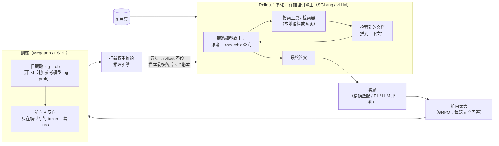

# AI-Search-Plugin

[English](README.md) | 中文

一组即插即用的组件，让 **搜索智能体的 RL 后训练**（AI 搜索 / 深度研究）在 slime 和 verl 上跑得更快、更稳。

> 早期版本，供审阅。下面的提速数字是用本包移植前的原始实现测的。部分组件还是空壳（stub），本仓库测试只在 CPU 上跑。每次实验的细节见 [EXPERIMENTS.md](EXPERIMENTS.md)。

在 5 个任务上对比各框架的最快配置：4 个快 1.17–1.56×，1 个打平，见[第 5 节](#5-实测结果)。

---

## 1. 什么是 AI 搜索后训练？

模型先思考，再搜索、读结果，反复几轮后给出答案。RL 教它什么时候搜、搜什么。奖励只看最终答案对不对。



一条训练样本：

```text
[ 系统提示 + 题目 ][ 思考 + 查询 ][ 检索文档 ][ 思考 + 查询 ][ 检索文档 ] ... [ 答案 ]
  不进 loss          进 loss        不进 loss     进 loss        不进 loss         进 loss
```

只有模型写的 token 进 loss，但所有 token 都要过每一层。

---

## 2. 和代码智能体 RL 的区别

AI 搜和代码智能体（SWE 类任务）都是"多轮调工具"的 RL，遇到的问题基本相同，没有哪个是 AI 搜独有的。区别在程度：AI 搜是其中比较极端的一种。

| | 代码智能体 RL | AI 搜 RL | 带来的影响 | 对应组件 |
|---|---|---|---|---|
| **样本里是什么** | 模型写的代码和命令，加上工具返回的文件和日志 | 大部分是搜回来的文档，模型自己写的很少 | 推理主要花在读入（prefill）；训练里大量 token 不进 loss，却照样要算 | `response_logits` |
| **同一道题的开头** | 题目和仓库上下文，也不短 | 系统提示 + 题目很长，一组 n 个回答完全相同 | 开头只算一遍，收益大 | `prefix_tree`（空壳） |
| **工具调用** | 次数少，每次慢（跑测试、编译，几秒到几分钟） | 次数多，每次快（几十毫秒到几秒） | 少数题被工具拖很久，必须异步训练，还要限制样本多旧 | `ticket_admission`、`pool_fill`、`prefetch` |
| **瓶颈在哪** | 沙箱和环境资源 | 常在发请求的 CPU 和调度（ASearcher 上实测，见第 3 节） | 要把 rollout 客户端拆开，重复的搜索要合并 | `rshard`、`toolcache` |
| **权重更新** | 一条轨迹会跨过几次更新 | 同左，轮数更多 | 旧缓存要作废；MoE 路由、稀疏注意力在推理和训练间要对齐 | `kvepoch` / `kvfresh`、`r3_transfer` |

多轮 RL 常见的两个坑：轮与轮之间要传 **token ID**（重新分词会把训练搞坏）；检索回来的 token 要从 loss 里 mask 掉。

---


## 3. 瓶颈：小 dense 模型 vs. 大 MoE 模型

以下是具体任务的实测分阶段数据，不是普遍规律。阶段：**等数据**（含工具调用）、**训练**（前向 + 反向 + 优化器）、权重**同步**。

### 小 dense 模型（Qwen2.5-7B、Qwen3-14B；单节点）

- **时间花在哪**，看任务：
  - ASearcher，slime 基线（开 `--use-distributed-post` 之前）：25.57 s/Mtok = 训练 14.64 + 等数据 10.94。我们：15.86 = 13.60 + 2.26。差距的 89% 在等数据（已复核，单序）。
  - Libra，较早的基线：30.4 s/步 = 训练 23.6 + 等数据 6.8 + 同步 0.8（未复核）。
- **基线为什么等（ASearcher）：卡在 rollout 客户端的 CPU**，不是 GPU，也不是检索服务。客户端调用 p50 1.005 s，而检索服务 0.036 s 就返回，只有 39 QPS。一个 asyncio 事件循环同时发 LLM 和工具请求，这个线程 CPU 约 81%，62% 的时间持有 GIL（做过 profile，未复核）。把客户端拆到 8 个进程（`rshard`）后，单次调用 2.52 → 0.82 s，每条轨迹生成 19.5 → 9.6 s（已复核；跨 run 比较）。
- **什么有用**（已复核）：Search-R1·slime：response logits ×1.116，prefetch ×1.033。ASearcher：DEFER ×1.333，引擎钩子 ×1.116，response logits ×1.090。Libra：引擎钩子 ×1.151。权重同步改动没效果（×1.002、×0.999）。
- **基线改配置能拿到的**：slime 自带的 `--use-distributed-post` 让等数据时间约减半（10.47 / 9.41 → 5.11 / 5.28 s/Mtok；未复核）。两边都开它时，`rshard` 只多 ×1.051（不显著）。

### 大 MoE 模型（Qwen3-Next 80B-A3B：MoE + GDN 线性注意力；4 节点）

- **时间花在哪**，每步秒数，我们 / verl：等数据 58.75 / 102.63，训练 168.70 / 211.33，同步 6.85 / 37.53，预处理 7.6–9.1 / 1.25；整步 227.85 / 352.96。我们的同步和预处理与等数据重叠，verl 是串行的。verl 的生成时间波动很大：短步 0–13 s，长步 194–236 s。（分阶段数据未复核，总比值已复核。）
- **什么有用**（已复核）：prefetch +13.51%（去掉后每步多等约 30 s）；专家重排 +2.70%（训练每步省约 4 s）。verl 改配置拿不到：它的 Megatron 路径没有专家负载均衡。

### 两条不能推广的观察

- **陈旧度准入只在单纯限并发守不住上限时有用。** Libra 需要（否则要降到并发 8），ASearcher 需要（并发从 256 降到 64 都守不住 ≤ 2）。Search-R1·slime 上没影响（×0.996）。Qwen3-Next 上亏 2.32%。
- **同步变快不一定有用。** Qwen3-Next 上关掉引擎钩子，同步时间翻倍（7.0–7.3 → 14.0–15.0 s/步），但整步不变，因为同步和等数据重叠（未复核）。

**没测的：** prefill 和 decode 的拆分；小模型多节点规模；prefetch 省的每步约 30 s 具体在哪；稀疏注意力（DSA）模型；真实检索。

---

## 4. 组件

所有组件都需手动开启。开关和默认值见 [docs/COMPONENTS.md](docs/COMPONENTS.md)，或运行 `ai-search-plugin list`。*空壳（stub）* = 已登记但代码还没移植（[docs/PORTING.md](docs/PORTING.md)）。

**效果列怎么看。** 从我们的全套里去掉一个组件对比，同节点、正反两序。小模型给比值（大于 1 = 有用），Qwen3-Next 给百分比收益。✓ = 95% 显著；n.s. = 不显著；*没生效* = 组件在那里根本没运行，不能下结论。SR1 = Search-R1，ASR = ASearcher，Q3N = Qwen3-Next。数字来自原始实现，当前默认配置略有不同（如 `ws direct` 已关）。

### 与模型无关

| 组件 | 做什么 | 实测效果 | 基线改配置能拿到吗？ |
|---|---|---|---|
| `ticket_admission`（slime） | 不压并发也能守住陈旧度上限。DEFER 把慢组挪到后面的批次，按预算截掉掉队样本。 | DEFER：ASR ×1.333 ✓；Q3N +0.38% n.s.。ticket 本身：SR1·slime ×0.996 n.s.；Q3N −2.32% ✓（关掉更快且仍合规）；ASR 没有它就没有合规的 run 可比。 | 不能。verl 是丢掉陈旧样本。 |
| `verl_ceiling`（verl） | 同样的陈旧度上限，用 verl 的单位 | SR1·verl ×1.000 n.s.（从未触发） | 能 |
| `pool_fill`（slime） | 在上限内让每个引擎都满载 | 没单独消融 | 不能 |
| `rshard`（slime） | 把 rollout 客户端拆到多个进程 | ASR ×1.051 n.s.（两边都开了 `--use-distributed-post`）；Libra n.s. | 部分能：`--use-distributed-post` 管 LLM 请求，不管工具调用 |
| `toolcache` + `tool_hedge` | 相同的并发工具调用合并成一次；慢调用补发备份请求 | ASR ×1.079 n.s.；Libra n.s.；SR1·verl 没生效（按位置参数调用绕过了缓存） | 不能 |
| `sampler_nosync` + `fastload`（"引擎钩子"） | 去掉 SGLang 每步的 GPU→CPU 同步；引擎内加载权重更快 | ASR ×1.116 ✓；Libra ×1.151 ✓；SR1 n.s.；Q3N n.s. | 不能 |
| `weight_sync`（+ `verl_inplace`） | 权重推送更快：分桶、流水线发送、PP 各段并行 | 全部 n.s.（Q3N +1.2%，只测单序） | 部分能：slime 基线也给了 2 GB 缓冲；verl 本来就分桶 |
| `prefetch`（slime） | 取 rollout 数据与权重同步重叠；提前构建下一批 | SR1·slime ×1.033 ✓；ASR ×1.066（弱 ✓）；Libra n.s.；Q3N +13.51% ✓（与 `r3_transfer` 一起） | 不能 |
| `response_logits` | 只在回答 token 上分块算 LM head、log-prob 和熵 | SR1·slime ×1.116 ✓；ASR ×1.090 ✓；Libra n.s.；Q3N n.s. | 不能。verl 的融合 kernel 省显存，但仍算所有行 |
| `kvepoch` / `kvfresh` / `verl_kvfresh` | 正确性：同步后不复用旧权重算出的前缀 KV | 开销不显著（SR1·verl ×0.993；Libra 对比关前缀缓存 ×1.065） | 部分能：清空或关掉前缀缓存 |
| `jitcache` | 跨 run 保留 Triton 编译和 autotune 结果 | 没消融 | 基本能 |
| `prefix_tree`（空壳） | 一组共享的提示只训一次 | 没测 | — |

### 与模型族相关

| 组件 | 模型族 | 做什么 | 实测效果 | 基线改配置能拿到吗？ |
|---|---|---|---|---|
| `expert_placement`（空壳） | MoE | 在 EP rank 间搬专家，均衡负载 | Q3N +2.70% ✓（代码还没进本包） | 不能 |
| `r3_transfer` | MoE + 路由回放 | 路由专家 id 压缩传输 | 只作为 prefetch 的一部分测过 | 不能 |
| `r3pack` | MoE + 路由回放 | 拼 micro-batch 时均衡专家负载 | Q3N 上没生效（自动关了） | 不能 |
| `jitfix` | MoE / GDN | 防止 torch.compile 反复重编译 | 没消融 | 不能 |
| `mtp_draft_loader`（空壳） | MTP | rollout 中用 MTP 投机解码 | Q3N：两次都更慢（−3.4%；−1.6% n.s.），保持关闭 | — |
| `dsa_replay`、`r3_ep_plan`、`hybridep_overlap`、`gdn_cudnn`、`fla_nb_bucket`、`gdn_convfuse_ep`（空壳） | DSA / MoE / GDN | 见 COMPONENTS.md | 没测（`gdn_cudnn` 早先测试比 FLA 慢） | — |

`ws direct`（`weight_sync` 的直连 HTTP 路径）**默认关闭**：在 80B 模型上偶发卡死（每 60 次同步 1 次），根因未确认。

---

## 5. 实测结果

**提速比 = 基线 ÷ 我们**，单位是每百万训练 token 的秒数（s/Mtok）。

- 两边在同一节点、正反两种顺序都跑。95% 置信区间用 bootstrap 算。
- 两边都做健康检查：熵、训推 log-prob 差、起始奖励、实际训练 token 数、陈旧度 ≤ 2。
- 每一行都经过独立复核。
- 基线 = 该框架在陈旧度 ≤ 2 内我们能找到的最快配置。

| 任务 | 基线 | 对数 | 提速比 [95% CI] | 说明 |
|---|---|---|---|---|
| Search-R1 · Qwen2.5-7B · 1 台 B300 | slime（5 张训练卡 + 3 张推理卡） | 2 | **1.170×** [1.164, 1.177] | 健康检查全过。主要来自 response logits（×1.116）和 prefetch（×1.033），约 1.5% 未归因。 |
| Search-R1 · Qwen2.5-7B · 1 台 B300 | verl，同卡异步，off-policy 上限 3 | 8 | **1.002×** [0.984, 1.021]，打平 | 每步慢 4.6%，但每步多训 6.8% 的 loss token。两项检查没过：这个 token 数，以及前 3 步奖励（卡在阈值上）。基线可能丢了超龄样本（未证实）。`toolcache` 没生效。 |
| ASearcher · Qwen2.5-7B · 1 台 B300 | verl 最优配置（同卡异步，off-policy 上限 3） | 4 | **1.167×** [1.131, 1.208] | verl 可能略超陈旧度 2（上界估计：0.002–0.16% 的轨迹到 3），这对 verl 有利。对开了 `--use-distributed-post` 的 slime：1.299×（仅供参考）。 |
| Libra · Qwen3-14B · 1 台 B200 | slime 最优配置 + 我们的 ticket 准入（不加的话 slime 要降到并发 8 才能守住陈旧度 2） | 6 | **1.219×** [1.133, 1.310] | 不含 ticket 准入的收益。收益来自组合，单个组件大多在噪声内。 |
| Qwen3-Next 80B-A3B · 4 台 B300 | verl 最优配置（分离式异步，off-policy 上限 3，partial rollout，路由回放） | 4 | **1.560×** [1.389, 1.719] | 见下方说明。 |

**Qwen3-Next 的说明**
1. 只测了一个场景，搜索工具是模拟的（*g1*：延迟抖动、超时、报错），奖励只看趋势。缩小版布局：2 台训练 + 2 台推理，64 题 × 每题 8 个回答。
2. 测速时 `ws direct` 开着。后来因为偶发卡死（每 60 次同步 1 次；verl 也每 63 次卡 1 次，原因不明）默认关掉了。没有重测；整个权重同步组件组约 1%（不显著）。
3. 测速时 ticket 准入开着。在这个场景关掉它快约 2.3%，所以 1.560× 偏保守。
4. 我们的样本几乎都在陈旧度 2，verl 约 99.6% 在陈旧度 1（都在上限内）。部分收益可能来自这一点，没有单独测。
5. 消融里只有 prefetch（+13.5%）和专家重排（+2.7%）显著，其余没有归因。第 3 节的分阶段数字不要和消融相加减。
6. verl 做了三处本地修补（没推上游），log-prob 差才从 0.210 降到 0.016–0.021：换新版 SGLang、加适配层、恢复 GDN output-norm 原始权重。两边用的是同一个 SGLang。

---

## 6. 难题场景

按工业场景做的合成版本，用来看各组件该在哪里起作用。只有 *g1*（Qwen3-Next 那次）报了数字。

| | 场景 | 难在哪 | 对应组件 |
|---|---|---|---|
| a | 单轮、超长提示 | 几乎没有 token 进 loss，却都要过每一层 | `response_logits`、`prefix_tree`（空壳） |
| b | 多轮检索 | 大量小而突发的请求；同步后前缀 KV 过期 | `rshard`、`toolcache`、`prefetch`、`kvepoch` / `kvfresh` |
| c | 题目间长尾 | 少数长轨迹拖住整批 | `ticket_admission`、`pool_fill`、`verl_ceiling` |
| d | 10 万+ token 的轨迹 | 全词表 logits 显存尖峰；prefill 很长 | `response_logits` |
| e | 难易比例随训练漂移 | 固定的在途数量一半时间都不对 | `ticket_admission`、`pool_fill`、`prefetch` |
| f | 少数极慢的轨迹 | 每步等最后一条；靠丢样本控陈旧度的框架会丢掉它们 | `ticket_admission`、`verl_ceiling` |
| g | 工具抖动、超时、失败 | 工具的长尾变成轨迹的长尾 | `toolcache`、`tool_hedge`、`rshard` |
| h | 多工具混用（搜索、长网页抓取、沙箱里的慢代码） | 长返回加重 prefill；沙箱排队；缓存帮不了不重复的代码调用 | `toolcache`（搜索/抓取）、`rshard`、`kvepoch` / `kvfresh` |
| i | 回答长度两极分化 | 尾部 decode batch 只剩几条序列 | `ticket_admission`、`pool_fill` |
| j | 数千条在途轨迹 | 控制面先于 GPU 打满 | `rshard`、`pool_fill`、`toolcache` |
| k | 引擎或节点中途挂掉 | 丢活、重启慢 | 只有 `jitcache`（还没有故障切换） |
| l | MoE 热点专家 | 最忙的 EP rank 决定速度 | `expert_placement`（空壳）、`r3pack` |
| m | 训练 : 推理 GPU 比例不同 | 最优点会变；引擎越多同步越贵 | `weight_sync`、`prefetch` |
| n | 更大的 GRPO 组（如 n = 16） | 一组等最慢的成员；共享前缀重复 n 次 | `prefix_tree`（空壳）、`toolcache`、`kvepoch` |
| o | 长单轮与多轮混合 | micro-batch 不均；prefill 和 decode 互相干扰 | 无（靠框架的动态 batching） |
| p | 奖励慢 / LLM 评判 | 奖励时间加到每步上 | 暂无 |

---

## 安装

```bash
pip install .                 # 或：pip install -e ".[test]"（无硬性运行时依赖）
ai-search-plugin list         # 组件、默认值、状态
ai-search-plugin plan verl default max_staleness=2   # 打印会设置的环境变量 / 参数
```

装到框架所在的环境里，保证每个 Ray worker 都能 import。torch、slime、verl、SGLang、Megatron 都是延迟导入。

```python
import ai_search_plugin as asp
plan = asp.install(framework="slime", components="default", options={"max_staleness": 2})
print(plan.shell())   # 环境变量 + 框架参数
```

启动示例（仅示意，测试中没跑）：
- [examples/slime/](examples/slime/)：slime 需用全异步 rollout 模式；训练端用 `python -m ai_search_plugin.adapters.slime_train` 启动，`prefetch` 才能工作。
- [examples/verl/](examples/verl/)：使用 `VERL_USE_EXTERNAL_MODULES`；`response_logits` 需要 Megatron 引擎。

**测了：** `pytest tests/` 在只有 CPU、没装任何框架的机器上跑，覆盖注册表、CLI、钩子和各已移植组件的 CPU 逻辑。80 个通过，2 个跳过（需通过 `SLIME_SRC` 提供 slime 源码）。

**没测：** 真实 slime/verl 运行、SGLang 引擎补丁、NCCL 权重传输、`rshard` 的 Ray 集成、`tests/gpu/` 里的 `response_logits` GPU 测试。详见 [docs/COMPONENTS.md](docs/COMPONENTS.md#what-is-tested-here-cpu-only-no-gpu-no-framework-installed)。
