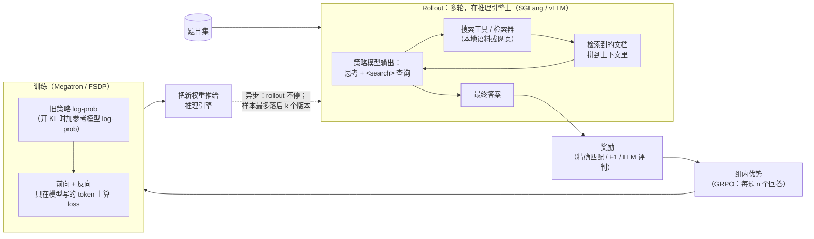

# AI-Search-Plugin

[English](README.md) | 中文

一组即插即用的组件，让 **搜索智能体的 RL 后训练**（AI 搜索 / 深度研究）在 slime 和 verl 上跑得更快、更稳。

> 早期版本，供审阅。下面的提速数字是用本包移植前的原始实现测的。部分组件还是空壳（stub），本仓库测试只在 CPU 上跑。每次实验的细节见 [EXPERIMENTS.md](EXPERIMENTS.md)。

在 5 个任务上对比各框架的最快配置：4 个快 1.17–1.56×，1 个打平，见[第 4 节](#4-效果快了多少时间花在哪)。

---

## 1. 什么是 AI 搜索后训练？

模型先思考，再搜索、读结果，反复几轮后给出答案。RL 教它什么时候搜、搜什么。奖励只看最终答案对不对。



一条训练样本：

```text
[ 系统提示 + 题目 ][ 思考 + 查询 ][ 检索文档 ][ 思考 + 查询 ][ 检索文档 ] ... [ 答案 ]
  不进 loss          进 loss        不进 loss     进 loss        不进 loss         进 loss
```

只有模型写的 token 进 loss，但所有 token 都要过每一层。

---

## 2. AI 搜属于哪类训练，会遇到哪些难题

AI 搜属于"多轮调工具"的 RL 训练，和代码智能体、多轮游戏是一类：模型写一段 → 调工具 → 工具结果拼回上下文 → 再写，直到给出答案。这类训练的难点大体相同，只是在不同任务里轻重不一样。

下面是工业里可能遇到的难题场景。我们为每个场景做了合成版本，用来检查各组件该在哪里起作用；只有 *f1*（Qwen3-Next 那次）报了数字（见第 4 节）。

| | 场景 | 难在哪 |
|---|---|---|
| a | 只问一轮，但题目特别长 | 几乎都不进 loss，却每一层都要算 |
| b | 多轮搜索，来回搜好几次 | 请求又多又碎；权重一更新，旧缓存就不能用了 |
| c | 少数几条特别慢，拖住整批（题和题快慢不一、个别慢得离谱、回答长短两极分化） | 每步都得等最后一条，其他卡闲着；靠丢样本控制新旧的框架会把慢的丢掉 |
| d | 一条轨迹超长，十万词以上 | 显存容易爆；读入很慢 |
| e | 难题和简单题混着来，比例还在变 | 题变难时数据供不上，变简单时训练跟不上 |
| f | 搜索服务不稳：时快时慢、超时、出错 | 搜索慢一次，整条轨迹就慢；重试越堆越多 |
| g | 好几种工具混着用：搜索、打开网页、跑代码 | 网页内容很长；跑代码要排队；代码结果没法复用 |
| h | 并发特别大，同时跑几千条 | 发请求那一侧先忙不过来，GPU 反而闲着 |
| i | 训练中途有机器挂了 | 跑了一半的白跑，重启又慢 |
| j | MoE 模型里有几个专家特别忙 | 最忙的那张卡决定整体速度 |
| k | 训练卡和推理卡的配比不一样 | 最优配比会变；推理卡越多，同步权重越贵 |
| l | 每道题让模型答更多遍，比如 16 遍 | 一组要等最慢的那遍；同样的开头重复算 |
| m | 长的单轮题和多轮题混在一起 | 每份数据长短不均；读入和生成互相干扰 |
| n | 打分很慢，比如要用另一个大模型来判 | 打分时间直接加到每一步上 |

多轮调工具的训练还要注意两点：轮与轮之间要传 **token ID**（重新分词会把训练搞坏）；工具返回的 token 要从 loss 里 mask 掉。

---

## 3. 组件

★ = 默认组合里开着，其余要手动打开。"实测效果"是从全套里去掉这个组件后慢了多少：× 大于 1 或 + 表示有用，✓ = 统计上显著。逐项的详细数字、开关，以及对手改自己的配置能不能拿到，见 [docs/COMPONENTS.md](docs/COMPONENTS.md)。

| 解决什么 | 组件 | 干什么 | 实测效果 |
|---|---|---|---|
| **少等数据** | `ticket_admission` ★（slime）、`verl_ceiling` ★（verl） | 限制样本最多旧几步，但不靠压低并发；慢的组挪到后面的批次（DEFER） | DEFER：ASearcher ×1.333 ✓。ticket 本身在 Qwen3-Next 上反而慢 2.3% |
| | `pool_fill` ★ | 在途请求始终补满每个推理引擎 | 没单独测 |
| | `prefetch` ★ | 同步权重的同时，把下一批数据先取好 | Search-R1 ×1.033 ✓；Qwen3-Next +13.5% ✓ |
| | `rshard` ★ | 把发请求的 rollout 客户端拆到多个进程 | ASearcher ×1.051，不显著 |
| **搜索更快** | `toolcache` ★ + `tool_hedge` ★ | 同样的搜索只发一次；搜得慢就补发一份 | ASearcher ×1.079，不显著 |
| **少算** | `response_logits` ★ | 只在模型自己写的部分算最后一层输出 | Search-R1 ×1.116 ✓；ASearcher ×1.090 ✓ |
| | `prefix_tree` | 同一道题的几个回答，开头只算一次 | 不在测速配置里 |
| **权重同步** | `sampler_nosync` ★ + 引擎侧快速加载 | 去掉推理引擎每步一次的等待；更快加载新权重 | ASearcher ×1.116 ✓；Libra ×1.151 ✓ |
| | `weight_sync` ★（+ `verl_inplace` ★） | 更快把新权重推给推理引擎 | 都不显著（约 1%） |
| | `kvepoch` / `kvfresh` / `verl_kvfresh` | 权重更新后不再用旧权重算的缓存，保证结果对 | 开销不显著 |
| **MoE 专用** | `expert_placement` | 专家忙闲不均时，把忙的专家挪到闲的卡上 | Qwen3-Next +2.7% ✓ |
| | `r3_ep_plan` | 训练前一次排好整步的 MoE 通信，每层不再停下来同步 | 不在测速配置里 |
| | `hybridep_overlap` | MoE 发数据和计算分两块同时进行（和上一个不能同开） | 不在测速配置里 |
| | `r3_transfer` ★ | 路由回放数据压缩后再传 | 和 prefetch 一起测（见上） |
| | `r3pack` | 拼微批时平衡各专家的负载 | Qwen3-Next 上没触发 |
| | `jitfix` ★ | 防止 torch.compile 因长度变化反复重编译 | 没单独测 |
| **其他** | `jitcache` | 跨次运行保留编译结果，省掉第一步的编译时间 | 没单独测 |

`weight_sync` 里的直连 HTTP 路径（`ws direct`）默认关闭：在 80B 模型上偶发卡死（每 60 次同步 1 次），根因未确认。

还有 5 个组件只登记了名字、还没有代码（MTP 投机解码、DSA 选块回放、3 个 GDN 相关），见 [docs/PORTING.md](docs/PORTING.md)。

---


## 4. 效果：快了多少、时间花在哪

三个开源小模型（Search-R1、ASearcher、Libra）和一个大模型（Qwen3-Next 80B）。

### 4.1 快了多少

**提速比 = 基线 ÷ 我们**，单位是每百万训练 token 的秒数（s/Mtok）。

- 两边在同一节点、正反两种顺序都跑。95% 置信区间用 bootstrap 算。
- 两边都做健康检查：熵、训推 log-prob 差、起始奖励、实际训练 token 数、陈旧度 ≤ 2。
- 每一行都经过独立复核。
- 基线 = 该框架在陈旧度 ≤ 2 内我们能找到的最快配置。

| 任务 | 基线 | 对数 | 提速比 [95% CI] | 说明 |
|---|---|---|---|---|
| Search-R1 · Qwen2.5-7B · 1 台 B300 | slime（5 张训练卡 + 3 张推理卡） | 2 | **1.170×** [1.164, 1.177] | 健康检查全过。主要来自 response logits（×1.116）和 prefetch（×1.033），约 1.5% 未归因。 |
| Search-R1 · Qwen2.5-7B · 1 台 B300 | verl，同卡异步，off-policy 上限 3 | 8 | **1.002×** [0.984, 1.021]，打平 | 每步慢 4.6%，但每步多训 6.8% 的 loss token。两项检查没过：这个 token 数，以及前 3 步奖励（卡在阈值上）。基线可能丢了超龄样本（未证实）。`toolcache` 没生效。 |
| ASearcher · Qwen2.5-7B · 1 台 B300 | verl 最优配置（同卡异步，off-policy 上限 3） | 4 | **1.167×** [1.131, 1.208] | verl 可能略超陈旧度 2（上界估计：0.002–0.16% 的轨迹到 3），这对 verl 有利。对开了 `--use-distributed-post` 的 slime：1.299×（仅供参考）。 |
| Libra · Qwen3-14B · 1 台 B200 | slime 最优配置 + 我们的 ticket 准入（不加的话 slime 要降到并发 8 才能守住陈旧度 2） | 6 | **1.219×** [1.133, 1.310] | 不含 ticket 准入的收益。收益来自组合，单个组件大多在噪声内。 |
| Qwen3-Next 80B-A3B · 4 台 B300 | verl 最优配置（分离式异步，off-policy 上限 3，partial rollout，路由回放） | 4 | **1.560×** [1.389, 1.719] | 见下方说明。 |

**Qwen3-Next 的说明**
1. 只测了一个场景，搜索工具是模拟的（*f1*：延迟抖动、超时、报错），奖励只看趋势。缩小版布局：2 台训练 + 2 台推理，64 题 × 每题 8 个回答。
2. 测速时 `ws direct` 开着。后来因为偶发卡死（每 60 次同步 1 次；verl 也每 63 次卡 1 次，原因不明）默认关掉了。没有重测；整个权重同步组件组约 1%（不显著）。
3. 测速时 ticket 准入开着。在这个场景关掉它快约 2.3%，所以 1.560× 偏保守。
4. 我们的样本几乎都在陈旧度 2，verl 约 99.6% 在陈旧度 1（都在上限内）。部分收益可能来自这一点，没有单独测。
5. 消融里只有 prefetch（+13.5%）和专家重排（+2.7%）显著，其余没有归因。4.2、4.3 的分阶段数字不要和消融相加减。
6. verl 做了三处本地修补（没推上游），log-prob 差才从 0.210 降到 0.016–0.021：换新版 SGLang、加适配层、恢复 GDN output-norm 原始权重。两边用的是同一个 SGLang。

### 4.2 时间花在哪

每个对比里各段占每步时间的比例。"整步"的单位：小模型是 s/Mtok（已复核），Qwen3-Next 是 s/步（未复核）；"等数据"都已扣掉同步：

| 对比 | 哪边 | 训练 | 等数据 | 同步 | 其他 | 整步 |
|---|---|---|---|---|---|---|
| Search-R1 对 slime | 基线 | 86% | 14% | 0% | 0% | 18.31 |
| | 我们 | 89% | 10% | 1% | 0% | 15.64 |
| Search-R1 对 verl（PPO，训练含 critic） | 基线 | 66% | 17% | 14% | 3% | 47.96 |
| | 我们 | 64% | 19% | 14% | 3% | 47.87 |
| ASearcher 对 verl | 基线 | 73% | 22% | 4% | 1% | 16.52 |
| | 我们 | 88% | 12% | 1% | 0% | 14.36 |
| ASearcher 对 slime（参考） | 基线 | 71% | 29% | 0% | 0% | 18.97 |
| | 我们 | 86% | 13% | 0% | 0% | 14.70 |
| Libra 对 slime | 基线 | 66% | 33% | 2% | 0% | 45.81 |
| | 我们 | 76% | 21% | 3% | 0% | 37.50 |
| Qwen3-Next 对 verl | 基线 | 60% | 29% | 11% | 0% | 352.96 |
| | 我们 | 74% | 23% | 3% | 0% | 227.85 |

### 4.3 小模型和大模型分别卡在哪

| | 小 dense 模型（Search-R1、ASearcher：Qwen2.5-7B；Libra：Qwen3-14B；单节点） | 大 MoE 模型（Qwen3-Next 80B-A3B；4 节点） |
|---|---|---|
| **时间大头在哪** | **训练**：基线占每步 66–86%，我们占 64–89%。等数据约占 10–33% | **训练**：我们占 74%（168.70 / 227.85 s/步），verl 占 60%（211.33 / 352.96） |
| **我们快在哪** | **主要省在等数据**：ASearcher（对 slime）差距的 81%、Libra 的 83% 在等数据。例外是 Search-R1·slime：基线等数据本来就少，65% 省在训练（只在回答 token 上算 logits）。对 verl：ASearcher 省在生成和同步，训练段我们反而略慢；Search-R1 训练省的被生成多花的抵消，打平 | **两边都省**：训练少 43 s/步，等数据少 44 s/步（我们的等数据里含 6.9 s 同步；扣掉同步约少 51 s）；verl 的同步 37.5 s 单独加在步上，我们的同步包含在等数据时间内、不另加到步上 |
| **等数据为什么慢** | slime 用一个进程发所有请求，CPU 忙不过来：客户端调用 p50 1.005 s，检索服务只要 0.036 s（ASearcher，未复核）。搜回来的内容占总 token 约 52%（Search-R1）到 70–83%（ASearcher） | verl 的生成时间波动大：短步 0–13 s，长步 194–236 s；同步和训练串行（未复核） |
| **什么组件有用（已复核）** | 等数据：慢组延后 DEFER ×1.333（ASearcher）、引擎钩子 ×1.12–1.15（ASearcher、Libra）、prefetch ×1.033（Search-R1）。训练：response logits ×1.09–1.12（Search-R1、ASearcher）。权重同步改动没效果 | prefetch +13.51%（去掉后每步多等约 30 s）；专家重排 +2.70%（训练每步省约 4 s） |
| **基线改配置能拿到吗** | 部分能：slime 开自带的 `--use-distributed-post`，等数据约减半（未复核）；两边都开后，我们拆进程（`rshard`）只多 ×1.051，不显著 | 拿不到：verl 的 Megatron 路径没有专家负载均衡 |
| **没测的** | 读入和生成各占多少；多节点规模 | 读入和生成各占多少；prefetch 省的约 30 s 具体在哪；稀疏注意力（DSA）模型；真实检索 |

### 4.4 另外两点观察

只在这几个任务上成立：
- **陈旧度准入只在单纯限并发守不住上限时有用**：Libra、ASearcher 需要；Search-R1 上没影响（×0.996）；Qwen3-Next 上反而慢 2.32%。
- **同步快了不一定有用**：Qwen3-Next 上关掉引擎钩子，同步时间翻倍，整步没变，因为同步和等数据重叠（未复核）。

---

## 安装

```bash
pip install .                 # 或：pip install -e ".[test]"（无硬性运行时依赖）
ai-search-plugin list         # 组件、默认值、状态
ai-search-plugin plan verl default max_staleness=2   # 打印会设置的环境变量 / 参数
```

装到框架所在的环境里，保证每个 Ray worker 都能 import。torch、slime、verl、SGLang、Megatron 都是延迟导入。

```python
import ai_search_plugin as asp
plan = asp.install(framework="slime", components="default", options={"max_staleness": 2})
print(plan.shell())   # 环境变量 + 框架参数
```

启动示例（仅示意，测试中没跑）：
- [examples/slime/](examples/slime/)：slime 需用全异步 rollout 模式；训练端用 `python -m ai_search_plugin.adapters.slime_train` 启动，`prefetch` 才能工作。
- [examples/verl/](examples/verl/)：使用 `VERL_USE_EXTERNAL_MODULES`；`response_logits` 需要 Megatron 引擎。

**测了：** `pytest tests/` 在只有 CPU、没装任何框架的机器上跑，覆盖注册表、CLI、钩子和各已移植组件的 CPU 逻辑。244 个通过，2 个跳过（需通过 `SLIME_SRC` 提供 slime 源码）。

**没测：** 真实 slime/verl 运行、SGLang 引擎补丁、NCCL 权重传输、`rshard` 的 Ray 集成、`tests/gpu/` 里的 `response_logits` GPU 测试，以及新搬进来的 4 个组件（`prefix_tree`、`expert_placement`、`r3_ep_plan`、`hybridep_overlap`）的 GPU 部分。详见 [docs/COMPONENTS.md](docs/COMPONENTS.md#what-is-tested-here-cpu-only-no-gpu-no-framework-installed)。
