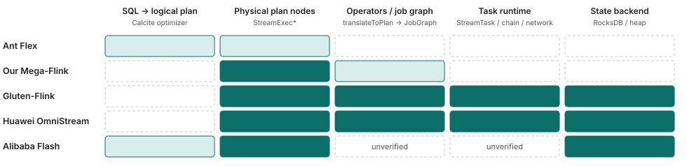
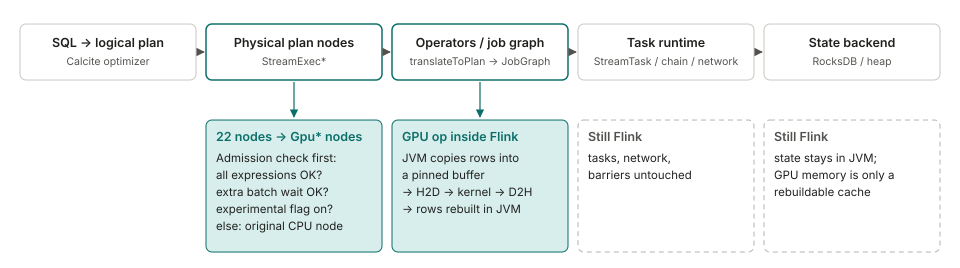
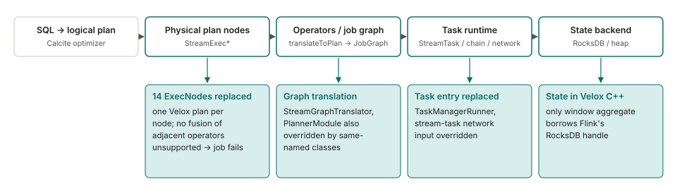
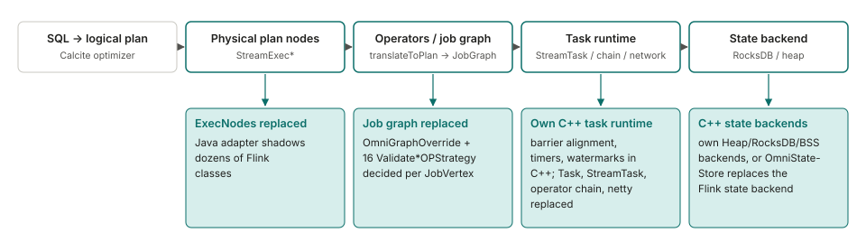
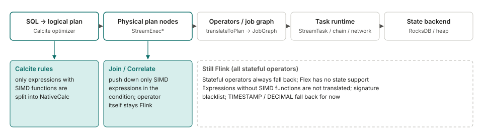
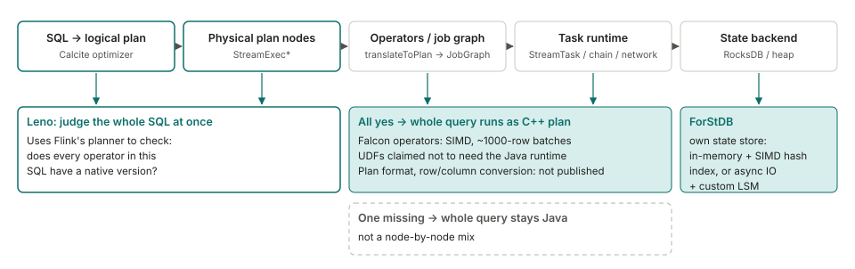

<!--
SPDX-FileCopyrightText: Copyright (c) 2026 NVIDIA CORPORATION & AFFILIATES. All rights reserved.
SPDX-License-Identifier: Apache-2.0
-->

# Feature-Extractor-Plugin: streaming (Flink)

English | [中文](README.zh-CN.md)

This is the streaming (Flink) part of Feature-Extractor-Plugin. **Status: the plugin code and the benchmark driver scripts are not in this directory yet.** What is here is the analysis that decides the design: a comparison with existing work, where Flink jobs spend their time, when a GPU helps, the planned components, and the benchmark cases and results.

1. [How this compares with known work](#part-1-how-this-compares-with-known-work)
2. [Where Flink jobs usually spend their time](#part-2-where-flink-jobs-usually-spend-their-time)
3. [Design approach: when to use CPU, when to use GPU](#part-3-design-approach-when-to-use-cpu-when-to-use-gpu)
4. [Components](#part-4-components)
5. [Performance test cases and links](#part-5-performance-test-cases-and-links) ([results](benchmarks/README.md))

## Part 1: How this compares with known work

Several projects replace part of Flink's execution with a faster engine. This part compares how five of them hook
into Flink: which stages of the pipeline they replace, what happens when something is not supported, where data and
state live. It is based on each project's public code, documentation and blog posts, read in November 2026. Where a
detail could not be confirmed it is marked **unverified**. Performance numbers are each project's own and use
different workloads and baselines, so they are not compared here.

### 1.1 Three angles for comparing how they hook into Flink

The five projects differ along three independent angles: **depth** (how far down Flink's pipeline they replace things), **unit** (how big a piece one "can this run natively?" decision looks at: an expression, a node, a block of consecutive nodes, or the whole query) and **timing** (when the decision is made).

| Project | Depth | Unit of each decision | When decided | When something is unsupported |
|---|---|---|---|---|
| Ant Flex | Planning only: expressions (and the conditions of join/correlate nodes) | Expression | Planning | Falls back to Flink, down to single expressions |
| Mega-Flink (ours) | Physical plan nodes; the GPU operator runs inside Flink's own tasks | Node | Planning (at run time it only switches paths inside an operator already chosen) | Per node, back to the CPU node |
| Gluten-Flink | Nodes, graph translation, task entry, state | Node | Planning | Calc-type nodes fail the job; source/sink fall back |
| StreamFusion | Nodes, its own operators, state in Rust | A block of consecutive columnar nodes | Planning (after Flink's optimizer) | The block falls back to Flink (an early design note says per operator; unverified) |
| Huawei OmniStream | Nodes (description only), job graph, task runtime, network, state | Operator chain (`JobVertex`) | Job-graph generation (the native operators are created when the task starts) | Per chain; for SQL jobs one non-forward edge sends the whole job back |
| Alibaba Flash | Execution plan and state (ForStDB); other details unverified | Whole SQL (the blog also mentions operator-level fallback, not reconciled) | Planning | Whole query runs on the Java plan |

The angles are independent: Gluten-Flink and OmniStream both decide per node-sized unit but OmniStream goes much deeper; Flex has the smallest unit and the shallowest depth. We found the authors stating reasons for only a few of these choices: StreamFusion's design notes give "avoid conversions inside the island" and a measurement that a single native operator can lose to Flink (0.58x and 0.81x) for its whole-block rule; Alibaba gives slow disk state access as the reason for its own state store; the Flex talk says stateful operators are not supported by Velox yet, so they fall back. We found no statement relating unit, timing and state placement to each other, so this page compares positions and does not explain them.

### 1.2 Which stages each project replaces

The columns are the stages a Flink SQL job goes through. The further right a project reaches, the more of Flink's own
runtime it takes over. Flex only touches expressions during planning; Mega-Flink replaces physical nodes; Gluten-Flink
and OmniStream go on to task execution and state.

**None of them uses an official extension point.** In Flink's source, `PlannerFactory`, `ExecNode` and
`ExecNodeMetadata` are annotated `@Internal`, and [FLIP-32](https://cwiki.apache.org/confluence/spaces/FLINK/pages/103088143/FLIP-32+Restructure+flink-table+for+future+contributions)
only makes the whole planner replaceable, not single operators. We found no proposal for operator-level replacement in
the dev mailing list or JIRA. Not checked: whether custom rules can be injected through `CalciteConfig` / `Programs`,
and whether a `CompiledPlan` can carry a custom `ExecNode`. Spark, by contrast, has
[`SparkSessionExtensions`](https://spark.apache.org/docs/latest/api/scala/org/apache/spark/sql/SparkSessionExtensions.html)
(marked experimental), which is how spark-rapids plugs in.

### 1.3 Mega-Flink (GPU)

| | |
|---|---|
| When something is unsupported | Falls back per node: if a node fails the admission check, the original CPU node is used. Default mode is `cpu-row`; `gpu-native` must be set explicitly |
| Data conversion | The JVM copies rows into a pinned buffer, then H2D, kernel, D2H, and rows are rebuilt in the JVM. Fusion and host-pack options that reduce conversions are mostly off by default |
| State | Stays in Flink and is the source of truth for checkpoints; GPU memory is only a rebuildable cache |
| Open source / version | Apache-2.0; Flink 2.2.1 only; the installer patches the planner jar embedded in `flink-table-planner-loader`; positioned as a research plugin on H20 |

Source: [Mega-Flink](https://github.com/cb521/Mega-Flink), docs and code.

### 1.4 Gluten-Flink (CPU, Velox)

| | |
|---|---|
| When something is unsupported | Calc, aggregate, rank and similar nodes: an unsupported function or shape raises an exception during planning and the job fails. Source/Sink nodes with no matching factory fall back to Flink's original transformation; SEMI/ANTI joins and mini-batch cases keep Flink's operators |
| Data conversion | None between adjacent native operators. On the Java input path each record is converted on arrival, one vector per row, with no batching (checked in code) |
| State | On the native side. Only the two window-aggregate nodes pass RocksDB handles to native code; for other operators native state initialisation and restore under RocksDB was not found. The native snapshot returned at checkpoint is discarded. Tests only check that a job runs, not results, and there is no checkpoint-restore test. Open issues include a memory-pool leak with RocksDB (#11791) |
| Open source / version | Apache-2.0; experimental; Flink 1.19.3 only; its own `PlannerModule` puts the planner jar first; three classes at client/TaskManager level (`StreamGraphTranslator`, `TaskManagerRunner`, `AbstractStreamTaskNetworkInput`) are overridden by the user editing `config.sh` |

Source: [apache/gluten, `gluten-flink`](https://github.com/apache/gluten/tree/main/gluten-flink) code, README and issues.
The README reports Nexmark q0 at 161 s versus 462 s for Flink; a community comment reports the opposite direction for
q0 (8 min versus 4 min). Neither states full test conditions.

### 1.5 Huawei OmniStream (CPU, Kunpeng)

| | |
|---|---|
| When something is unsupported | Decided per operator chain (`JobVertex`), statically when the job graph is generated. For SQL jobs, if any edge is not a forward edge the whole job falls back; DataStream jobs are not subject to this. The flag is a static in the JobManager that is only ever set to false, so in a session cluster it can affect later jobs |
| Data conversion | Native tasks pass `VectorBatch` pointers; no serialization on the same TaskManager, a custom columnar format across TaskManagers. Java to native: each row is copied and batches form at 1000 rows or 1 s. Native to Java: a heap-allocated row per record, the most expensive point |
| State | Two paths: its own C++ backends, or OmniStateStore, a separate state backend that replaces Flink's. No batched state access API was found |
| Open source / version | MulanPSL-2.0 (Java adapter: Apache-2.0); Flink 1.16.3; aarch64 Kunpeng with openEuler only; Join supports Inner only, and by default only Calc and a few others are enabled |

Source: [OmniStream](https://gitcode.com/openeuler/OmniStream) and its documentation.

### 1.6 Ant Group Flex (CPU, Velox)

| | |
|---|---|
| When something is unsupported | Per expression and per node, with fine-grained configuration |
| Data conversion | Based on Arrow. Conversion cost was close to 11%; after splitting a Calc so that only the columns used by expressions are converted, it dropped to 6.68% (for one kind of job with many pass-through long fields) |
| State | Not supported yet; stateful operators fall back to Flink. The stated reason is that Velox does not support stateful operators or retraction messages; they are on the roadmap, so this is a current limit, not a deliberate design choice |
| Open source / version | No public code. Numbers reported for production: among jobs suited to vectorization, average +75%, best 14x |

Source: a conference talk (FFA 2024) as reproduced on
[CSDN](https://blog.csdn.net/DB_GPT/article/details/144718528) and
[Zhihu](https://zhuanlan.zhihu.com/p/1916129445640648620). Other figures quoted for Flex on third-party summary pages
(number of jobs, cores saved) could not be traced to an original source and are omitted.

### 1.7 Alibaba Flash (CPU, commercial)

| | |
|---|---|
| When something is unsupported | Judged for the whole SQL: if any operator has no native version, the whole query runs on the Java plan. The blog also mentions operator-level fallback in another sentence and does not reconcile the two, and it gives no reason for the whole-SQL rule |
| Data conversion | Processes batches with SIMD; where row/column conversion happens is not described |
| State | Its own ForStDB. The stated reason: spilling state to disk is hundreds to thousands of times slower than memory and would cancel the vectorization gain. No job-level numbers given |
| Open source / version | Closed commercial product. The open-source [ForSt](https://github.com/ververica/ForSt) state backend in Flink 2.0 is a separate project |

Source: [Alibaba Cloud blog](https://www.alibabacloud.com/blog/flash-a-next-gen-vectorized-stream-processing-engine-compatible-with-apache-flink_602088).
The format of the C++ plan and DataStream support are **unverified**.

### 1.8 Not drawn

- **ByteDance Bolt**: the Flink part is not open source yet (see the
  [discussion](https://github.com/bytedance/bolt/discussions/20)). Two designs are described: one changes
  `StreamGraphTranslator` and merges adjacent pushable operators into one native plan; the other keeps the DAG and maps
  each Flink operator to a Bolt operator. Which one is implemented is **unverified**.
- **Ververica VERA-X**: closed commercial product; the [announcement](https://www.ververica.com/blog/vera-x-introducing-the-first-native-vectorized-apache-flink-engine)
  does not describe how it hooks in.
- **StreamFusion** (Rust / DataFusion, Apache-2.0): only read at summary level, so not drawn.

No other project running Flink SQL streaming operators on a GPU was found. Flink's own GPU work is at the resource and
inference level (for example [FLIP-592](https://cwiki.apache.org/confluence/display/FLINK/FLIP-592%3A+First-Class+Accelerator+Resource+Support)).

### 1.9 What we take from this

This is our reading; it has not been tested.

- State separates the projects. Alibaba, Huawei and Gluten-Flink move state to the native side, Flex leaves stateful
  operators alone, and Mega-Flink keeps state in the JVM. In our own measurements, state reads and writes were 43% to
  52% of the time in an interval join, and a GPU kernel cannot take that part over.
- Flex replaces only expressions and, for now, leaves stateful operators on Flink. It is the narrowest of the approaches
  here; we did not find the authors describing this as a risk trade-off.
- We found no project that exposes accelerated operators as a library the user calls explicitly instead of replacing
  Flink internals. Whether that is better has no evidence either way.

### 1.10 Limits of this comparison

The Ant Group talk was read through reproductions, not the original; Huawei's documentation site was not reachable and
the repository's own docs were read instead; the Flash and VERA-X pages were read as summaries. We did not build or run
any of these projects. For Mega-Flink we diffed the 22 replaced `StreamExec*` classes against Flink 2.2.1 line by
line: the changes are mostly additions (GPU admission, compilation, fusion, operator construction) and most classes
change fewer than 70 original lines; the diff was not analysed for semantics.

## Part 2: Where Flink jobs usually spend their time

This part lists the bottleneck classes that public reports describe, what is usually done about each, and whether our own measurements agree.

How to read the numbers:
- **Public numbers** belong to one company and one scenario each. They are quoted as published and must not be read as general percentages. "Vendor" means the vendor measured its own product.
- **Our numbers** are from this repository's benchmarks ("this repo's measurements, see benchmarks"): public KuaiRand data, one NVIDIA L20, Flink 2.2.1, mostly parallelism 1, in-process replay (no Kafka), heap state backend. Throughput comparisons use `pipeline.object-reuse=true` on both CPU and GPU sides. The time breakdowns in the table at the end were taken earlier with Flink defaults (object-reuse off), and they are JFR sampling estimates.
- "Not measured" means we did not test it. We do not claim anything about it.

### 2.1 Serialization and copying between operators
- **Where time goes**: Kryo/POJO serialization, deep copy of each record between operators, encode/decode around exchanges.
- **Public**:
  - Flink blog (micro-benchmark): POJO falling back to Kryo costs 75%; nested Tuple instead of POJO is 42% faster. https://flink.apache.org/2020/04/15/flink-serialization-tuning-vol.-1-choosing-your-serializer-if-you-can/
  - Shopify: fixing serialization problems (Kryo fallback among them) gave +20% throughput. https://shopify.engineering/optimizing-apache-flink-applications-tips
  - Iron Vector benchmark (vendor, one Kafka-Avro-to-SQL-to-blackhole pipeline): enabling object reuse alone raised native Flink throughput by 35% to 40%. https://docs.google.com/document/d/1ledkVUcWSlx5l4yLaK9nmdIoOPMpUd_1GbjBezbNMPs
  - FLINK-30536 (micro-benchmark): removing a per-record wrapper gave +12.2%. https://issues.apache.org/jira/browse/FLINK-30536
- **Ours** (KuaiRand, L20, parallelism 1, c1 simple filter, saturated input): object-reuse off to on, CPU 0.84M to 2.47M rows/s, GPU 1.03M to 2.06M rows/s. Serialization/exchange is 29% of sampled time on both sides in c1 (table below). This repo's measurements, see benchmarks.
- **Usual fixes**: POJO/Tuple/Row instead of Kryo, object reuse, operator chaining, column pruning.
- **Consistent?** Same direction. Our gain (about 3x on a trivial filter) is much larger than the single public end-to-end figure (+35% to 40%); do not extrapolate either one.

### 2.2 State access
- **Where time goes**: with RocksDB, per-access serialization, seek, compaction and disk I/O; with heap state, hash lookups and object access.
- **Public** (almost all RocksDB, large state):
  - ByteDance/Douyin recommendation, feature computation moved onto Flink State: CPU 40% to 80% higher than the old in-memory/abase version; after optimization mostly serialization. A state cache then cut CPU by about 50% in most scenarios. Largest job state 60 TB. https://developer.aliyun.com/article/796471
  - Zalando ad events: Interval Join spent 15% to 30% of CPU on seek (RocksDB). https://engineering.zalando.com/posts/2026/07/migrating-ad-event-processing-to-flink.html
  - Taobao (Alibaba Cloud blog): Delta Join removed 50 TB of join state, 80%+ CPU and memory saved. https://www.alibabacloud.com/blog/the-delta-join-in-apache-flink-architectural-decoupling-for-hyper-scale-stream-processing_602645
  - Alibaba GeminiStateBackend (vendor docs): on Nexmark cases that are state-bound, 5 of 8 listed cases were more than 70% faster than RocksDB (range 29.77% to 237.30%). https://help.aliyun.com/zh/flink/user-guide/geministatebackend
  - Shopify: moving 8 TB of RocksDB state from network disk to local SSD gave about 10x processing rate. https://shopify.engineering/optimizing-apache-flink-applications-tips
- **Ours** (heap state, parallelism 1, JFR estimate): Interval Join c5 state 52% (CPU) and 43% (GPU) of sampled time; join + aggregate 32% / 40%; window aggregate c2 14% (CPU); keep-last dedup c4 14% / 17%. In the GPU runs the state stayed in the JVM, which is why those cases show little or no GPU gain. This repo's measurements, see benchmarks.
- **Usual fixes**: cache hot keys, key-value separation, other state backends, rewriting a join as a lookup, TTL, mini-batch.
- **Consistent?** Same direction (state is large). Cost structure differs: public cases are RocksDB, ours is heap, so the ByteDance remark "mostly serialization" does not explain our numbers.

### 2.3 Source, sink and format parsing
- **Where time goes**: JSON/Avro/PB deserialization, connector threads, external writes.
- **Public**:
  - ByteDance/Douyin: pruning the PB schema of Kafka sources so unused fields are skipped saved about 30% CPU in most jobs (CPU saving, not a share of run time). https://developer.aliyun.com/article/796471
  - IBM (single core, parallelism 1): 1,340 to 44,320 events/s across all job variants of one test (logic, state backend, format, batch size); Avro jobs were almost always faster than JSON. The author warns it is not a generic report. https://dalelane.co.uk/blog/?p=6001
  - Iron Vector benchmark (vendor, mainly Avro source decoding): 274 to 528 MiB/s (+93%), reached only after tuning Kafka consumer fetch settings; the first run was 23% slower because Kafka fetching limited it. https://docs.google.com/document/d/1ledkVUcWSlx5l4yLaK9nmdIoOPMpUd_1GbjBezbNMPs
- **Ours**: local replay of int64 columns, no Kafka, no text parsing. Source thread is 15% (CPU) and 18% (GPU) of sampled time in c1 and 10% (GPU side) in c3. Kafka and real formats not measured. This repo's measurements, see benchmarks.
- **Usual fixes**: binary formats, pruning unused columns or fields, connector isolation and parallelism, batched sink writes, consumer fetch tuning.
- **Consistent?** Partly. The source is a visible share in ours, but our source is far lighter than real Kafka plus JSON/PB decoding, so it understates this class. We found no public "source/sink is X% of run time" figure.

### 2.4 Row/column conversion (and the extra H2D/D2H on a GPU)
- **Where time goes**: converting Flink's row format (RowData) to the columnar format a vectorized or GPU engine needs, and back. On a GPU there are also host-to-device and device-to-host copies.
- **Public** (no public Flink-on-GPU figure found):
  - Ant Flex (Flink + Velox, CPU vectorized): converting all schema fields cost nearly 11%; converting only the fields the expression uses brought it to 6.68%. Other details of the job mix: not verified. https://segmentfault.com/a/1190000046642882
  - Gluten-Flink issue: "two row-column conversions per batch", no number. https://github.com/apache/gluten/issues/12426
  - Source-code reading only, no measurements: in Gluten-Flink the row path builds a one-row vector per record; in OmniStream the native-to-Java path allocates a new row object per record.
- **Ours** (c1 filter, saturated, Flink-defaults run, GPU-side timers): of five timed GPU steps (499 ms total), row-to-column 254 ms, host-to-device 20, kernel 25, device-to-host 14, column-to-row 186. Row/column conversion is 88% of those five, kernel 5%. Not counted in those five: JVM-side processing and collect, 1,725 and 1,096 ms. nsys agrees on kernel and copy time within about 10%. c5 Interval Join GPU: column-to-row 843 ms of 1,107 ms timed. This repo's measurements, see benchmarks.
- **Usual fixes**: stay columnar end to end, enter and leave the device rarely, convert only the columns used, batch.
- **Consistent?** Direction yes. Ant's 11% is a CPU engine and much lower than our share; we have not verified why, so Ant's figure does not support ours. This cost belongs to GPU offload, not to Flink in general.

### 2.5 Data skew
- **Where time goes**: a few subtasks are saturated while others idle; upstream backs up.
- **Public**: Rippling (CDC pipeline): 60% of load on 2 subtasks; fixing it gave +38% throughput, run time 17 h to 12.4 h. https://www.rippling.com/blog/eliminating-data-skew-in-flink . JD: sending to the least-loaded downstream channel gave nearly 2x in specific scenarios. https://cloud.tencent.com/developer/news/738891
- **Ours**: not measured (parallelism 1 cannot show skew).
- **Usual fixes**: two-phase aggregation, key salting, load-aware routing.
- **Consistent?** No data of our own.

### 2.6 Checkpoint and recovery
- **Where time goes**: uploading state, barrier alignment, metadata serialization, restoring large state.
- **Public**: Netflix (200-node test cluster): a 21 TB savepoint took 27 minutes; fixing S3 HEAD requests cut checkpoint duration 10x. https://www.slideshare.net/StevenWu5/scaling-flink-in-cloud-94274600 . Flink changelog test: p99.9 checkpoint 10 s to 1 s, recovery time +66% to +225%, throughput unchanged. https://flink.apache.org/2022/05/30/improving-speed-and-stability-of-checkpointing-with-generic-log-based-incremental-checkpoints/ . Alibaba VLDB'25 (vs Flink 1.20): up to 94% shorter checkpoints, up to 49x faster recovery. https://www.vldb.org/pvldb/vol18/p4846-mei.pdf
- **Ours**: not measured.
- **Usual fixes**: incremental checkpoints, changelog, unaligned checkpoints with buffer debloating, disaggregated state (ForSt).
- **Consistent?** No data of our own. Public evidence is mostly about stability, tail latency and recovery, less about steady throughput.

### 2.7 Network and backpressure
- **Where time goes**: cross-machine transfer, serialization, buffer queueing.
- **Public**: Pinterest: better task placement cut cross-host traffic by 70%+ and job cost by about 75% (cost not all from network). https://www.slideshare.net/slideshow/tuning-flink-clusters-for-stability-and-efficiency/266280602 . Alibaba, batch TPC-DS 10 TB (not streaming): one source task sent 1.03 TB to the network and 16.5 GB remained after the join filter. https://www.alibabacloud.com/blog/flink-how-to-optimize-sql-performance-using-multiple-input-operators_597839
- **Ours**: single machine, parallelism 1 (and 2, 4 for some cases); exchange is counted inside "serialization/exchange" (12% to 34% of sampled time across cases). No cross-machine network test.
- **Usual fixes**: chain operators or multiple-input to drop shuffles, task placement, credit-based flow control, buffer debloating.
- **Consistent?** Partly (exchange cost visible locally; real network not tested). No public streaming "shuffle is X%" figure found.

### 2.8 Garbage collection
- **Where time goes**: full GC with large heap state; pauses cause heartbeat timeouts and backpressure.
- **Public**: only thresholds and qualitative statements. Tencent Cloud treats full GC above 30% of a 5-minute window as severe (an alert threshold, not a measurement). https://www.tencentcloud.com/document/product/1000/56810 . ByteDance: GC pauses grow with heap state size. https://juejin.cn/post/7146142717934829605 . No credible quantified case found.
- **Ours**: not measured separately (16 GB heap, G1).
- **Usual fixes**: RocksDB or off-heap state, more memory or parallelism, different collector.
- **Consistent?** Unknown.

### 2.9 JVM pipeline ceiling (per-record path)
- **Where time goes**: even with no computation, one source thread, exchange and one sink thread cap single-parallelism throughput.
- **Public**: no direct figure found. Vendor native vectorized engines report large gains on Nexmark (Alibaba Flash 5x+, 8x+ for small/medium state, https://developer.aliyun.com/article/1634363 ; Ververica VERA-X 5x to 10x vs Flink 1.19, https://ververica.com/blog/vera-x-introducing-the-first-native-vectorized-apache-flink-engine), but these include many factors besides the per-record path.
- **Ours** (c0-pass probe: source + exchange + sink only, 3.3M rows, Flink defaults): CPU 0.856M rows/s, GPU 0.851M rows/s. Top-N on GPU (c3): kernels about 3.6% of job time, GPU idle over 95%, and throughput was bounded by the JVM side. This repo's measurements, see benchmarks.
- **Usual fixes**: higher parallelism, chaining, less per-record work.
- **Consistent?** This is our own finding; the public sources give no comparable number.

### 2.10 Time breakdown of our test cases
KuaiRand, one L20, parallelism 1, saturated input, JFR sampling estimates (share of sampled time, Flink defaults). "GPU-related" = GPU operator code and copies. c6 (dimension lookup) is omitted because the GPU-share classifier misattributed some CPU frames. This repo's measurements, see benchmarks.

| Case | CPU side | GPU side |
|---|---|---|
| c1 filter | operator 29, serialization/exchange 29, row conversion 20, source 15 | serialization/exchange 29, operator 21, source 18, GPU-related 13, row conversion 9 |
| c2 window aggregate (GPU: single-stage) | operator 35, serialization/exchange 28, state 14 | GPU-related 38, serialization/exchange 29, operator 12 |
| c3 per-user Top-N | operator 45, serialization 34, state 3 | serialization 30, operator 24, GPU-related 23, source 10 |
| c4 keep-last dedup | serialization 34, operator 22, state 14, sink 10 | serialization 34, operator 20, state 17, GPU-related 7 |
| c5 Interval Join | state 52, operator 27, serialization 12 | state 43, operator 26, GPU-related 15 |
| c5 join + aggregate | state 32, operator 31, serialization 28 | (fused) state 40, operator 24, GPU-related 21 |

Reading: on both sides, serialization/exchange, state and row conversion take most of the time; GPU kernels are small (5% of the timed GPU steps in c1, 3.6% of job time in c3). The throughput winner flips by case, and with object-reuse on, CPU wins c1, c3, c4, c5 and GPU wins c2 and c6 (see benchmarks).

## Part 3: Design approach: when to use CPU, when to use GPU

### 3.1 Why not put everything on the GPU

A GPU only replaces the computation step. In a Flink job most of the time goes elsewhere: serialization and network exchange, source replay, state reads and writes, and row/column conversion on the JVM side. In our measurements the GPU kernel was 3-5% of the work on the operators we profiled, and the GPU device was more than 95% idle on the TopN case (kernel about 108 ms inside a job of about 3.2 s). So the question for each step is not "is the kernel fast" but "is this step heavy enough that replacing it pays for the extra packing, copying and unpacking".

Conditions for all numbers below (unless a line says otherwise): KuaiRand-27K log (92.9M rows) replayed in event-time order; 1 x NVIDIA L20; Flink 2.2.1 with the Mega-Flink build; parallelism 1 (2 and 4 where stated); saturating rate, 3M records after 300k warm-up, 3 rounds, median; CPU and GPU both run with `pipeline.object-reuse=true`; final output tables of CPU and GPU runs compared by SHA-256 and all matched. Lookup join dimension table: 1,039,412 rows (a 4M-row run is stated separately). Source: [benchmarks/README.md](benchmarks/README.md). Nothing here has been run on other GPUs, on multiple GPUs, on other datasets, or on a cluster.

### 3.2 Rule 1: tune the CPU side first

Compare against a tuned CPU job, not the default one. In our runs a single setting, `pipeline.object-reuse`, changed the answer for the filter case: with defaults the GPU was 23% faster (1.03M vs 0.83M rows/s); with the setting on for both sides the CPU was 20% faster (2.47M vs 2.06M). The CPU gained 2.95x, the GPU 2.0x. For TopN we also raised `table.exec.rank.topn-cache-size` to 100000 (default 10000, about 20,000 users in the data). Other CPU options were not explored, so a tuned CPU baseline may be better than ours.

### 3.3 Rule 2: what we measured, by step (tuned, saturated, parallelism 1)

| Step | CPU | GPU (batch) | Winner | Other parallelism |
|---|---|---|---|---|
| Filter / project | 2.47M/s | 2.06M/s | CPU +20% | not measured |
| HOP window aggregate (two-phase) | 1.48M/s | 1.86M/s | GPU +26% | p2 +26%, p4 +16% |
| TUMBLE window aggregate | 1.61M/s | 2.02M/s | GPU +25% | not measured |
| Per-user TopN (append-only) | 1.36M/s | 1.23M/s | CPU +11% | CPU +38% (p2), +21% (p4) |
| Keep-last dedup | 1.03M/s | 0.85M/s | CPU +22% | not measured |
| Interval join (INNER) | 292k/s | 253k/s | CPU +15% | not measured |
| Interval join + filter / + aggregate | 308k / 293k | 262k / 236k | CPU +17% / +24% | not measured |
| Lookup join (INNER, single BIGINT key) | 1.30M/s | 2.28M/s | GPU +76% | p2 +88%, p4 +20%; 4M-row table +83% |

Reading the table:

- **Choose CPU** for filter/project, TopN, dedup and interval join. In these the cost is serialization, JVM state access and row/column conversion, which the GPU does not remove. For the filter case the row/column conversion was 88% of the measured GPU-side time (kernel 5%). At low and medium rates (20k and 100k rows/s, rate-limited) both sides keep up, and the GPU adds about 3 ms latency versus under 0.01 ms for the CPU filter.
- **Choose GPU** for window aggregation and INNER lookup join, when traffic is high and batches are large. Each record there touches several windows or a table lookup, so the step is heavy enough. Window aggregation also had lower latency (HOP two-phase p50 36 ms vs 48 ms at saturation; 37 ms vs 63 ms at 100k rows/s). For lookup join at low and medium rates the GPU option mostly ran the JVM lookup (batches under 1024 rows fall back), so those latencies say nothing about the GPU.
- **Limits of the lookup result**: only a single BIGINT key with a few BIGINT columns, INNER only. LEFT lookup join cannot run on the GPU in this build (it falls back to CPU). The GPU table limit is 4,194,304 rows; the full 32M-row table was not tested.
- **Not measured**: other key types, longer or heavier expressions, multi-GPU, parallelism above 4, parallelism 2/4 for dedup and interval join, any workload outside KuaiRand. Mark these "unverified"; do not read the table as a general rule.

### 3.4 Rule 3: the three ways to use the GPU

- **Batch (accumulate, then run)**: the only mode our data supports. It won window aggregation and lookup join at saturation and tied or lost elsewhere. It needs enough traffic to fill batches.
- **Persistent (resident kernel)**: not supported by our data. On TopN at saturation it reached 0.43M rows/s against 1.36M for CPU; at low and medium rates its latency beat batch but not CPU (medium rate p50 4.1 ms vs 3.6 ms CPU). On interval join it was worse at every rate (p99 about 200 ms). We cannot recommend it for any case measured. These persistent figures come from the default configuration, apart from the TopN saturation figure.
- **Adaptive (switch by traffic)**: at low and medium rates 0 rows went to the GPU (the operator ran its internal CPU path), so its latency equals CPU. At saturation it was below batch on TopN and about equal on dedup, and below CPU in both. We found no case where it beat the better of CPU and batch.
- **"Heavy or high-output steps"** is the common pattern behind the batch wins: window aggregation (each record enters several HOP windows) and lookup. The filter step is light and did not win.

### 3.5 Rule 4: keeping consecutive steps on the GPU (fusion)

The idea is to avoid copying data back to the host between two GPU steps. We tested it on interval join followed by filter or aggregate. With both sides tuned, fusion gave no throughput gain (join +0.8%, join+filter +1.1%, both within noise; join+aggregate -7%). It lowered median latency only for join+aggregate (6.5% at saturation, 12% at 100k rows/s). Pushing the filter condition to the device alone showed no gain. The gain is capped because join state in the JVM is the largest cost on both sides. Fusion of other operator pairs is unverified here.

### 3.6 Checklist before choosing GPU

1. Tune the CPU job first (at least `pipeline.object-reuse`) and measure it.
2. Run the qualification and profiling tools (Part 4) on the existing job to see whether the heavy part is the step you plan to move.
3. Move a step only if it is window aggregation or INNER lookup join of the shape above, or if you have your own measurement for another shape.
4. Run a paired CPU/GPU comparison on your data and compare the final output.
5. Do not change state layout or buffering for speed without a correctness check on the full result.

## Part 4: Components

Status labels: **Exists** = available in the Mega-Flink project today; **Planned** = intended to be extracted or written for this directory; the direction (an explicitly called library, no planner override) is agreed, but no code is here yet; **Not started**. As of this README the plugin code and the benchmark driver scripts are not in this directory; the benchmark results are in [benchmarks/](benchmarks/README.md). The extraction design is a draft and parts of it are still open (see 4.2).

### 4.1 Components

| Component | What it is | Status |
|---|---|---|
| GPU operator library | Operators called explicitly from a Flink job, not by overriding Flink's planner classes. Proposed form: DataStream API with builders (a recommendation, not final). Our current recommendation for the first version (not final): window aggregation and bounded INNER lookup join, the two that won on GPU in our tuned runs. Keep-last dedup, append-only TopN, interval join and INNER join with fused filter/project or local aggregate stay optional candidates, to be included only if they win in a re-measurement | Operators and kernels **exist** in Mega-Flink, bound to Flink's planner. **Planned**: extraction to a library; no code in this directory |
| Public builder API and shape validation | Java builders that check types, append-only input, non-null keys and the number of cross-side comparisons at build time and fail early (replacing the planner's automatic proof) | **Not started** (design draft only) |
| Table/SQL bridge | Convert a Table to a stream, call the GPU operator, convert back | **Not started**; whether it is in the first version is open |
| Native layer (CUDA, JNI) | Row/column packing, device memory management, the kernels the library needs | Kernels **exist** in Mega-Flink. **Planned**: copy and trim to the needed ones |
| Selection logic | Chooses CPU, persistent or batch per traffic level; batch size and wait settings; fall back to CPU when not admitted | Adaptive controllers **exist** in Mega-Flink (inside the operators). **Planned**: carry over. Our measurements (3.4) did not show an adaptive win, so defaults need re-checking |
| Qualification and profiling tools | Python, standard library only, no GPU needed. `qualification` judges whether a job is worth a CPU/GPU comparison; `profiling` shows hot spots, back pressure, skew, checkpoint risk. Read-only against Flink's REST API or a history archive | **Exists** in Mega-Flink (source 0.4.0, release package 0.2.0; targets Flink 2.2.1). **Planned**: adapt operator-family list and naming to this library. Limit: it recognises operators by SQL node names, so pure DataStream jobs are not identified |
| Model-based prediction (XGBoost) in the tools | Predict from paired measurements | **Exists** in Mega-Flink; whether to include is open |
| Benchmark driver and result comparison | Replays KuaiRand at several rates, runs CPU and GPU variants, compares final tables by SHA-256, collects timing | **Exists** (used for the numbers in Part 3) but not in this directory. **Planned**: publish after making paths parameters |
| Example jobs | KuaiRand sample jobs matching the benchmark cases | **Not started** |
| GPU metrics and alert templates | Prometheus rules, Grafana dashboard, runbook | **Exists** in Mega-Flink as static candidates, not deployed. Inclusion not decided |

Not planned for the library: the planner override layer, the installer, and operators that did not beat CPU in Mega-Flink's own tests (for example LEFT/SEMI/ANTI join, standalone Calc, COUNT DISTINCT, SESSION windows, cross join).

### 4.2 Open design decisions

These are questions still to be decided; none is settled.

1. Java package name: keep the original (JNI symbols unchanged) or rename (about 100 JNI symbols to rewrite and retest).
2. Copyright line and NOTICE wording.
3. Whether to add operators beyond the recommended first version (window join, group aggregate, over aggregate, and the optional candidates in 4.1).
4. Flink versions: 2.2.x only, or a 2.0+ build matrix (2.0 and 2.1 are not verified to compile).
5. Whether the Table bridge is in the first version.
6. Whether to keep the XGBoost subcommands of the tools.
7. Whether to trim the Calc interpreter from the native code in the first version.

Our measurements also bear on the operator list: the list was drawn from Mega-Flink's own benchmark claims (for example TopN and dedup faster than CPU), while in our tuned KuaiRand runs CPU won those two, and lookup join, which is not on the list, won on GPU. The two sets of results use different workloads and CPU settings and have not been reconciled. Our current recommendation is to base the first version on our own tuned measurements (window aggregation and lookup join) and to treat the others as optional until they are re-measured; this is a recommendation, not a decision.

Known risks: moving from a SQL job to the library changes operator state names, so a savepoint from the SQL job cannot be restored and the job starts from scratch; some Flink classes used are marked `@Internal` and may change between minor versions.

## Part 5: Performance Test Cases and Links

We wrote six common recommendation feature / sample streaming computations as Flink SQL on the public KuaiRand dataset, and compared Flink's CPU execution with GPU execution (Mega-Flink) on a single NVIDIA L20. For every case, the final result tables of the CPU and GPU runs were compared by SHA-256 per tier and all matched. Methodology, dataset, result tables, known limitations and reproduction requirements are in [benchmarks/README.md](benchmarks/README.md).

Basis for the conclusions below: single GPU, parallelism 1, saturated-input throughput, with **`pipeline.object-reuse` enabled on both CPU and GPU (tuned)**. Numbers under default configuration are also in the benchmarks document and some conclusions differ (for example c1); see each section. The report was rewritten after its review and the rewritten version has not been independently re-reviewed.

| Case | What it does | Recommendation scenario | Key result (tuned, saturated) | Details |
| --- | --- | --- | --- | --- |
| c1 Filter / cleaning | Filter on duration, play time, random-exposure flag, etc.; compute watch ratio, duration bucket, interaction count | Sample cleaning, basic feature computation | CPU faster: 2.47M vs 2.06M rec/s (CPU +20%); at low/mid rates latency is <0.01 ms on CPU vs about 3 ms on GPU | [c1](benchmarks/README.md#c1-filter--cleaning) |
| c2 Window aggregation | Per user, impressions / clicks / play time over the last 30 min (HOP, 5 min slide) and over 5 min TUMBLE | Real-time statistical features (user behavior in the last N minutes) | GPU faster: HOP two-phase 1.86M vs 1.48M (GPU +26%), TUMBLE 2.02M vs 1.61M (GPU +25%); latency also lower | [c2](benchmarks/README.md#c2-per-user-clicks-over-the-last-n-minutes-window-aggregation-hop-and-tumble) |
| c3 Per-user TopN | Top 10 longest-watched videos per user (ROW_NUMBER TopN) | Top-K features over user behavior | CPU faster: 1.36M vs 1.23M (CPU +11%); at parallelism 2/4 CPU is +38% / +21%. The GPU is mostly idle; the bottleneck is on the JVM side | [c3](benchmarks/README.md#c3-per-user-top-10-by-watch-time-topn) |
| c4 Keep-last dedup | Keep the latest row per (user_id, video_id) | Sample dedup, latest-state extraction | CPU faster: 1.03M vs 0.85M (CPU +22%) | [c4](benchmarks/README.md#c4-keep-last-dedup) |
| c5 Interval Join and fusion | Join impressions with clicks within 30 min; also with a following Filter and a following aggregation (multiple steps fused on GPU) | Impression-click attribution, training-sample assembly | Throughput favors CPU: join +15%, join-filter +17%, join-agg +24%; with aggregation, GPU p50 latency is about 23% lower. After tuning, fusion gives no throughput gain, only slightly lower latency for join-agg | [c5](benchmarks/README.md#c5-impression-x-click-interval-join-and-fusion-with-a-following-filter--aggregation) |
| c6 Lookup Join | Look up a video dimension table per event to fetch author_id (INNER) | Real-time item-side feature joins | GPU faster: 2.28M vs 1.30M (GPU +76%); only 1.04M dimension rows were loaded, the full table was not tested; LEFT cannot run on GPU in this build | [c6](benchmarks/README.md#c6-feature-dimension-table-lookup-join) |

In short: on this data the GPU helps for window aggregation (c2) and dimension lookups (c6); for filtering, TopN, dedup and Interval Join the CPU is not behind, because most of the cost is serialization, JVM state access and row/column conversion, and GPU kernels account for a small share. These are single-GPU results, mostly at parallelism 1, and do not necessarily carry over to larger deployments.
