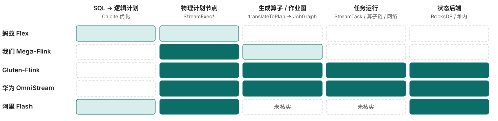
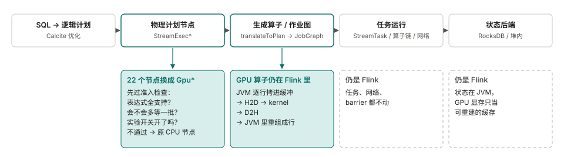
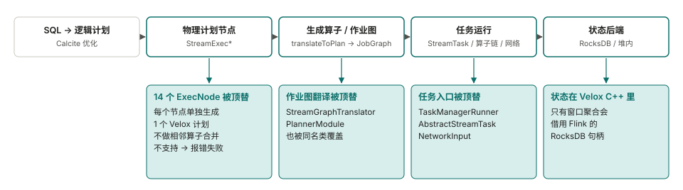
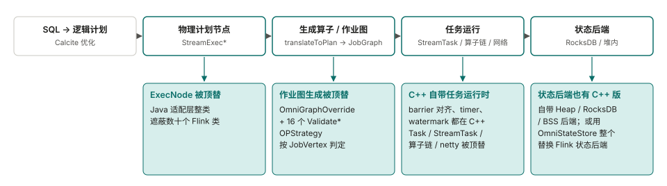
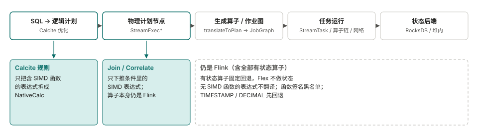
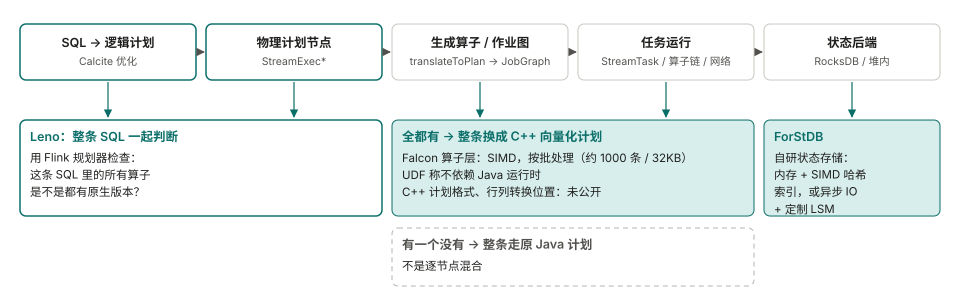

<!--
SPDX-FileCopyrightText: Copyright (c) 2026 NVIDIA CORPORATION & AFFILIATES. All rights reserved.
SPDX-License-Identifier: Apache-2.0
-->

# Feature-Extractor-Plugin：streaming（Flink）

[English](README.md) | 中文

这是 Feature-Extractor-Plugin 的流式（Flink）部分。**现状：插件代码和基准测试脚本还没放进这个目录。** 这里目前是决定设计的分析：和已有工作的对比、Flink 作业的时间花在哪、什么时候用 GPU、计划中的组件，以及测试用例和结果。

1. [和已有工作的对比](#第一部分和已有工作的对比)
2. [Flink 作业的性能瓶颈一般有哪些](#第二部分flink-作业的性能瓶颈一般有哪些)
3. [插件的设计思路（什么时候用 CPU，什么时候用 GPU）](#第三部分插件的设计思路什么时候用-cpu什么时候用-gpu)
4. [组件组成](#第四部分组件组成)
5. [性能测试用例与跳转链接](#第五部分性能测试用例与跳转链接)（[详细结果](benchmarks/README.zh-CN.md)）

## 第一部分：和已有工作的对比

有几个项目把 Flink 的一部分执行换成了更快的引擎。这一部分比较其中五个怎么接入 Flink：换掉流程里的哪几段、遇到不支持的怎么办、数据和状态放在哪。
资料来自各项目公开的代码、文档和博客，读于 2026 年 11 月。没能确认的地方标成**未核实**。性能数字都是各家自己测的，工作负载和对比基线不同，这里不做比较。

### 1.1 从三个角度比较"怎么接入 Flink"

这五个项目在三个互相独立的角度上不同：**深度**（沿着 Flink 的流程一路换到哪一段）、**单位**（一次判断"能不能用原生"看多大一块：一个表达式、一个节点、一连串节点，还是整条查询）、**时机**（什么时候做这个判断）。

| 项目 | 深度 | 判断单位 | 决定时机 | 不支持时 |
|---|---|---|---|---|
| 蚂蚁 Flex | 只在规划阶段：表达式（以及 Join / Correlate 条件里的表达式） | 表达式 | 规划时 | 退回 Flink，细到单个表达式 |
| Mega-Flink（我们） | 物理计划节点；GPU 算子在 Flink 自己的任务里运行 | 节点 | 规划时（运行时只在已选好的算子内部切换路径） | 按节点退回 CPU 节点 |
| Gluten-Flink | 节点、作业图翻译、任务入口、状态 | 节点 | 规划时 | 计算类节点让作业失败；数据源/输出退回 |
| StreamFusion | 节点、自己的算子、状态在 Rust | 一连串列式节点组成的一块 | 规划时（Flink 优化之后） | 整块退回 Flink（早期设计笔记写的是逐算子，未核实） |
| 华为 OmniStream | 节点（只写说明）、作业图、任务运行时、网络、状态 | 算子链（`JobVertex`） | 生成作业图时（任务启动时才创建原生算子） | 按算子链；SQL 作业只要有一条边不是直连，整个作业退回 |
| 阿里 Flash | 执行计划和状态（ForStDB），其余细节未核实 | 整条 SQL（博客另一处提到算子级回退，没有统一） | 规划时 | 整条查询走 Java 计划 |

这三个角度互相独立：Gluten-Flink 和 OmniStream 的判断单位都是节点，但 OmniStream 换得深得多；Flex 单位最小，深度也最浅。我们只找到作者对其中少数几个选择写过理由：StreamFusion 的设计笔记为"整块"给出的理由是避免块内转换，并实测单独换一个原生算子可能比 Flink 慢（0.58 倍和 0.81 倍）；阿里给自研状态存储的理由是状态落盘太慢；Flex 的演讲说有状态算子退回，是因为 Velox 暂时不支持。我们没有找到任何把单位、时机和状态位置联系起来的说法，所以这一页只比较各家的位置，不解释原因。

### 1.2 各项目替换了哪几段

列是一个 Flink SQL 作业依次经过的阶段。越往右，说明项目接管的 Flink 自身运行时越多。Flex 只在规划阶段处理表达式；Mega-Flink 换物理节点；Gluten-Flink 和 OmniStream 一直换到任务执行和状态。

**没有一家用官方扩展点。** Flink 源码里 `PlannerFactory`、`ExecNode`、`ExecNodeMetadata` 都标着 `@Internal`，
[FLIP-32](https://cwiki.apache.org/confluence/spaces/FLINK/pages/103088143/FLIP-32+Restructure+flink-table+for+future+contributions)
只是让整个规划器可以替换，不是替换单个算子。我们在 dev 邮件列表和 JIRA 里没找到算子级替换的提案。没查的：能否通过 `CalciteConfig` / `Programs` 注入自定义规则，以及 `CompiledPlan` 能否带自定义 `ExecNode`。
作为对照，Spark 有
[`SparkSessionExtensions`](https://spark.apache.org/docs/latest/api/scala/org/apache/spark/sql/SparkSessionExtensions.html)（标着实验性），spark-rapids 就是靠它接入的。

### 1.3 Mega-Flink（GPU）

| | |
|---|---|
| 不支持时 | 按节点退回：节点没通过准入检查，就用原来的 CPU 节点。默认模式是 `cpu-row`，要显式设成 `gpu-native` |
| 数据转换 | JVM 把行拷进 pinned 缓冲，再 H2D、kernel、D2H，最后在 JVM 里重组成行。能减少转换的融合、host-pack 等选项多数默认关闭 |
| 状态 | 留在 Flink，checkpoint 以它为准；GPU 显存只是可重建的缓存 |
| 开源与版本 | Apache-2.0；只认 Flink 2.2.1；安装器给嵌在 `flink-table-planner-loader` 里的 planner jar 打补丁；定位是 H20 上的研究插件 |

来源：[Mega-Flink](https://github.com/cb521/Mega-Flink) 的文档和代码。

### 1.4 Gluten-Flink（CPU，Velox）

| | |
|---|---|
| 不支持时 | Calc、聚合、排名等节点：遇到不支持的函数或形态，规划阶段直接抛异常，作业失败。数据源和输出节点找不到对应实现时，退回 Flink 原来的做法；半连接、反连接和开了 mini-batch 的情况仍用 Flink 原算子 |
| 数据转换 | 相邻原生算子之间没有转换。Java 输入这条路径上，每条记录到达就转换，一行一个向量，不攒批（已在代码里核实） |
| 状态 | 在原生侧。只有两个窗口聚合节点把 RocksDB 句柄传给原生；其他算子在 RocksDB 下怎么初始化、恢复原生状态，没找到。checkpoint 时原生返回的快照被丢弃。测试只检查作业能跑完，不比对结果，也没有 checkpoint 恢复的测试。未解决的问题包括用 RocksDB 时内存池泄漏（#11791） |
| 开源与版本 | Apache-2.0；实验性；只支持 Flink 1.19.3；规划器那层由它自己的 `PlannerModule` 把 planner jar 排在最前；客户端和 TaskManager 那层的三个类（`StreamGraphTranslator`、`TaskManagerRunner`、`AbstractStreamTaskNetworkInput`）要用户改 `config.sh` 来覆盖 |

来源：[apache/gluten 的 `gluten-flink`](https://github.com/apache/gluten/tree/main/gluten-flink) 代码、README 和 issue。
README 报告 Nexmark q0 为 161 秒对 Flink 的 462 秒；社区有一条评论说 q0 的结果相反（8 分钟对 4 分钟）。两边都没给全测试条件。

### 1.5 华为 OmniStream（CPU，鲲鹏）

| | |
|---|---|
| 不支持时 | 按一条算子链（`JobVertex`）判定，在生成作业图时静态决定。对 SQL 作业，只要有一条边不是 forward，整个作业回退；DataStream 作业不受这条限制。这个开关是 JobManager 里的静态变量，只会被置为 false、不会重置，在 session 集群里会影响后面的作业 |
| 数据转换 | 原生任务之间传 `VectorBatch` 指针：同一个 TaskManager 内不序列化，跨 TaskManager 用自定义列式格式。Java 到原生：每行拷贝一次，攒满 1000 行或 1 秒成一批。原生到 Java：每条记录堆上分配一行，是最贵的转换点 |
| 状态 | 两条路：自带的 C++ 后端；或 OmniStateStore，一个独立的状态后端，替换 Flink 的。没找到批量访问状态的接口 |
| 开源与版本 | 木兰 PSL-2.0（Java 适配层是 Apache-2.0）；Flink 1.16.3；只能跑在鲲鹏 aarch64 + openEuler；Join 只支持 Inner，默认只开 Calc 等少数算子 |

来源：[OmniStream](https://gitcode.com/openeuler/OmniStream) 及其文档。

### 1.6 蚂蚁 Flex（CPU，Velox）

| | |
|---|---|
| 不支持时 | 按表达式和节点，可细粒度配置 |
| 数据转换 | 基于 Arrow。转换开销近 11%；把 Calc 拆开、只转换表达式用到的列之后降到 6.68%（针对含大量长字段透传的一类作业） |
| 状态 | 暂不支持，有状态算子退回 Flink。演讲给的原因是 Velox 暂不支持有状态算子和回撤消息，路线图里要做，所以这是目前的限制，不是有意的设计取舍 |
| 开源与版本 | 没有公开代码。线上数字：适合向量化的作业平均 +75%，最好 14 倍 |

来源：FFA 2024 的演讲，经
[CSDN](https://blog.csdn.net/DB_GPT/article/details/144718528) 和
[知乎](https://zhuanlan.zhihu.com/p/1916129445640648620) 转载整理。第三方摘要页上引用的其他数字（作业数、省的核数）找不到原始出处，这里不采用。

### 1.7 阿里 Flash（CPU，商业版）

| | |
|---|---|
| 不支持时 | 整条 SQL 判断：只要有一个算子没有原生版本，整条查询都走 Java 计划。博客另一处还提到算子级回退，两种说法没有统一，也没有给出整条判断的理由 |
| 数据转换 | 按批处理并用 SIMD；行列转换在哪做，没有说明 |
| 状态 | 自研 ForStDB。博客给的理由：状态落到磁盘比内存慢成百上千倍，会抵消向量化的收益。没有作业级数字 |
| 开源与版本 | 闭源商业产品。Flink 2.0 里开源的 [ForSt](https://github.com/ververica/ForSt) 状态后端是另一个项目 |

来源：[阿里云博客](https://www.alibabacloud.com/blog/flash-a-next-gen-vectorized-stream-processing-engine-compatible-with-apache-flink_602088)。
C++ 计划的格式、是否支持 DataStream：**未核实**。

### 1.8 没画的

- **字节 Bolt**：Flink 部分还没开源（见[讨论帖](https://github.com/bytedance/bolt/discussions/20)）。描述了两种设计：一种改 `StreamGraphTranslator`，把相邻可下推的算子合成一个原生计划；另一种保持 DAG 不变，每个 Flink 算子对应一个 Bolt 算子。实际实现的是哪种：**未核实**。
- **Ververica VERA-X**：闭源商业产品，[发布博客](https://www.ververica.com/blog/vera-x-introducing-the-first-native-vectorized-apache-flink-engine)没说怎么接入。
- **StreamFusion**（Rust / DataFusion，Apache-2.0）：只读到摘要，所以没画。

没找到其他用 GPU 跑 Flink SQL 流式算子的项目。Flink 自己和 GPU 相关的工作都在资源和推理层（例如 [FLIP-592](https://cwiki.apache.org/confluence/display/FLINK/FLIP-592%3A+First-Class+Accelerator+Resource+Support)）。

### 1.9 我们从中得到的

这是我们的判断，没有做实验验证。

- 状态把几个项目分开了。阿里、华为、Gluten-Flink 把状态搬到原生侧，Flex 不碰有状态算子，Mega-Flink 把状态留在 JVM。我们自己的测量里，双流区间关联中状态读写占 43% 到 52% 的时间，GPU kernel 接管不了这部分。
- Flex 只换表达式，目前把有状态算子留给 Flink，是这几种做法里最窄的。我们没有找到作者把它说成是风险取舍。
- 我们没找到哪个项目把加速算子做成一个让用户显式调用的库，而不是替换 Flink 内部。这样做是否更好，目前两边都没有证据。

### 1.10 这份比较的局限

蚂蚁的演讲读的是转载而不是原文；华为的文档网站打不开，读的是仓库里自带的文档；Flash 和 VERA-X 的网页读的是摘要。我们没有编译或运行过这些项目。对 Mega-Flink，我们把被替换的 22 个 `StreamExec*` 类和 Flink 2.2.1 逐行对比过：改动以新增为主（GPU 准入、编译、融合、算子构造），多数类改动的原有代码少于 70 行；这个对比没有做语义分析。

## 第二部分：Flink 作业的性能瓶颈一般有哪些

本部分列出公开资料里常见的瓶颈类别、一般怎么解决，以及我们自己的实测是否与之一致。

读数字时请注意：
- **公开数字**只代表那家公司的那个场景，原样引用，不能当成通用占比。标"厂商"的是厂商对自家产品的自测。
- **我们的数字**来自本仓库的实测（"本仓库实测，见 benchmarks"）：公开数据集 KuaiRand、单张 NVIDIA L20、Flink 2.2.1、以单并行度为主、进程内回放（没有 Kafka）、堆内状态后端。吞吐对比里 CPU 与 GPU 两边都开了 `pipeline.object-reuse=true`。文末时间构成表是更早用 Flink 默认配置（object-reuse 关）采的，是 JFR 采样估算。
- "未测"就是没测，不作任何说法。

### 2.1 序列化 / 算子间记录复制
- **时间花在哪**：Kryo/POJO 序列化、记录在算子间的深拷贝、网络交换前后的编解码。
- **公开数字**：
  - Flink 官方博客（微基准）：POJO 退回 Kryo 性能降 75%；用嵌套 Tuple 代替 POJO 快 42%。https://flink.apache.org/2020/04/15/flink-serialization-tuning-vol.-1-choosing-your-serializer-if-you-can/
  - Shopify：修掉 Kryo 回退等序列化问题后吞吐 +20%。https://shopify.engineering/optimizing-apache-flink-applications-tips
  - Iron Vector 基准（厂商，单条 Kafka Avro→SQL→blackhole 管道）：只开 object reuse，原生 Flink 吞吐 +35%～40%。https://docs.google.com/document/d/1ledkVUcWSlx5l4yLaK9nmdIoOPMpUd_1GbjBezbNMPs
  - FLINK-30536（微基准）：去掉每条记录的一层包装，吞吐 +12.2%。https://issues.apache.org/jira/browse/FLINK-30536
- **我们的实测**（KuaiRand、L20、单并行度、c1 简单过滤、不限速）：object-reuse 关→开，CPU 0.84M→2.47M 行/秒，GPU 1.03M→2.06M 行/秒。c1 里序列化/交换在两边各占约 29% 采样时间（见文末表）。本仓库实测，见 benchmarks。
- **一般怎么解决**：用 POJO/Tuple/Row 代替 Kryo、开 object reuse、算子链、列裁剪。
- **是否一致**：方向一致。我们在简单过滤上提升约 3 倍，比公开的唯一端到端数字（+35%～40%）大得多，两者都不要外推。

### 2.2 状态读写
- **时间花在哪**：RocksDB 下是每次访问的序列化、seek、compaction、磁盘 IO；堆内状态下是哈希查找和对象访问。
- **公开数字**（几乎都是 RocksDB 大状态）：
  - 字节/抖音推荐（特征计算接入 Flink State）：CPU 比原内存/abase 实现高 40%～80%，优化后主要在序列化；加 State Cache 后大部分场景 CPU 约降 50%。单作业状态最大 60TB。https://developer.aliyun.com/article/796471
  - Zalando 广告事件：Interval Join 有 15%～30% 的 CPU 花在 seek 上（RocksDB）。https://engineering.zalando.com/posts/2026/07/migrating-ad-event-processing-to-flink.html
  - 淘宝（阿里云博客）：Delta Join 去掉 50TB 的 Join 状态，CPU 和内存省 80% 以上。https://www.alibabacloud.com/blog/the-delta-join-in-apache-flink-architectural-decoupling-for-hyper-scale-stream-processing_602645
  - 阿里 GeminiStateBackend（厂商文档）：Nexmark 中受状态限制的用例，列出的 8 个里 5 个比 RocksDB 快 70% 以上（范围 29.77%～237.30%）。https://help.aliyun.com/zh/flink/user-guide/geministatebackend
  - Shopify：8TB RocksDB 状态从网络盘换成本地 SSD，处理速度约 10 倍。https://shopify.engineering/optimizing-apache-flink-applications-tips
- **我们的实测**（堆内状态、单并行度、JFR 估算）：c5 Interval Join 状态占采样时间 52%（CPU）、43%（GPU）；Join+聚合 32% / 40%；c2 窗口聚合 14%（CPU）；c4 去重 14% / 17%。GPU 版里状态仍在 JVM，所以这几个用例 GPU 收益很小或没有。本仓库实测，见 benchmarks。
- **一般怎么解决**：缓存热 key、KV 分离、换状态后端、把 Join 改成查表、TTL、MiniBatch。
- **是否一致**：方向一致（状态占比大）。成本构成不同：公开案例是 RocksDB，我们是堆内，所以字节那句"主要是序列化"不能用来解释我们的数字。

### 2.3 Source / Sink 与格式解析
- **时间花在哪**：JSON/Avro/PB 反序列化、连接器线程、外部写入。
- **公开数字**：
  - 字节/抖音：Kafka 源的 PB 数据裁剪 IDL、跳过无用字段后，大部分任务 CPU 节省约 30%（是 CPU 节省，不是占总时间的比例）。https://developer.aliyun.com/article/796471
  - IBM（单核、并行度 1）：同一组测试里所有作业变体（处理逻辑、状态后端、格式、批大小）的范围是 1,340～44,320 events/s；Avro 作业几乎都比 JSON 快。作者说明这不是通用报告。https://dalelane.co.uk/blog/?p=6001
  - Iron Vector 基准（厂商，主要测 Avro 源解码）：274→528 MiB/s（+93%），但要先调大 Kafka consumer 拉取参数；第一次跑时被 Kafka 拉取拖住，反而慢 23%。https://docs.google.com/document/d/1ledkVUcWSlx5l4yLaK9nmdIoOPMpUd_1GbjBezbNMPs
- **我们的实测**：本地回放 int64 列文件，没有 Kafka，也没有文本解析。source 线程在 c1 占 15%（CPU）/18%（GPU），c3 的 GPU 侧占 10%。Kafka 和真实格式未测。本仓库实测，见 benchmarks。
- **一般怎么解决**：二进制格式、裁剪无用列/字段、连接器隔离和并行度、sink 批量写、调 consumer 拉取参数。
- **是否一致**：部分一致。我们的 source 占比可见，但比真实 Kafka 加 JSON/PB 解码轻得多，会低估这一类。没找到"source/sink 占总时间 X%"的公开数字。

### 2.4 行列转换（含 GPU 上多出的 H2D/D2H）
- **时间花在哪**：把 Flink 的行格式（RowData）转成向量化/GPU 引擎要的列格式，再转回来。GPU 上还多了主机到设备、设备到主机的拷贝。
- **公开数字**（没找到 Flink 上 GPU 的公开数字）：
  - 蚂蚁 Flex（Flink + Velox，CPU 向量化）：所用字段全部转换时开销将近 11%，只转表达式用到的字段后降到 6.68%。作业构成等其他条件：未核实。https://segmentfault.com/a/1190000046642882
  - Gluten-Flink issue：每批多两次行列转换，无数字。https://github.com/apache/gluten/issues/12426
  - 仅为读源码所得，没有实测：Gluten-Flink 的行路径每条记录建一个单行向量；OmniStream 原生到 Java 的路径每条记录新建一行对象。
- **我们的实测**（c1 过滤、不限速、Flink 默认配置那轮、GPU 算子自带计时）：GPU 上计时的 5 段合计 499 ms，行→列 254、H2D 20、kernel 25、D2H 14、列→行 186。行列转换占这 5 段的 88%，kernel 占 5%。这 5 段没算 JVM 侧 processElement 1,725 ms 和 collect 1,096 ms。nsys 核对：kernel 和拷贝时间与计时相差约 10% 以内。c5 Interval Join 的 GPU 侧：计时的 1,107 ms 里列→行占 843 ms。本仓库实测，见 benchmarks。
- **一般怎么解决**：端到端列式、少出入设备、只转用到的列、批量化。
- **是否一致**：方向一致。蚂蚁的 11% 是 CPU 引擎，比我们低很多，原因没有核实，所以不能拿它佐证我们的数字。这是上 GPU 方案特有的成本，不是 Flink 的通用瓶颈。

### 2.5 数据倾斜
- **时间花在哪**：少数 subtask 满载、其余空闲，上游被反压。
- **公开数字**：Rippling（CDC 管道）：60% 的负载落在 2 个 subtask 上，修复后吞吐 +38%，总耗时 17 小时→12.4 小时。https://www.rippling.com/blog/eliminating-data-skew-in-flink 。京东：按下游负载最小的 channel 分发，特定场景性能近 1 倍。https://cloud.tencent.com/developer/news/738891
- **我们的实测**：未测（单并行度看不出倾斜）。
- **一般怎么解决**：两阶段聚合、打散 key、按负载分发。
- **是否一致**：我们没有数据。

### 2.6 Checkpoint 与恢复
- **时间花在哪**：状态上传、对齐等待、元数据序列化、大状态恢复。
- **公开数字**：Netflix（200 节点测试集群）：21TB savepoint 生成要 27 分钟，修 S3 HEAD 请求问题后 checkpoint 时长降 10 倍。https://www.slideshare.net/StevenWu5/scaling-flink-in-cloud-94274600 。Flink 官方 changelog 测试：p99.9 checkpoint 10 秒→1 秒，恢复时间 +66%～+225%，吞吐基本不变。https://flink.apache.org/2022/05/30/improving-speed-and-stability-of-checkpointing-with-generic-log-based-incremental-checkpoints/ 。阿里 VLDB'25（对比 Flink 1.20）：checkpoint 时长最多缩短 94%，恢复最多快 49 倍。https://www.vldb.org/pvldb/vol18/p4846-mei.pdf
- **我们的实测**：未测。
- **一般怎么解决**：增量 checkpoint、changelog、非对齐 checkpoint 加 buffer debloating、存算分离（ForSt）。
- **是否一致**：我们没有数据。公开证据主要说的是稳定性、尾延迟和恢复时间，对稳态吞吐的影响小。

### 2.7 网络与反压
- **时间花在哪**：跨机器传输、序列化、缓冲区排队。
- **公开数字**：Pinterest：优化 task 放置后跨主机网络流量降 70% 以上，作业成本降约 75%（成本不全来自网络）。https://www.slideshare.net/slideshow/tuning-flink-clusters-for-stability-and-efficiency/266280602 。阿里（批作业，TPC-DS 10TB，不是流）：一个 source 任务向网络发送 1.03TB，Join 过滤后只剩 16.5GB。https://www.alibabacloud.com/blog/flink-how-to-optimize-sql-performance-using-multiple-input-operators_597839
- **我们的实测**：单机、单并行度（部分用例补测并行度 2、4）；交换成本包含在"序列化/交换"里（各用例占采样时间 12%～34%）。没有跨机网络测试。
- **一般怎么解决**：算子链或 multiple-input 去掉无用 shuffle、task 放置、credit-based 流控、buffer debloating。
- **是否一致**：部分一致（本机交换成本可见，真实网络没测）。没找到流作业"shuffle 占 X%"的公开数字。

### 2.8 GC
- **时间花在哪**：堆内状态大时 Full GC，停顿引发心跳超时和反压。
- **公开数字**：只有阈值和定性说法。腾讯云把"5 分钟内 Full GC 超过 30%"当严重问题（告警阈值，不是测得的占比）。https://www.tencentcloud.com/document/product/1000/56810 。字节：堆内状态越大 GC 停顿越长。https://juejin.cn/post/7146142717934829605 。没找到可信的量化案例。
- **我们的实测**：没有单独测（16GB 堆，G1）。
- **一般怎么解决**：大状态改 RocksDB 或堆外、加内存或并行度、换垃圾回收器。
- **是否一致**：不知道。

### 2.9 JVM 流水线上限（逐条记录路径）
- **时间花在哪**：即使没有任何计算，单并行度下一个 source 线程、交换和一个 sink 线程就会限制吞吐。
- **公开数字**：没找到直接的数字。厂商的原生向量化引擎在 Nexmark 上报告了很大的提升（阿里 Flash 五倍以上，中小状态八倍以上，https://developer.aliyun.com/article/1634363 ；Ververica VERA-X 对 Flink 1.19 为 5～10 倍，https://ververica.com/blog/vera-x-introducing-the-first-native-vectorized-apache-flink-engine ），但这些提升包含很多逐条路径之外的因素。
- **我们的实测**（c0-pass 上限探针：只有 source+交换+sink，输出 3.3M 行，Flink 默认配置）：CPU 0.856M 行/秒，GPU 0.851M 行/秒。c3 的 GPU Top-N：kernel 约占作业时间 3.6%，GPU 设备 95% 以上时间空闲，吞吐受 JVM 侧限制。本仓库实测，见 benchmarks。
- **一般怎么解决**：提高并行度、算子链、减少逐条处理。
- **是否一致**：这是我们自己的发现，公开资料里没有可比的数字。

### 2.10 我们实测的各用例时间构成
KuaiRand、单卡 L20、单并行度、不限速，JFR 采样估算（占采样时间的百分比，Flink 默认配置）。"GPU 相关"指 GPU 算子代码和拷贝。c6（维表查询）不列：它的 GPU 占比被分类器误归类，不采用。本仓库实测，见 benchmarks。

| 用例 | CPU 侧 | GPU 侧 |
|---|---|---|
| c1 过滤 | 算子 29、序列化/交换 29、行转换 20、source 15 | 序列化/交换 29、算子 21、source 18、GPU 相关 13、行转换 9 |
| c2 窗口聚合（GPU 为一阶段） | 算子 35、序列化/交换 28、状态 14 | GPU 相关 38、序列化/交换 29、算子 12 |
| c3 每用户 Top-N | 算子 45、序列化 34、状态 3 | 序列化 30、算子 24、GPU 相关 23、source 10 |
| c4 保留最新去重 | 序列化 34、算子 22、状态 14、sink 10 | 序列化 34、算子 20、状态 17、GPU 相关 7 |
| c5 Interval Join | 状态 52、算子 27、序列化 12 | 状态 43、算子 26、GPU 相关 15 |
| c5 Join+聚合 | 状态 32、算子 31、序列化 28 | （融合）状态 40、算子 24、GPU 相关 21 |

小结：两边的大头都是序列化/交换、状态和行列转换；GPU kernel 很小（c1 占计时 GPU 步骤的 5%，c3 占作业时间 3.6%）。吞吐谁赢因用例而异：两边都开 object-reuse 后，CPU 赢 c1、c3、c4、c5，GPU 赢 c2 和 c6（见 benchmarks）。

## 第三部分：插件的设计思路（什么时候用 CPU，什么时候用 GPU）

### 3.1 为什么不是什么都上 GPU

GPU 只替换"计算"这一步。Flink 作业的时间大头在别处：序列化和网络交换、source 回放、状态读写，以及 JVM 侧的行列转换。我们实测中，被分析的算子里 GPU kernel 只占 3%～5%；TopN 一例里 GPU 设备超过 95% 的时间是空闲的（kernel 约 108 ms，整个作业约 3.2 s）。所以对每一步要问的不是"kernel 快不快"，而是"这一步够不够重，值不值得多付出打包、拷贝、解包的代价"。

下文所有数字的共同条件（另有说明的除外）：KuaiRand-27K 日志（9,292 万行）按事件时间回放；1 张 NVIDIA L20；Flink 2.2.1，Mega-Flink 同一次构建；并行度 1（标明处为 2、4）；不限速打满，预热 30 万条后测 300 万条，3 轮取中位数；CPU 和 GPU 两边都开 `pipeline.object-reuse=true`；CPU 与 GPU 的最终结果表按 SHA-256 对拍，全部一致。维表查询的维表为 104.0 万行（另有 400 万行的一次单独说明）。来源：[benchmarks/README.zh-CN.md](benchmarks/README.zh-CN.md)。没有在其他 GPU、多卡、其他数据集、集群上跑过。

### 3.2 第一条：先把 CPU 侧调好

要和调优后的 CPU 比，不要和默认配置比。我们的实测里，仅 `pipeline.object-reuse` 一项就翻转了过滤场景的结论：默认配置下 GPU 快 23%（103 万对 83 万条/秒）；两边同开后 CPU 快 20%（247 万对 206 万）。CPU 提升 2.95 倍，GPU 提升 2.0 倍。TopN 另把 `table.exec.rank.topn-cache-size` 调到 100000（默认 10000，数据里约 2 万个用户）。其他 CPU 选项没有探索，所以调得更好的 CPU 基线可能比我们的更高。

### 3.3 第二条：分步骤的实测结果（调优后、打满、并行度 1）

| 步骤 | CPU | GPU（batch） | 谁赢 | 其他并行度 |
|---|---|---|---|---|
| 过滤 / 投影 | 247 万/秒 | 206 万/秒 | CPU +20% | 未测 |
| HOP 窗口聚合（两阶段） | 148 万/秒 | 186 万/秒 | GPU +26% | 并行度 2 +26%，4 +16% |
| TUMBLE 窗口聚合 | 161 万/秒 | 202 万/秒 | GPU +25% | 未测 |
| 每用户 TopN（append-only） | 136 万/秒 | 123 万/秒 | CPU +11% | CPU +38%（2），+21%（4） |
| keep-last 去重 | 103 万/秒 | 85 万/秒 | CPU +22% | 未测 |
| Interval Join（INNER） | 29.2 万/秒 | 25.3 万/秒 | CPU +15% | 未测 |
| Interval Join 后接过滤 / 聚合 | 30.8 万 / 29.3 万 | 26.2 万 / 23.6 万 | CPU +17% / +24% | 未测 |
| 维表查询（INNER，单 BIGINT key） | 130 万/秒 | 228 万/秒 | GPU +76% | 并行度 2 +88%，4 +20%；400 万行维表 +83% |

怎么读这张表：

- **选 CPU**：过滤/投影、TopN、去重、Interval Join。这些步骤的成本在序列化、JVM 状态读写和行列转换，GPU 换不掉。过滤一例中，GPU 一侧实测耗时里行列转换占 88%，kernel 占 5%。低、中档（每秒 2 万、10 万条，受限速）两边都跟得上，GPU 多约 3 ms 延迟，CPU 过滤延迟不到 0.01 ms。
- **选 GPU**：窗口聚合和 INNER 维表查询，条件是流量高、每批足够大。这两步每条记录要进多个窗口或做一次查表，计算量够重。窗口聚合的延迟也更低（HOP 两阶段打满 p50 36 ms 对 48 ms；每秒 10 万条时 37 ms 对 63 ms）。维表查询在低、中档的 GPU 选项多半实际走的是 JVM 查表（每批不足 1024 行会回落），所以那两档的延迟不能算作 GPU 的结果。
- **维表结果的边界**：只测了单个 BIGINT key 加少量 BIGINT 列，只测 INNER。本构建下 LEFT 维表查询无法上 GPU（回落 CPU）。GPU 维表上限是 4,194,304 行，3,204 万行全表没有测。
- **没测过**：其他 key 类型、更长或更重的表达式、多卡、并行度大于 4、去重和 Interval Join 在并行度 2/4 下的表现、KuaiRand 以外的任何负载。这些都是"未验证"，不要把这张表当成通用规律。

### 3.4 第三条：GPU 的三种用法

- **攒批（batch）**：我们的数据只支持这一种。窗口聚合和维表查询在打满时赢，其他步骤持平或输。需要流量足够大才能攒满批。
- **常驻（persistent）**：我们的数据不支持。TopN 打满时只有 43 万条/秒，CPU 是 136 万；低、中档延迟优于 batch，但不优于 CPU（中档 p50 4.1 ms，CPU 3.6 ms）。Interval Join 各档都更差（p99 约 200 ms）。在已测的所有场景里都给不出"选常驻"的建议。上述常驻数字除 TopN 打满一项外都来自默认配置。
- **自适应（adaptive）**：低、中档 0 行上 GPU（算子走内部 CPU 路径），延迟等于 CPU。打满时 TopN 不如 batch，去重与 batch 相当，两者都不如 CPU。没有发现它优于"CPU 与 batch 中较好者"的情形。
- **"计算重或产出多"**是 batch 赢的共同点：窗口聚合（每条记录进多个 HOP 窗口）和维表查询。过滤计算很轻，没有赢。

### 3.5 第四条：连续几步留在 GPU（融合）

目的是两个 GPU 步骤之间不把数据搬回主机。我们测了 Interval Join 后接过滤或聚合。两边调优后，融合没有吞吐收益（join +0.8%，join+过滤 +1.1%，均在噪声内；join+聚合 −7%）；只有 join+聚合的中位延迟更低（打满低 6.5%，每秒 10 万条时低 12%）。单独把过滤条件下放到设备端没有收益。收益被压住，是因为两边最大的成本都是 JVM 里的 Join 状态。其他算子组合的融合在这里**未验证**。

### 3.6 选 GPU 前的检查清单

1. 先把 CPU 作业调好（至少 `pipeline.object-reuse`）并测一次。
2. 对现有作业跑 qualification 和 profiling 工具（见第四部分），看重的部分是不是你打算挪走的那一步。
3. 只有窗口聚合或上述形状的 INNER 维表查询才考虑挪；其他形状要有你自己的实测。
4. 用你的数据做 CPU/GPU 成对对比，并核对最终输出。
5. 为提速改状态布局或缓冲，必须先过全量结果的正确性检查。

## 第四部分：组件组成

状态标注：**已有** = Mega-Flink 项目里现在就有；**计划** = 打算抽取或新写到本目录，方向已定（显式调用的库，不覆盖 Flink 规划器类），但这里还没有代码；**尚未开始**。截至本 README，插件代码和基准测试脚本还没放进该目录；基准测试结果在 [benchmarks/](benchmarks/README.zh-CN.md) 里。抽取方案仍是草稿，部分问题未定（见 4.2）。

### 4.1 组件

| 组件 | 说明 | 现状 |
|---|---|---|
| GPU 算子库 | 由用户在 Flink 作业里显式调用的算子，不覆盖 Flink 规划器类。拟提供形式：DataStream API 加 builder（是建议，未最终确定）。我们目前对第一版的建议（未最终确定）：窗口聚合和有界 INNER 维表查询，这是调优后实测里 GPU 赢的两项。keep-last 去重、append-only TopN、Interval Join、带过滤/投影或局部聚合融合的 INNER Join 作为可选候选，只有重新测量后确实赢才放进去 | 算子和 kernel 在 Mega-Flink 里**已有**，但绑定在 Flink 规划器上。**计划**：抽取成库；本目录暂无代码 |
| 公开 builder API 与形状校验 | Java builder，在构建时检查类型、append-only、key 非空、跨侧比较个数，不满足就提前报错（取代规划器的自动证明） | **尚未开始**（只有设计草稿） |
| Table/SQL 桥接 | Table 转流、调用 GPU 算子、再转回 | **尚未开始**；是否放进第一版未定 |
| 原生层（CUDA、JNI） | 行列打包、显存管理、库需要的 kernel | kernel 在 Mega-Flink **已有**。**计划**：拷贝并裁到所需部分 |
| 选档逻辑 | 按流量选 CPU、常驻或攒批；批大小和等待时间；未准入时回退 CPU | 自适应控制器在 Mega-Flink 里**已有**（在算子内部）。**计划**：随算子带过来。我们的实测（3.4）没有看到自适应的收益，默认值需要重新核对 |
| qualification / profiling 工具 | 纯 Python 标准库，不需要 GPU。`qualification` 判断作业是否值得做 CPU/GPU 对照；`profiling` 看热点、反压、倾斜、Checkpoint 风险。只读访问 Flink REST 或历史归档 | Mega-Flink 里**已有**（源码 0.4.0，发布包 0.2.0，对应 Flink 2.2.1）。**计划**：按本库调整算子族清单和命名。局限：按 SQL 节点名识别算子，纯 DataStream 作业识别不了 |
| 工具里的模型预测（XGBoost） | 用成对实测数据做预测 | Mega-Flink **已有**；是否带入未定 |
| 基准与对拍脚本 | 按多档速率回放 KuaiRand，跑 CPU/GPU 各变体，按 SHA-256 对拍最终表，收集计时 | **已有**（第三部分的数字就来自它），但不在本目录。**计划**：把路径改成参数后公开 |
| 示例作业 | 与基准用例对应的 KuaiRand 示例 | **尚未开始** |
| GPU 指标与告警模板 | Prometheus 规则、Grafana 面板、运维手册 | Mega-Flink 里**已有**，是静态候选，未部署。是否带入未定 |

不打算放进库的：规划器覆盖层、安装器，以及在 Mega-Flink 自己的测试里没有赢过 CPU 的算子（例如 LEFT/SEMI/ANTI Join、单独的 Calc、COUNT DISTINCT、SESSION 窗口、Cross Join）。

### 4.2 待定设计决策

下面都是还没定的问题，没有一条已经决定。

1. Java 包名：保留原名（JNI 符号不用改），还是改名（约 100 个 JNI 符号要替换并重测）。
2. 版权行和 NOTICE 的写法。
3. 是否在建议的第一版之外再加算子（Window Join、GroupAggregate、Over，以及 4.1 里的可选候选）。
4. Flink 版本：只承诺 2.2.x，还是做 2.0 及以上的编译矩阵（2.0、2.1 能否编译未验证）。
5. Table 桥接是否进第一版。
6. 工具里的 XGBoost 子命令是否保留。
7. native 侧的 Calc 解释器是否第一版就裁掉。

我们的实测也影响算子清单：这份清单依据的是 Mega-Flink 自己的基准结论（例如 TopN、去重比 CPU 快），而在我们调优后的 KuaiRand 测试里这两项是 CPU 赢，反倒是不在清单里的维表查询 GPU 赢。两边的负载和 CPU 设置不同，尚未对齐。我们目前的建议是：第一版以我们自己调优后的实测为准（窗口聚合和维表查询），其余算子在重新测量之前只作为可选项；这是建议，不是决定。

已知风险：从 SQL 作业改用本库会改变算子状态名，原 SQL 作业的 savepoint 无法恢复，需要从头启动；用到的部分 Flink 类标注为 `@Internal`，小版本升级可能变化。

## 第五部分：性能测试用例与跳转链接

我们用 KuaiRand 公开数据集，在 NVIDIA L20 单卡上，把六类常见的推荐特征 / 样本流式计算分别写成 Flink SQL，对比 Flink CPU 执行与 GPU 执行（Mega-Flink）。每个用例的 CPU 与 GPU 最终结果表做了 SHA-256 逐档对拍，全部一致。测量方法、数据、结果表、已知局限与复现要求见 [benchmarks/README.zh-CN.md](benchmarks/README.zh-CN.md)。

下列结论的口径：单卡、并行度 1、打满档吞吐，**CPU 与 GPU 两边都开了 `pipeline.object-reuse`（调优后）**。默认配置下的数字也在 benchmarks 文档里，部分结论会不同（例如 c1），详见各小节。报告改写后尚未经过独立复核。

| 用例 | 做什么 | 对应的推荐场景 | 关键结论（调优后，打满档） | 详情 |
| --- | --- | --- | --- | --- |
| c1 过滤清洗 | 按时长、播放、随机曝光等条件过滤，并计算观看比例、时长分桶、互动次数 | 样本清洗、基础特征计算 | CPU 更快：2.47M 对 2.06M 条/秒（CPU +20%）；低/中档延迟 CPU <0.01 ms，GPU 约 3 ms | [c1](benchmarks/README.zh-CN.md#c1-过滤清洗) |
| c2 窗口聚合 | 每用户最近 30 分钟（5 分钟步长 HOP）及 5 分钟 TUMBLE 的曝光数、点击数、播放时长 | 实时统计特征（用户近 N 分钟行为） | GPU 更快：HOP 两阶段 1.86M 对 1.48M（GPU +26%），TUMBLE 2.02M 对 1.61M（GPU +25%）；延迟也更低 | [c2](benchmarks/README.zh-CN.md#c2-每用户最近-30-分钟点击数的窗口聚合hop-与-tumble) |
| c3 每用户 TopN | 每个用户观看时长最长的 10 条（ROW_NUMBER TopN） | 用户行为序列的 Top-K 特征 | CPU 更快：1.36M 对 1.23M（CPU +11%）；并行度 2/4 下 CPU +38% / +21%。GPU 设备大部分时间空闲，瓶颈在 JVM 侧 | [c3](benchmarks/README.zh-CN.md#c3-每用户观看最久的前-10-个视频topn) |
| c4 keep-last 去重 | 按 (user_id, video_id) 保留最新一条 | 样本去重、取最新状态 | CPU 更快：1.03M 对 0.85M（CPU +22%） | [c4](benchmarks/README.zh-CN.md#c4-keep-last-去重) |
| c5 Interval Join 及融合 | 曝光流与点击流在 30 分钟区间内 join；另测后接 Filter、后接聚合（GPU 上将多步融合） | 曝光-点击归因、训练样本拼接 | 吞吐 CPU 更快：join +15%、join-filter +17%、join-agg +24%；接聚合时 GPU 延迟 p50 低约 23%。融合在调优后没有吞吐收益，仅 join-agg 延迟略低 | [c5](benchmarks/README.zh-CN.md#c5-曝光--点击-interval-join及后接-filter--聚合的融合) |
| c6 Lookup Join | 事件流查视频维表，取 author_id（INNER） | 实时拼接物品侧特征 | GPU 更快：2.28M 对 1.30M（GPU +76%）；维表只装了 104 万行，未测全量；LEFT 在本构建不能上 GPU | [c6](benchmarks/README.zh-CN.md#c6-查特征维表-lookup-join) |

一句话归纳：本次数据下，GPU 在窗口聚合（c2）和维表查询（c6）上有收益；过滤、TopN、去重、Interval Join 上 CPU 不输，主要成本在序列化、JVM 状态读写和行列转换，GPU kernel 本身只占很小一块。这是单卡、并行度主要为 1 的结果，不代表更大规模部署。
