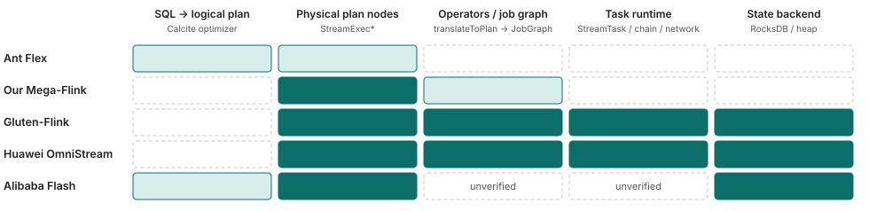
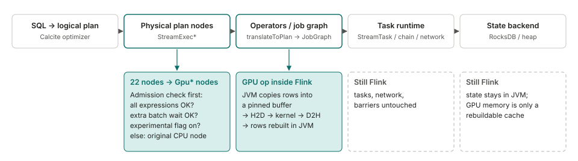
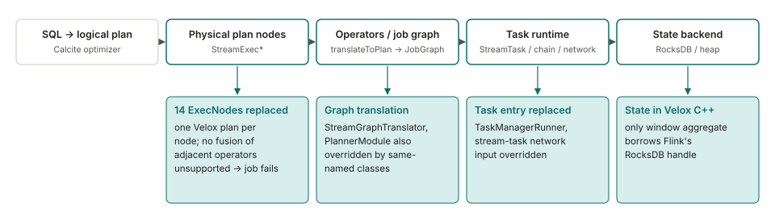
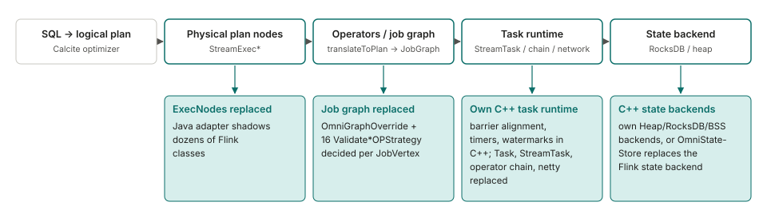
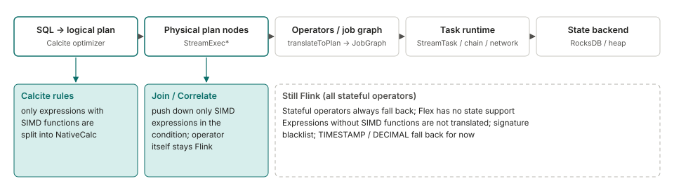
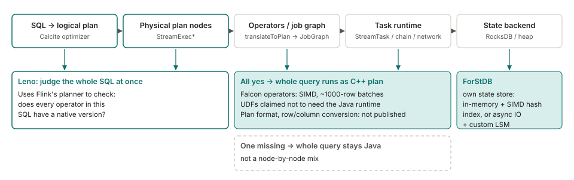

<!--
SPDX-FileCopyrightText: Copyright (c) 2026 NVIDIA CORPORATION & AFFILIATES. All rights reserved.
SPDX-License-Identifier: Apache-2.0
-->

# How other projects accelerate Flink

English | [中文](related-work.zh-CN.md)

Several projects replace part of Flink's execution with a faster engine. This page compares how five of them hook
into Flink: which stages of the pipeline they replace, what happens when something is not supported, where data and
state live. It is based on each project's public code, documentation and blog posts, read in November 2026. Where a
detail could not be confirmed it is marked **unverified**. Performance numbers are each project's own and use
different workloads and baselines, so they are not compared here.

## 1. Which stages each project replaces

The columns are the stages a Flink SQL job goes through. The further right a project reaches, the more of Flink's own
runtime it takes over. Flex only touches expressions during planning; Mega-Flink replaces physical nodes; Gluten-Flink
and OmniStream go on to task execution and state.

**None of them uses an official extension point.** In Flink's source, `PlannerFactory`, `ExecNode` and
`ExecNodeMetadata` are annotated `@Internal`, and [FLIP-32](https://cwiki.apache.org/confluence/spaces/FLINK/pages/103088143/FLIP-32+Restructure+flink-table+for+future+contributions)
only makes the whole planner replaceable, not single operators. We found no proposal for operator-level replacement in
the dev mailing list or JIRA. Not checked: whether custom rules can be injected through `CalciteConfig` / `Programs`,
and whether a `CompiledPlan` can carry a custom `ExecNode`. Spark, by contrast, has
[`SparkSessionExtensions`](https://spark.apache.org/docs/latest/api/scala/org/apache/spark/sql/SparkSessionExtensions.html)
(marked experimental), which is how spark-rapids plugs in.

## 2. Mega-Flink (GPU)

| | |
|---|---|
| When something is unsupported | Falls back per node: if a node fails the admission check, the original CPU node is used. Default mode is `cpu-row`; `gpu-native` must be set explicitly |
| Data conversion | The JVM copies rows into a pinned buffer, then H2D, kernel, D2H, and rows are rebuilt in the JVM. Fusion and host-pack options that reduce conversions are mostly off by default |
| State | Stays in Flink and is the source of truth for checkpoints; GPU memory is only a rebuildable cache |
| Open source / version | Apache-2.0; Flink 2.2.1 only; the installer patches the planner jar embedded in `flink-table-planner-loader`; positioned as a research plugin on H20 |

Source: [Mega-Flink](https://github.com/cb521/Mega-Flink), docs and code.

## 3. Gluten-Flink (CPU, Velox)

| | |
|---|---|
| When something is unsupported | Calc, aggregate, rank and similar nodes: an unsupported function or shape raises an exception during planning and the job fails. Source/Sink nodes with no matching factory fall back to Flink's original transformation; SEMI/ANTI joins and mini-batch cases keep Flink's operators |
| Data conversion | None between adjacent native operators. On the Java input path each record is converted on arrival, one vector per row, with no batching (checked in code) |
| State | On the native side. Only the two window-aggregate nodes pass RocksDB handles to native code; for other operators native state initialisation and restore under RocksDB was not found. The native snapshot returned at checkpoint is discarded. Tests only check that a job runs, not results, and there is no checkpoint-restore test. Open issues include a memory-pool leak with RocksDB (#11791) |
| Open source / version | Apache-2.0; experimental; Flink 1.19.3 only; its own `PlannerModule` puts the planner jar first; three classes at client/TaskManager level (`StreamGraphTranslator`, `TaskManagerRunner`, `AbstractStreamTaskNetworkInput`) are overridden by the user editing `config.sh` |

Source: [apache/gluten, `gluten-flink`](https://github.com/apache/gluten/tree/main/gluten-flink) code, README and issues.
The README reports Nexmark q0 at 161 s versus 462 s for Flink; a community comment reports the opposite direction for
q0 (8 min versus 4 min). Neither states full test conditions.

## 4. Huawei OmniStream (CPU, Kunpeng)

| | |
|---|---|
| When something is unsupported | Decided per operator chain (`JobVertex`), statically when the job graph is generated. For SQL jobs, if any edge is not a forward edge the whole job falls back; DataStream jobs are not subject to this. The flag is a static in the JobManager that is only ever set to false, so in a session cluster it can affect later jobs |
| Data conversion | Native tasks pass `VectorBatch` pointers; no serialization on the same TaskManager, a custom columnar format across TaskManagers. Java to native: each row is copied and batches form at 1000 rows or 1 s. Native to Java: a heap-allocated row per record, the most expensive point |
| State | Two paths: its own C++ backends, or OmniStateStore, a separate state backend that replaces Flink's. No batched state access API was found |
| Open source / version | MulanPSL-2.0 (Java adapter: Apache-2.0); Flink 1.16.3; aarch64 Kunpeng with openEuler only; Join supports Inner only, and by default only Calc and a few others are enabled |

Source: [OmniStream](https://gitcode.com/openeuler/OmniStream) and its documentation.

## 5. Ant Group Flex (CPU, Velox)

| | |
|---|---|
| When something is unsupported | Per expression and per node, with fine-grained configuration |
| Data conversion | Based on Arrow. Conversion cost was close to 11%; after splitting a Calc so that only the columns used by expressions are converted, it dropped to 6.68% (for one kind of job with many pass-through long fields) |
| State | Not supported; stateful operators fall back to Flink |
| Open source / version | No public code. Numbers reported for production: among jobs suited to vectorization, average +75%, best 14x |

Source: a conference talk (FFA 2024) as reproduced on
[CSDN](https://blog.csdn.net/DB_GPT/article/details/144718528) and
[Zhihu](https://zhuanlan.zhihu.com/p/1916129445640648620). Other figures quoted for Flex on third-party summary pages
(number of jobs, cores saved) could not be traced to an original source and are omitted.

## 6. Alibaba Flash (CPU, commercial)

| | |
|---|---|
| When something is unsupported | Judged for the whole SQL: if any operator has no native version, the whole query runs on the Java plan |
| Data conversion | Processes batches with SIMD; where row/column conversion happens is not described |
| State | Its own ForStDB. The stated reason: spilling state to disk is hundreds to thousands of times slower than memory and would cancel the vectorization gain. No job-level numbers given |
| Open source / version | Closed commercial product. The open-source [ForSt](https://github.com/ververica/ForSt) state backend in Flink 2.0 is a separate project |

Source: [Alibaba Cloud blog](https://www.alibabacloud.com/blog/flash-a-next-gen-vectorized-stream-processing-engine-compatible-with-apache-flink_602088).
The format of the C++ plan and DataStream support are **unverified**.

## 7. Not drawn

- **ByteDance Bolt**: the Flink part is not open source yet (see the
  [discussion](https://github.com/bytedance/bolt/discussions/20)). Two designs are described: one changes
  `StreamGraphTranslator` and merges adjacent pushable operators into one native plan; the other keeps the DAG and maps
  each Flink operator to a Bolt operator. Which one is implemented is **unverified**.
- **Ververica VERA-X**: closed commercial product; the [announcement](https://www.ververica.com/blog/vera-x-introducing-the-first-native-vectorized-apache-flink-engine)
  does not describe how it hooks in.
- **StreamFusion** (Rust / DataFusion, Apache-2.0): only read at summary level, so not drawn.

No other project running Flink SQL streaming operators on a GPU was found. Flink's own GPU work is at the resource and
inference level (for example [FLIP-592](https://cwiki.apache.org/confluence/display/FLINK/FLIP-592%3A+First-Class+Accelerator+Resource+Support)).

## 8. What we take from this

This is our reading; it has not been tested.

- State separates the projects. Alibaba, Huawei and Gluten-Flink move state to the native side, Flex leaves stateful
  operators alone, and Mega-Flink keeps state in the JVM. In our own measurements, state reads and writes were 43% to
  52% of the time in an interval join, and a GPU kernel cannot take that part over.
- Flex's approach, replacing only expressions and never touching state, has the lowest risk and is in line with where
  where our own measurements showed GPU wins (window aggregation and lookup join against a small dimension table).
- We found no project that exposes accelerated operators as a library the user calls explicitly instead of replacing
  Flink internals. Whether that is better has no evidence either way.

## Limits of this comparison

The Ant Group talk was read through reproductions, not the original; Huawei's documentation site was not reachable and
the repository's own docs were read instead; the Flash and VERA-X pages were read as summaries. We did not build or run
any of these projects. For Mega-Flink we diffed the 22 replaced `StreamExec*` classes against Flink 2.2.1 line by
line: the changes are mostly additions (GPU admission, compilation, fusion, operator construction) and most classes
change fewer than 70 original lines; the diff was not analysed for semantics.
