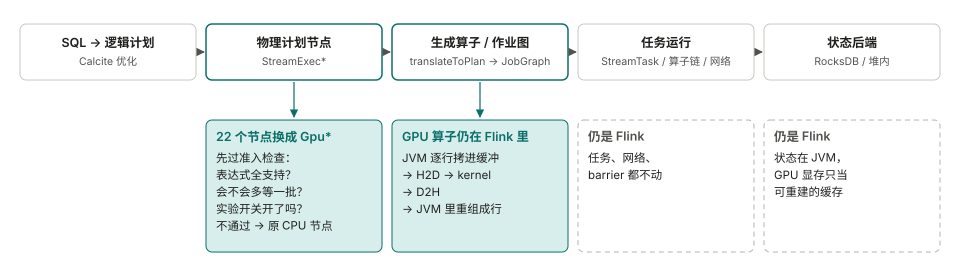
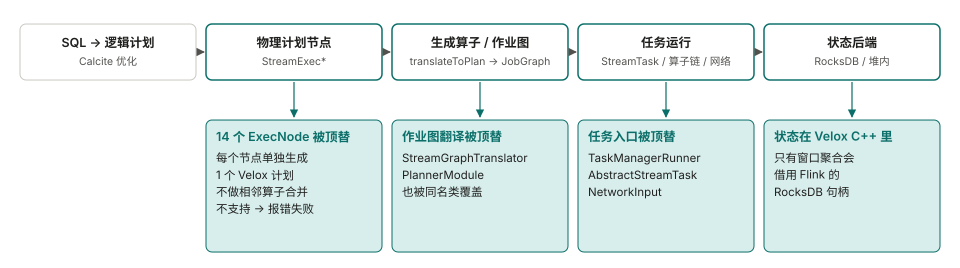
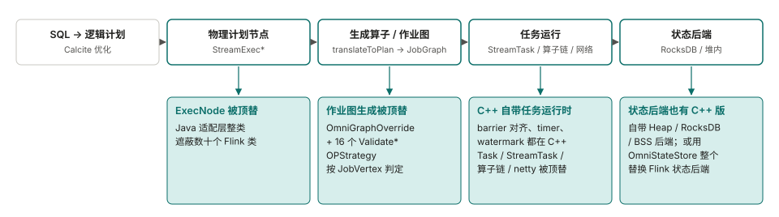
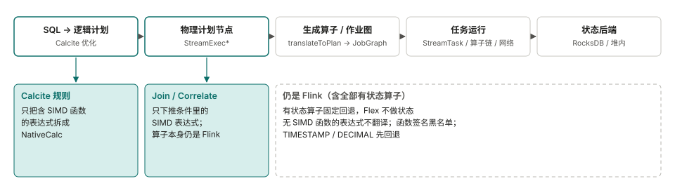
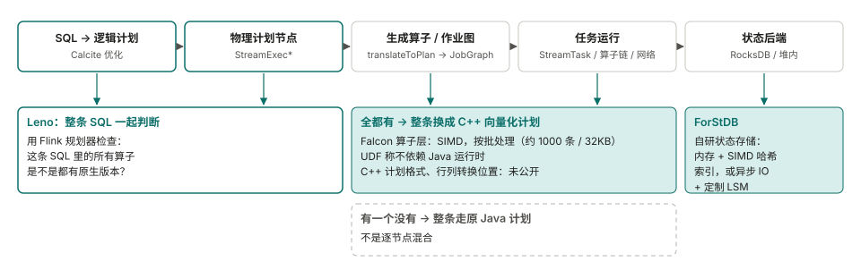

<!--
SPDX-FileCopyrightText: Copyright (c) 2026 NVIDIA CORPORATION & AFFILIATES. All rights reserved.
SPDX-License-Identifier: Apache-2.0
-->

# 其他项目是怎么加速 Flink 的

[English](related-work.md) | 中文

有几个项目把 Flink 的一部分执行换成了更快的引擎。这一页比较其中五个怎么接入 Flink：换掉流程里的哪几段、遇到不支持的怎么办、数据和状态放在哪。
资料来自各项目公开的代码、文档和博客，读于 2026 年 11 月。没能确认的地方标成**未核实**。性能数字都是各家自己测的，工作负载和对比基线不同，这里不做比较。

## 1. 各项目替换了哪几段

列是一个 Flink SQL 作业依次经过的阶段。越往右，说明项目接管的 Flink 自身运行时越多。Flex 只在规划阶段处理表达式；Mega-Flink 换物理节点；Gluten-Flink 和 OmniStream 一直换到任务执行和状态。

**没有一家用官方扩展点。** Flink 源码里 `PlannerFactory`、`ExecNode`、`ExecNodeMetadata` 都标着 `@Internal`，
[FLIP-32](https://cwiki.apache.org/confluence/spaces/FLINK/pages/103088143/FLIP-32+Restructure+flink-table+for+future+contributions)
只是让整个规划器可以替换，不是替换单个算子。我们在 dev 邮件列表和 JIRA 里没找到算子级替换的提案。没查的：能否通过 `CalciteConfig` / `Programs` 注入自定义规则，以及 `CompiledPlan` 能否带自定义 `ExecNode`。
作为对照，Spark 有
[`SparkSessionExtensions`](https://spark.apache.org/docs/latest/api/scala/org/apache/spark/sql/SparkSessionExtensions.html)（标着实验性），spark-rapids 就是靠它接入的。

## 2. Mega-Flink（GPU）

| | |
|---|---|
| 不支持时 | 按节点退回：节点没通过准入检查，就用原来的 CPU 节点。默认模式是 `cpu-row`，要显式设成 `gpu-native` |
| 数据转换 | JVM 把行拷进 pinned 缓冲，再 H2D、kernel、D2H，最后在 JVM 里重组成行。能减少转换的融合、host-pack 等选项多数默认关闭 |
| 状态 | 留在 Flink，checkpoint 以它为准；GPU 显存只是可重建的缓存 |
| 开源与版本 | Apache-2.0；只认 Flink 2.2.1；安装器给嵌在 `flink-table-planner-loader` 里的 planner jar 打补丁；定位是 H20 上的研究插件 |

来源：[Mega-Flink](https://github.com/cb521/Mega-Flink) 的文档和代码。

## 3. Gluten-Flink（CPU，Velox）

| | |
|---|---|
| 不支持时 | 不退回：遇到不支持的函数，规划阶段直接抛异常，作业失败 |
| 数据转换 | 原生算子之间没有转换。和 Java 算子相邻时，每条记录单独转成一个单行 Arrow 批（批大小 1） |
| 状态 | 在原生侧。未解决的问题包括用 RocksDB 时内存池泄漏（#11791）；key 哈希碰撞会静默合并 key（#12805）已修；分组聚合刚开始做 |
| 开源与版本 | Apache-2.0；实验性；只支持 Flink 1.19.3；靠把它的 jar 排在类路径最前面来加载（用户要改 `config.sh`） |

来源：[apache/gluten 的 `gluten-flink`](https://github.com/apache/gluten/tree/main/gluten-flink) 代码、README 和 issue。
README 报告 Nexmark q0 为 161 秒对 Flink 的 462 秒；社区有一条评论说 q0 的结果相反（8 分钟对 4 分钟）。两边都没给全测试条件。

## 4. 华为 OmniStream（CPU，鲲鹏）

| | |
|---|---|
| 不支持时 | 按一条算子链（`JobVertex`）判定。要和 Flink 任务混跑，所有连接都得是 forward；否则整个作业回退。**这是我们读代码的推断，文档里没这么写** |
| 数据转换 | 在 C++ 里做：`rowdata_marshaller` 把 `BinaryRowData` 转成 `VectorBatch`，`extractRowData` 再转回来 |
| 状态 | 两条路：自带的 C++ 后端；或 OmniStateStore，一个独立的状态后端，替换 Flink 的。没找到批量访问状态的接口 |
| 开源与版本 | 木兰 PSL-2.0（Java 适配层是 Apache-2.0）；Flink 1.16.3；只能跑在鲲鹏 aarch64 + openEuler；Join 只支持 Inner，默认只开 Calc 等少数算子 |

来源：[OmniStream](https://gitcode.com/openeuler/OmniStream) 及其文档。

## 5. 蚂蚁 Flex（CPU，Velox）

| | |
|---|---|
| 不支持时 | 按表达式和节点，可细粒度配置 |
| 数据转换 | 基于 Arrow。转换开销近 11%；把 Calc 拆开、只转换表达式用到的列之后降到 6.68%（针对含大量长字段透传的一类作业） |
| 状态 | 不支持，有状态算子退回 Flink |
| 开源与版本 | 没有公开代码。线上数字：适合向量化的作业平均 +75%，最好 14 倍 |

来源：FFA 2024 的演讲，经
[CSDN](https://blog.csdn.net/DB_GPT/article/details/144718528) 和
[知乎](https://zhuanlan.zhihu.com/p/1916129445640648620) 转载整理。第三方摘要页上引用的其他数字（作业数、省的核数）找不到原始出处，这里不采用。

## 6. 阿里 Flash（CPU，商业版）

| | |
|---|---|
| 不支持时 | 整条 SQL 判断：只要有一个算子没有原生版本，整条查询都走 Java 计划 |
| 数据转换 | 按批处理并用 SIMD；行列转换在哪做，没有说明 |
| 状态 | 自研 ForStDB。博客给的理由：状态落到磁盘比内存慢成百上千倍，会抵消向量化的收益。没有作业级数字 |
| 开源与版本 | 闭源商业产品。Flink 2.0 里开源的 [ForSt](https://github.com/ververica/ForSt) 状态后端是另一个项目 |

来源：[阿里云博客](https://www.alibabacloud.com/blog/flash-a-next-gen-vectorized-stream-processing-engine-compatible-with-apache-flink_602088)。
C++ 计划的格式、是否支持 DataStream：**未核实**。

## 7. 没画的

- **字节 Bolt**：Flink 部分还没开源（见[讨论帖](https://github.com/bytedance/bolt/discussions/20)）。描述了两种设计：一种改 `StreamGraphTranslator`，把相邻可下推的算子合成一个原生计划；另一种保持 DAG 不变，每个 Flink 算子对应一个 Bolt 算子。实际实现的是哪种：**未核实**。
- **Ververica VERA-X**：闭源商业产品，[发布博客](https://www.ververica.com/blog/vera-x-introducing-the-first-native-vectorized-apache-flink-engine)没说怎么接入。
- **StreamFusion**（Rust / DataFusion，Apache-2.0）：只读到摘要，所以没画。

没找到其他用 GPU 跑 Flink SQL 流式算子的项目。Flink 自己和 GPU 相关的工作都在资源和推理层（例如 [FLIP-592](https://cwiki.apache.org/confluence/display/FLINK/FLIP-592%3A+First-Class+Accelerator+Resource+Support)）。

## 8. 我们从中得到的

这是我们的判断，没有做实验验证。

- 状态把几个项目分开了。阿里、华为、Gluten-Flink 把状态搬到原生侧，Flex 不碰有状态算子，Mega-Flink 把状态留在 JVM。我们自己的测量里，双流区间关联中状态读写占 43% 到 52% 的时间，GPU kernel 接管不了这部分。
- Flex 的做法，只换表达式、绝不碰状态，风险最低，也和我们实测里 GPU 赢的场景（窗口聚合、小维表的查表关联）方向一致。
- 我们没找到哪个项目把加速算子做成一个让用户显式调用的库，而不是替换 Flink 内部。这样做是否更好，目前两边都没有证据。

## 这份比较的局限

蚂蚁的演讲读的是转载而不是原文；华为的文档网站打不开，读的是仓库里自带的文档；Flash 和 VERA-X 的网页读的是摘要。我们没有编译或运行过这些项目。对 Mega-Flink，我们把被替换的 22 个 `StreamExec*` 类和 Flink 2.2.1 逐行对比过：改动以新增为主（GPU 准入、编译、融合、算子构造），多数类改动的原有代码少于 70 行；这个对比没有做语义分析。
